<p align="center">
  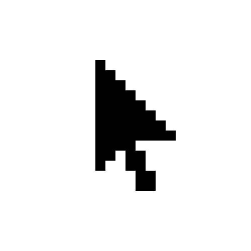
</p>

<h1 align="center">Crivo<br><sub><sup><sup><sub>Copyright (©) 2026 Erik Pimenta</sub></sup></sup></sub></h1>

<p align="center">
  Editor de pixel art que roda no navegador e trata a imagem como ela é: uma matriz de pixels RGBA. Desenhe com lápis, spray, balde, linhas, curvas, formas, pontilhado e degradês, selecione com retângulo, elipse, laço ou varinha mágica, organize em camadas e grupos com modos de mistura, anime quadro a quadro com tags e cels vinculados e exporte PNG, GIF e PNG animados, sprite sheets, arquivos <code>.ase</code> com camadas ou a própria matriz em JSON, CSV, JavaScript, Python, C e Java para usar direto no seu jogo.<br>
  Ou monte o jogo no próprio Crivo: o <b>Estúdio de jogo</b> junta cenas com tiles, personagens, inimigos, itens, regras, sons de 8 bits e música, sem código, e exporta o jogo pronto numa página <code>.html</code>. Na 2.5.0 ele virou um motor completo: luz e escuridão, câmera com zoom e zona morta, escadas, água, plataformas móveis, pontos de controle, áreas de gatilho, emissores de partículas, diálogos, inimigos com A*, tweens, sinais, salvar o progresso, eventos de desenho e mapas nas três linguagens.<br>
  Roda de três maneiras: app desktop para Windows (<code>Crivo.exe</code>), servidor local com backend ou arquivo único no navegador (<code>Crivo.html</code>).<br>
  Ou abra direto no navegador, sem baixar nada: <a href="https://ravelroot.github.io/Pixel-Art-Matrix-Editor/">ravelroot.github.io/Pixel-Art-Matrix-Editor</a>.<br>
  Pronto para baixar e usar.
</p>

<p align="center">
  JavaScript (módulos ES, Canvas 2D) · HTML5 · CSS3 · Python 3.13 · Django 6.1 · PostgreSQL 17 · Java 21 · Go 1.24 + WebView2 (app desktop) · Docker Compose · Node Test Runner · Playwright · Ruff · Bandit
</p>

---

> **Manual completo:** [`Manual-Crivo.pdf`](Manual-Crivo.pdf) explica as três maneiras de rodar (app desktop, servidor local e arquivo único), cada uma das 23 ferramentas, seleção, camadas e grupos, modos de mistura, tags, tilemaps, slices, cor e paletas, ajustes, arquivos `.ase`, abas, o Caderno (2.3.0), o Estúdio de jogo (2.4.0: o passo a passo do primeiro jogo, cenas, atores, eventos, regras, código em Crivo Script, C++ e Lua, terminal, depuração e exportação do jogo), o motor profissional e os comandos novos de pixel art (2.5.0: física de escadas, água, gelo e molas, comportamentos novos, câmera, luz, clima, diálogos, sinais, tweens, A*, salvar o progresso, eventos de desenho, mapas, tiles animados, Scale2x, sel-out e redução de cores), exportação, a matemática por trás dos algoritmos (Bresenham, flood fill, OKLCH, pontilhado de Bayer, LZW do GIF, RLE), a janela Salvar como, o tutorial rápido, a API, a ferramenta em Java, a configuração, a segurança, os testes e a solução de problemas, passo a passo (cópia em [`docs/`](docs/Manual-Crivo.pdf)).

> **Banco de dados:** [`Banco-de-Dados-Crivo.pdf`](Banco-de-Dados-Crivo.pdf) traz o diagrama de relacionamentos, todas as tabelas (inclusive `tag`, `slice` e `tileset`, da 2.1.0) com campos, tipos, chaves e restrições, o formato binário das células, o controle de versões, consultas prontas, como preparar o PostgreSQL e as regras de integridade e segurança dos dados; na 2.4.0, uma seção sobre o formato `.crivojogo` dos jogos, que fica fora do banco, e na 2.5.0 os campos da versão 2 desse formato.

> **Ferramentas e desafios:** [`Ferramentas-Crivo.pdf`](Ferramentas-Crivo.pdf) ilustra as ferramentas em cartões, agora também as do Estúdio de jogo, o terminal (F4), a depuração (F3), os tiles e comportamentos da 2.5.0 e os comandos novos do menu Imagem, e [`Desafios-Crivo.pdf`](Desafios-Crivo.pdf) traz 16 desafios, dos quais quatro novos da 2.5.0: a mina escura, o mineiro que fala, a ponte que se mexe e o caçador que acha o caminho (cópias em [`docs/`](docs/)).

> **Versão 2.5.0 (Atual):** o **motor de jogo profissional** e nove comandos novos de **pixel art**. O Estúdio de jogo ganhou escadas, água, gelo e molas, pulo na parede e investida, plataformas móveis, pontos de controle, personagens que falam, inimigos que acham o caminho com **A\***, torres que atiram, áreas de gatilho, emissores de partículas, geradores de atores, **câmera** com zoom e quatro modos, **luz e escuridão** por cena, clima, efeitos de partículas, transições e filtros de tela, **tweens**, **sinais**, **diálogos**, **salvar o progresso**, eventos de **desenho** e de **mouse**, tiles animados, **mapas e tabelas** nas três linguagens, mais de 50 funções novas, **Testar daqui** (Shift+F5), **gravação do jogo em GIF** (F6) e uma depuração mais completa. O menu Imagem ganhou contorno interno, contorno seletivo (sel-out), sombra projetada, sombreamento automático, limpar pixels soltos, reduzir cores, mapa de degradê e ampliação **Scale2x/Scale3x/Scale4x**, e o menu Cor ganhou a rampa com desvio de matiz. O exemplo ganhou a Fase 3, a mina escura. Nada muda no formato `.crivo`, na API nem no banco. Detalhes em [Motor profissional e pixel art (2.5.0)](#motor-profissional-e-pixel-art-250).

> **Versão 2.4.0 (Anterior):** o **Estúdio de jogo**, com menu próprio na barra (entre Caderno e Ajuda) e atalho F9, monta jogos de pixel art a partir dos seus desenhos, sem código: cenas com tiles, atores com comportamentos prontos (jogador de plataforma ou com visão de cima, inimigos, itens, saídas, tiros), objetos com eventos e ações (criar, passo, alarmes, colisão, teclas, destruir), pai, profundidade, **código em Crivo Script, C++ e Lua com terminal**, tamanhos de 8 a 1024 px, regras "quando… então…", sons de 8 bits e música, teste na hora (F5) e exportação para um único `.html` que roda em qualquer navegador, inclusive no celular e com controle. Já vem com um jogo de exemplo de duas fases. Nada muda no formato `.crivo`, na API nem no banco. Detalhes em [Estúdio de jogo (2.4.0)](#estúdio-de-jogo-240).

<p align="center">
  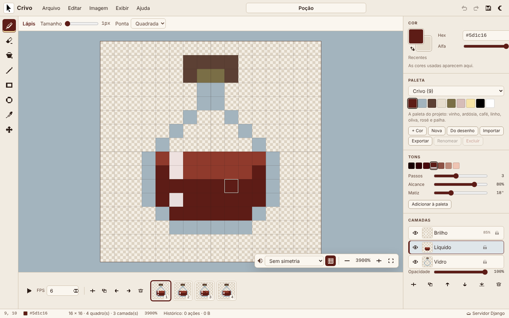
</p>

## O que o Crivo faz

- **Ferramentas de desenho:** 23 ao todo. Lápis com pincel quadrado ou redondo de 1 a 32 px e modo **pixel perfect** (tira os cantos em L dos traços), spray, borracha (transparente ou com a cor secundária), balde de tinta com 4 ou 8 vizinhos, tolerância e modo global, linha, curva, retângulo, elipse e polígono (vazados ou preenchidos, com Shift para 45°, quadrado e círculo perfeitos), contorno livre, desfocar, embaralhar e conta-gotas, com **modos de tinta** (simples, composição alfa, travar alfa e atrás) e **pincel personalizado** feito de uma seleção.
- **Pontilhado e degradê:** pincel de pontilhado com o padrão de Bayer 4×4 em sete densidades (de 12,5% a 87,5%) e **degradê pontilhado** linear ou radial entre a cor primária e a secundária, com matriz de Bayer 2×2, 4×4 ou 8×8. O padrão é fixo na matriz, então traços vizinhos se encaixam sem emendas.
- **Clarear e escurecer:** um pincel que sobe ou desce cada pixel um degrau na rampa da paleta (ordenada por luminosidade OKLab) ou soma/subtrai luz no OKLCH mantendo matiz e croma. Botão esquerdo clareia, direito escurece.
- **Seleção e área de transferência:** seleção retangular (S), elíptica (Shift+S), laço (A), laço poligonal (Shift+A) e varinha mágica (W), com os modos substituir, somar (Shift), subtrair (Alt) e interseção (Shift+Alt), inverter, expandir, contrair, reselecionar e transformar (rotação em qualquer ângulo com RotSprite, escala e espelho); a seleção, de qualquer forma, limita todas as ferramentas de pintura; **mover pixels** (V) com o mouse ou as setas, copiar, recortar, colar, apagar, selecionar tudo e desmarcar. A colagem flutua sobre o fundo: dá para arrastá-la, levar até fora da borda e trazer de volta sem furar nem perder pixels.
- **Comandos de imagem:** recortar para a seleção, aparar bordas transparentes, adicionar contorno (4 ou 8 vizinhos), converter para a paleta atual (cor mais próxima no OKLab), substituir uma cor por outra em todos os quadros, espelhar só a seleção, inverter cores, tons de cinza e deslocar meia matriz para pintar emendas de tiles.
- **Matriz de verdade:** cada camada é um `Uint32Array` com os canais RGBA de cada pixel. A tela é composta direto num `ImageData` e ampliada sem suavização, então o que você vê é exatamente o que será exportado.
- **Camadas e animação:** camadas com visibilidade, opacidade, bloqueio, duplicação e mescla, **grupos** que abrem e fecham, **19 modos de mistura**, camadas de **referência** e camadas de **tiles**; quadros com duração própria, duplicação, reordenação, FPS, **cels vinculados**, **tags** (para frente, para trás ou pingue-pongue, com repetições), papel cebola configurável e reprodução.
- **Histórico ilimitado sem estourar a memória:** cada traço guarda só os pixels que mudaram; mudanças grandes viram RLE da célula inteira; ações estruturais guardam instantâneos comprimidos. A barra de status mostra quanto o histórico ocupa.
- **Visualização:** vários projetos abertos em **abas**, janela de **pré-visualização** (F7), **Caderno** em 3D para folhear os projetos (F8), zoom no ponto do cursor (100% a 12800%), arrastar com espaço ou botão do meio, ajustar à tela, grade com linha forte a cada 4, 8, 16 ou 32 pixels, **modo ladrilho** (repete o desenho 3×3 para conferir texturas) e simetria horizontal, vertical ou nos dois eixos.
- **Estúdio de jogo (2.4.0):** cenas montadas com tiles (sólido, plataforma e perigo), atores com 12 comportamentos prontos, objetos com eventos (criar, passo, alarmes, colisão, teclas, destruir), pai e profundidade, código em Crivo Script, C++ e Lua com terminal, tamanhos de 8 a 1024 px, depuração, partículas, regras "quando… então…" com variáveis e placar, sons de 8 bits, música por cena, teste na hora e exportação do jogo para um `.html` que roda sozinho, com tela de título, pausa, gamepad e botões de toque. Detalhes em [Estúdio de jogo (2.4.0)](#estúdio-de-jogo-240).
- **Motor profissional (2.5.0):** escadas, água, gelo e molas; pulo na parede e investida; plataformas móveis, molas, pontos de controle, personagens que falam, inimigos com A*, torres, áreas de gatilho, emissores de partículas e geradores de atores (21 comportamentos); câmera com zoom e quatro modos; luz, escuridão e clima por cena; partículas prontas, câmera lenta, hitstop, transições e filtros de tela; tweens, sinais, diálogos, salvar o progresso, eventos de desenho e de mouse, tiles animados e mapas nas três linguagens. Detalhes em [Motor profissional e pixel art (2.5.0)](#motor-profissional-e-pixel-art-250).
- **Comandos de pixel art (2.5.0):** contorno interno, contorno seletivo (sel-out), sombra projetada, sombreamento automático com desvio de matiz, limpar pixels soltos, reduzir cores (corte mediano e k-médias no OKLab), mapa de degradê com a paleta, ampliação Scale2x, Scale3x e Scale4x e rampas de cor com desvio de matiz para a paleta.
- **Tamanho da matriz:** de 1×1 a 1024×1024, com âncora de nove posições para centralizar ou expandir para um lado, ou escalando o desenho por vizinho mais próximo. Também gira 90° e espelha camadas.
- **Paletas e cor:** Crivo, Game Boy, NES, Pico-8, CGA, CGA modo 4, Commodore 64 e 1 bit já incluídas. Crie, renomeie, importe (`.hex`, `.gpl`, `.json`, `.txt` do Paint.NET) e exporte as suas, gere uma paleta a partir das cores do desenho ou edite tudo no **editor de paleta**. Modos de cor **RGBA**, **indexado** (com pontilhado opcional) e **tons de cinza**, seletor HSV com alfa e **ajustes** com prévia: brilho e contraste, matiz/saturação/luminosidade, curva de cores, posterizar, remover ruído e matriz de convolução.
- **Gerador de tons:** a partir da cor escolhida, cria rampas de sombra e luz no espaço de cor OKLCH, com o desvio de matiz típico da pixel art (sombras puxam para o azul, luzes para o amarelo).
- **Importação e exportação:** PNG e JPEG em tamanho real ou ampliados por vizinho mais próximo; **GIF animado** com transparência e a duração de cada quadro (codificador LZW próprio, sem bibliotecas); **PNG animado (APNG)** e quadros em PNG num `.zip`; arquivos **`.ase`** com camadas, tags e slices (abrir e exportar); sprite sheet horizontal, vertical ou em grade, com JSON das posições no formato do Crivo ou nos formatos hash e array que os motores de jogo leem; dados da matriz em JSON, CSV, JavaScript, Python, C e Java; importação de imagens com detecção automática do tamanho do pixel e fatiamento de sprite sheets.
- **Salva onde você escolher:** o Ctrl+S abre a janela **Salvar como** do Windows na primeira vez, para escolher a pasta e o nome do arquivo `.crivo`, e as exportações usam a mesma janela. Além disso, no app desktop, projetos e paletas ficam neste computador; com o servidor Django, vão para o banco de dados, com histórico de versões; no [`Crivo.html`](Crivo.html), ficam no navegador (IndexedDB). Um rascunho automático recupera o trabalho se a janela fechar.
- **Tutorial rápido:** na primeira vez que o Crivo abre, ele pergunta se você quer um tour de oito passos pelas 23 ferramentas, cores, camadas, zoom e salvar. Dá para recusar, e ele fica em **Ajuda → Tutorial rápido**.
- **Paletas de cores da interface:** o botão de paleta no topo troca a interface entre a paleta original do Crivo e as do Bento, do Sonda e do Nexo, todas com versão clara e escura. A escolha fica salva e volta na próxima vez. Detalhes em [Paletas de cores da interface](#paletas-de-cores-da-interface).
- **Seguro por padrão:** Content-Security-Policy restrita, CSRF, token de API comparado em tempo constante, limite de escritas por IP, validação de tudo que chega à API e recusa de iniciar em produção com chave secreta fraca. Detalhes em [Qualidade e segurança](#qualidade-e-segurança).

<p align="center">
  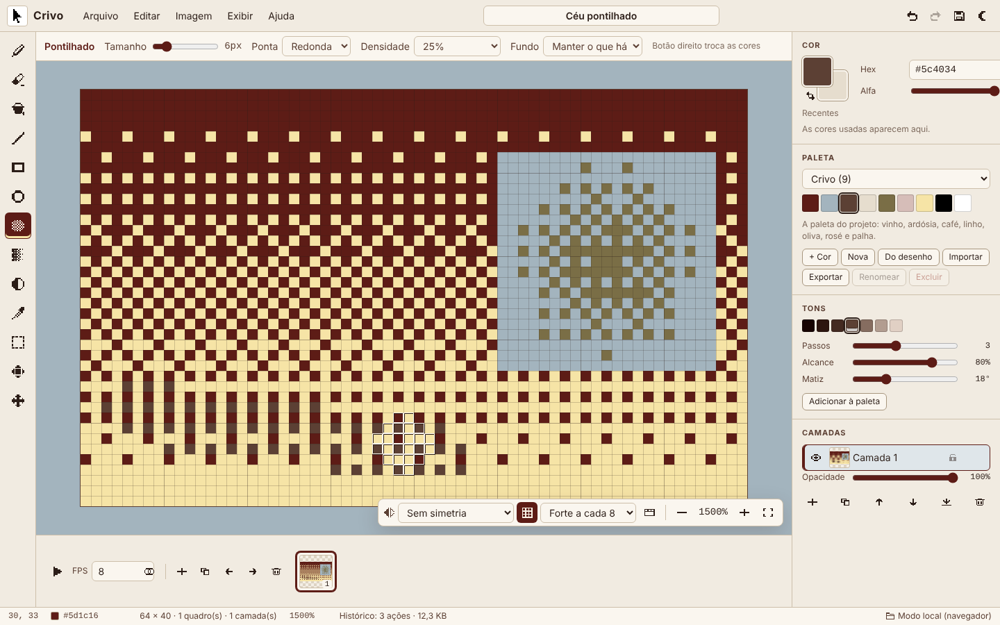
  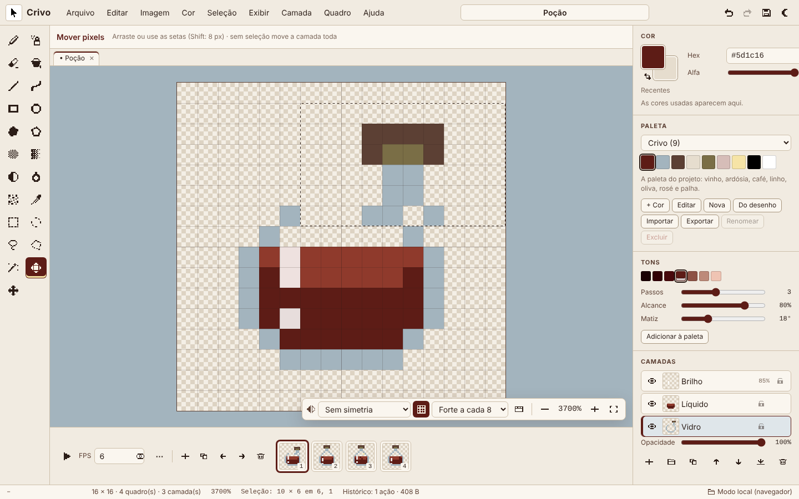
</p>

<p align="center">
  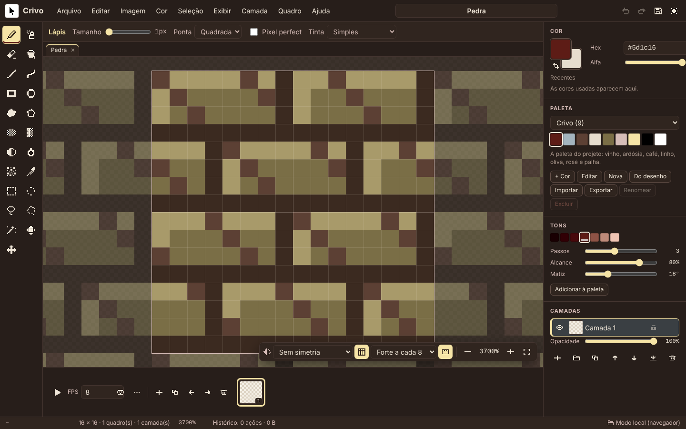
  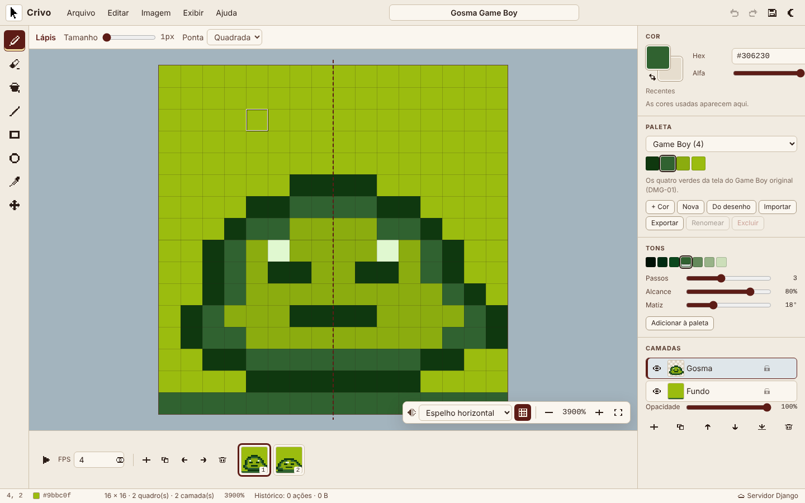
</p>

## Paletas de cores da interface

O botão com o ícone de paleta, no canto superior direito ao lado do botão de tema, abre a lista das paletas da interface. A escolhida muda barras, painéis, menus e a área em volta da matriz (fundo, xadrez da transparência, grade, borda, eixos de simetria e cursor) e funciona junto com o tema claro ou escuro. As cores do desenho e as paletas de pintura (Crivo, Game Boy, NES e as outras) não mudam.

| Paleta | De onde vem | Tema claro | Tema escuro |
| --- | --- | --- | --- |
| **Crivo** (padrão) | paleta original do Crivo | linho `#E6DDCE`, vinho `#5D1C16`, ardósia `#A3B4BE`, palha `#F6E4A6` | fundo `#1D1613`, destaque palha `#F6E4A6` |
| **Bento** | painel administrativo Bento | mesa `#F5F4F4`, caixa `#FFFFFF`, tinta `#000000`, alta `#3E6B2A`, queda `#9B2F1E` | mesa `#020202`, caixa `#121111`, destaque `#FFFFFF` |
| **Sonda** | motor de busca Sonda | papel `#F3F1EC`, folha `#FCFBF8`, tinta `#17212B`, água `#E3ECEF`, sinal `#A8235A` | papel `#0F161B`, água `#172A33`, sinal `#F0679A` |
| **Nexo** | paleta original do Nexo | papel `#E8E8E8`, pó `#D9D1CE`, pedra `#BAB7B5`, malva `#AB9D9D`, tinta `#000000` | fundo `#000000`, superfície `#121111`, malva `#AB9D9D` |

A escolha fica salva neste navegador (ou no app desktop) junto com as outras preferências. As paletas são variáveis CSS em `:root[data-palette]` no [`editor/static/editor/css/crivo.css`](editor/static/editor/css/crivo.css), e a lista do menu fica em `PALETTES` no [`editor/static/editor/js/main.js`](editor/static/editor/js/main.js). Funciona nas três maneiras de rodar.

## Motor profissional e pixel art (2.5.0)

<p align="center">
  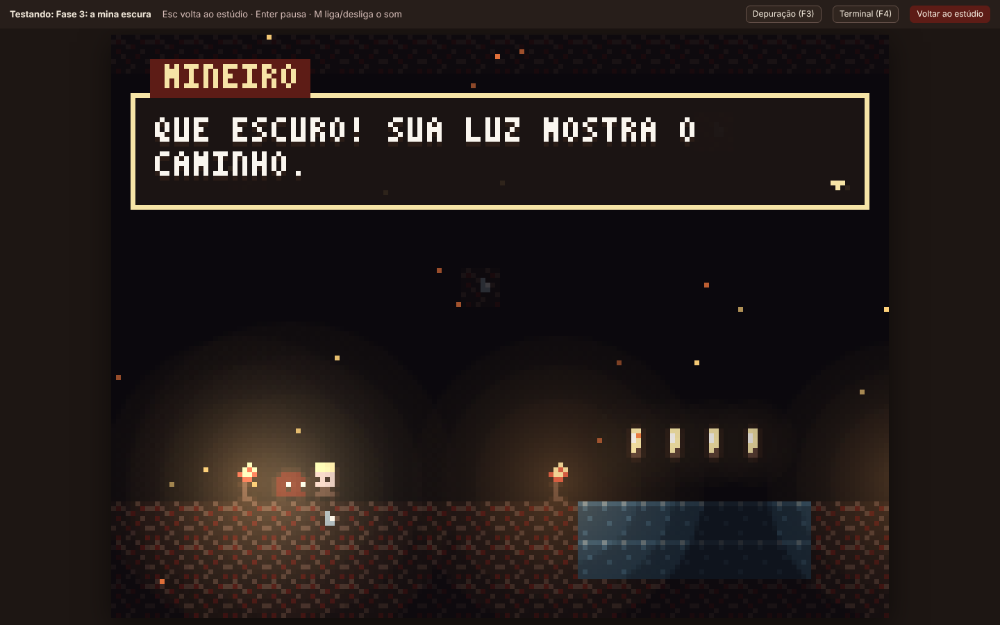
</p>

<p align="center">
  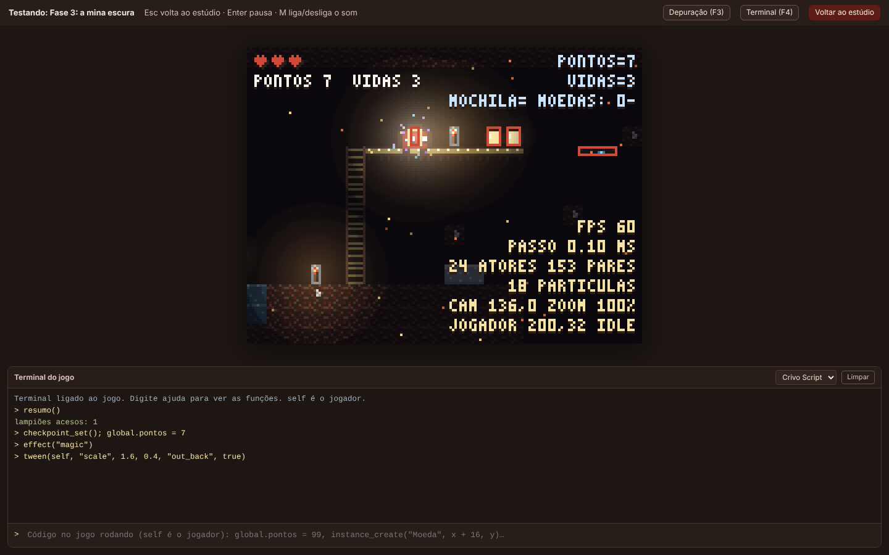
  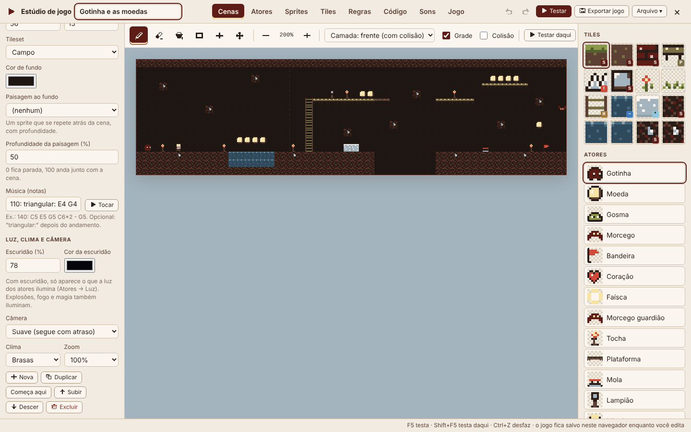
</p>

A versão 2.5.0 transforma o Estúdio de jogo num motor completo, com os recursos que se espera de uma ferramenta profissional, e dá ao editor de pixel art nove comandos novos, oito no menu Imagem e um no menu Cor. Tudo continua rodando sem código quando você quer (comportamentos, eventos e regras) e com código quando precisa (Crivo Script, C++ e Lua). O jogo de exemplo ganhou a **Fase 3: a mina escura**, que usa quase tudo o que entrou, inclusive uma área de gatilho que avisa do morcego caçador perto da saída e aproxima a câmera.

**Física e mundo**

| Recurso | O que faz |
|---|---|
| Tiles novos | **Escada** (sobe e desce com Cima e Baixo, e o topo vira chão), **Água** (gravidade a 30%, queda lenta, cada pulo vira uma braçada e há respingos na entrada e na saída), **Gelo** (sólido e escorregadio) e **Mola** (sólido que quica alto) |
| Jogador de plataforma | **Pulo na parede** (desliza segurando na direção da parede e pula para o outro lado), **investida** (Shift ou L, também no ar, uma por pulo), sobe escadas, nada e tem as animações novas Subindo escada, Na parede, Investida e Nadando |
| Jogador visto de cima | Investida nas oito direções; anda mais devagar na água e escorrega no gelo |
| Plataforma móvel | Vai e volta na horizontal ou na vertical, pausa nas pontas, leva quem estiver em cima e pode ser de mão única (o jogador pula por baixo e para em cima) |
| Mola e ponto de controle | A mola joga o jogador para o alto e troca para a animação "Ativo"; o ponto de controle acende, pode recuperar a vida e vira o lugar onde o jogador volta depois de morrer |
| Personagem que fala (NPC) | Fala com o jogador quando ele aperta X por perto (um "!" aparece em cima da cabeça), com várias páginas separadas por `|`, nome de quem fala e o evento **Fim do diálogo** |
| Inimigo que acha o caminho | Persegue o jogador contornando as paredes com o algoritmo **A\*** sobre os tiles sólidos, recalculando o caminho a cada 0,35 s |
| Torre que atira | Fica parada, mira no jogador e atira o projétil escolhido quando ele está no alcance e, se marcado, sem parede no meio (linha de visão) |
| Área de gatilho | Uma área invisível no jogo (verde na depuração) que envia um sinal quando o jogador entra, uma vez ou sempre: serve para cenas de corte, avisos, armadilhas e portas que fecham atrás do jogador |
| Gerador de atores | Cria o ator escolhido no intervalo definido, até um máximo vivos ao mesmo tempo, repondo os que morrem; com alcance, só quando o jogador está perto. Serve para ondas de inimigos, ninhos e itens que reaparecem |
| Emissor de partículas | Solta um dos oito efeitos de partículas no intervalo escolhido (fogo de uma fogueira, fumaça de uma chaminé, brilho de um cristal) e, com alcance, só quando o jogador está perto |
| Colisões em grade | Com mais de 32 atores, a busca de colisões usa uma grade espacial e só testa quem está perto: com 121 atores espalhados pela cena, são cerca de 270 pares por passo em vez de 7.260 |
| Tiles animados | Na aba Tiles, cada tile pode trocar de desenho sozinho numa sequência e numa velocidade (água, lava, tochas), mantendo a colisão do tile pintado |
| Cenas persistentes | Marque **Cena persistente** na aba Cenas e ela lembra, ao voltar, os itens pegos, os inimigos derrotados, as posições, a vida e as variáveis de cada ator colocado, sem rodar o evento Criar de novo; recomeçar a cena ou o jogo volta tudo ao início |

**Câmera, luz e tela**

| Recurso | O que faz |
|---|---|
| Câmera | Quatro modos por cena (**suave**, **zona morta**, **presa ao jogador** e **fixa**), **zoom** de 50% a 400% com transição, seguir qualquer ator e tremor com força |
| Luz e escuridão | Cada cena tem **escuridão** de 0 a 100% e uma cor; cada ator pode ter **luz** com raio, cor e tremulação de fogo. Explosões, fogo, brilho e magia iluminam por um instante. A luz é desenhada em anéis, no estilo da pixel art |
| Clima | Chuva, neve, folhas e brasas, que seguem a câmera e se ajustam ao tamanho da tela |
| Partículas | Oito efeitos prontos: explosão, poeira, brilho, fumaça, fogo, respingo, confete e magia, com gravidade, arrasto, tamanho e brilho próprios |
| Efeitos de tela | Piscar a tela, **câmera lenta**, **congelar no impacto** (hitstop), texto flutuante e transições entre cenas (corte, esmaecer e íris) |
| Filtros | Linhas de varredura, tubo CRT, LCD de portátil e vinheta, feitos em CSS por cima do canvas, sem borrar os pixels |
| Diálogos | Caixa com o nome de quem fala, texto digitado letra por letra (velocidade na aba Jogo), páginas, sinal no fim e o jogo pausado enquanto a caixa está aberta; ela sai de cima do jogador e esconde o placar |

**Lógica, eventos e código**

| Recurso | O que faz |
|---|---|
| Eventos novos | Tocou o chão, Levou dano, **Recebeu um sinal**, **Clique do mouse no ator**, **Desenhar** (no mundo), **Desenhar na tela (HUD)** e Fim do diálogo; alarmes de 0 a 11 (eram 0 a 3) |
| Condições novas | Se o botão está segurado, se o jogador está perto (px), se vê o jogador (sem parede no meio) e **se uma expressão em código for verdadeira** (Crivo Script, C++ ou Lua) |
| Ações novas | Animar propriedade (**tween** com nove curvas), enviar sinal, mostrar diálogo, texto flutuante, efeito de partículas, piscar a tela, zoom da câmera, câmera segue, câmera lenta, congelar o jogo, luz do ator, escuridão da cena, tamanho do ator, marcar ponto de controle, **salvar** e **carregar** o jogo e **esperar e continuar depois**, que pausa o resto da lista por alguns segundos sem parar o jogo, para montar cenas de corte em sequência |
| Gatilhos novos nas regras | Quando um sinal for enviado, quando o jogador marcar um ponto de controle e quando ele tocar o chão |
| Sinais | `signal_send("abrir")` avisa todos os atores com o evento Recebeu um sinal e as regras de sinal, para portas, interruptores e cenas de corte |
| Mapas e tabelas | `{ vida: 3, nome: "Gota" }` no Crivo Script, `{ vida = 3, [1] = "a" }` e `pairs(t)` no Lua e `std::map` no C++, com `.campo`, `[chave]`, `for (var chave, valor in mapa)`, `#t`, `size()`, `count()` e `erase()` |
| Funções novas | Mais de 50: `tween`, `effect`, `floating_text`, `flash`, `time_scale`, `hitstop`, `camera_follow`, `camera_zoom`, `camera_mode`, `gamepad_rumble`, `light_set`, `light_add`, `ambient_set`, `weather_set`, `path_find`, `move_path_towards`, `raycast`, `line_of_sight`, `collision_line`, `instance_list`, `dialog`, `signal_send`, `game_save`, `game_load`, `save_set`, `save_get`, `checkpoint_set`, `map_create`, `mouse_check`, `mouse_over`, `draw_self`, `draw_sprite`, `draw_rect`, `draw_circle`, `draw_line`, `draw_text`, `draw_bar` e outras, todas listadas por `ajuda` no terminal |
| Vibração do controle | O controle (gamepad) vibra quando o jogador leva dano, mais forte quando ele morre, e `gamepad_rumble(força, segundos)` vibra quando o código quiser, no estúdio e no jogo exportado |
| Barras de vida e números de dano | Na aba Jogo, **Barra de vida nos inimigos feridos** mostra uma barrinha em cima de cada inimigo machucado (verde, amarela e vermelha) e **Números de dano** faz o dano subir em texto sobre quem levou o golpe |
| Propriedades novas | `xscale`, `yscale`, `scale`, `angle`, `image_index`, `image_speed` e `light` (mudam o desenho do ator), `climbing`, `in_water`, `dashing`, `on_wall` e `active` (só leitura), `mouse_x`, `mouse_y` e `delta_time` |
| Salvar o progresso | Dez espaços de jogo salvo (cena, variáveis, ponto de controle e posição) e valores guardados para sempre, como o recorde, no próprio navegador de quem joga |
| Mouse | Posição no mundo e na tela, três botões e o evento de clique no ator, para menus, jogos de apontar e clicar e botões na tela |

**Testar e depurar**

- **Testar daqui** (Shift+F5 ou o botão na barra da cena) começa o teste com o jogador no ponto da cena onde o mouse passou por último.
- A **Depuração (F3)** mostra também o tempo de cada passo em milissegundos, os pares de colisão testados, as partículas, o zoom, o estado do jogador, as setas de velocidade, o caminho do A\*, a zona morta da câmera e as variáveis globais.
- O **Terminal (F4)** agora abre e fecha de verdade (na 2.4.0 ele ficava sempre aberto) e o `ajuda` lista as funções novas por assunto.
- **Quadro a quadro:** com o jogo pausado (Enter), a tecla `.` avança um passo do motor (1/60 s) e a pausa vira uma faixa discreta embaixo, para ver colisões, animações e a depuração passo a passo.
- **Gravar GIF (F6)** grava o jogo rodando a 25 quadros por segundo (até 15 s) e, ao apertar de novo, salva um GIF animado ampliado por vizinho mais próximo, com o maior lado perto de 480 px, pronto para mostrar o jogo em redes sociais ou num devlog.
- `game.place(x, y)` e `game.signal(nome)` também estão disponíveis para quem usa o motor por fora.

```c
function acender(lampiao) {
  global.mochila.lampioes += 1
  effect("sparkle", lampiao.x + 4, lampiao.y + 2)
  tween(lampiao, "light", 34, 0.6, "out_elastic", true)
  floating_text(lampiao.x + 4, lampiao.y - 4, "salvo!", "#f6e4a6")
}
```

<p align="center">
  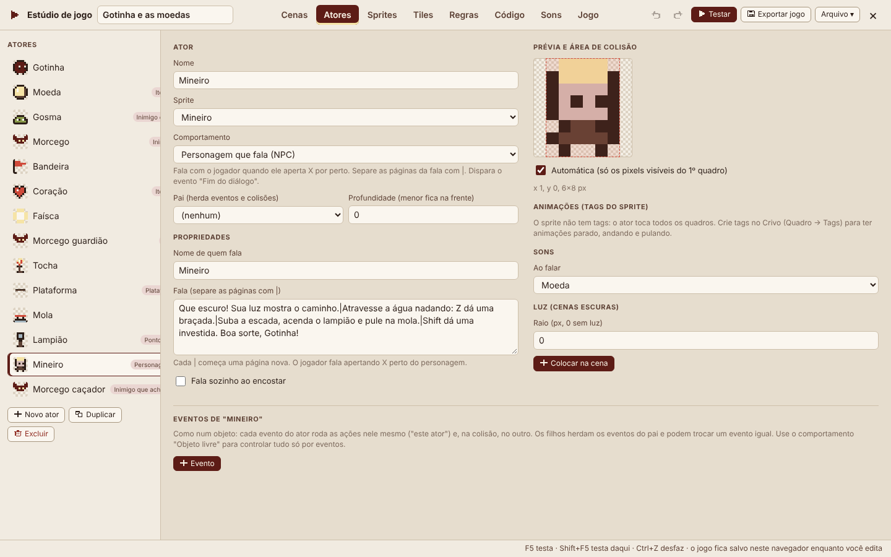
  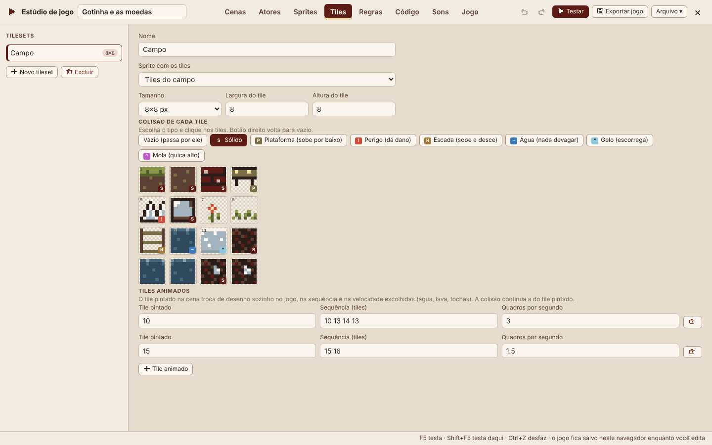
</p>

<p align="center">
  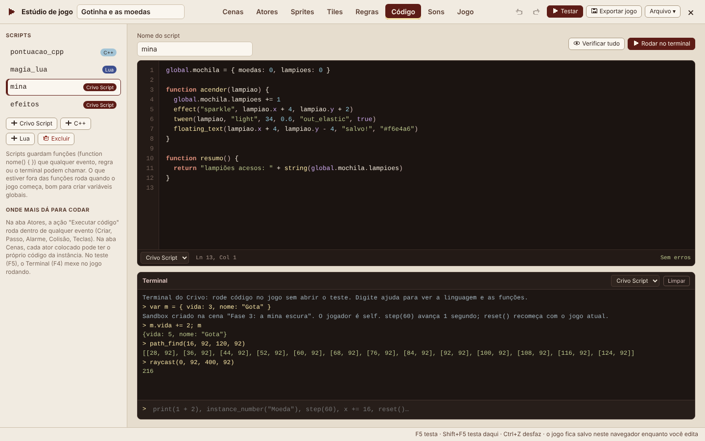
  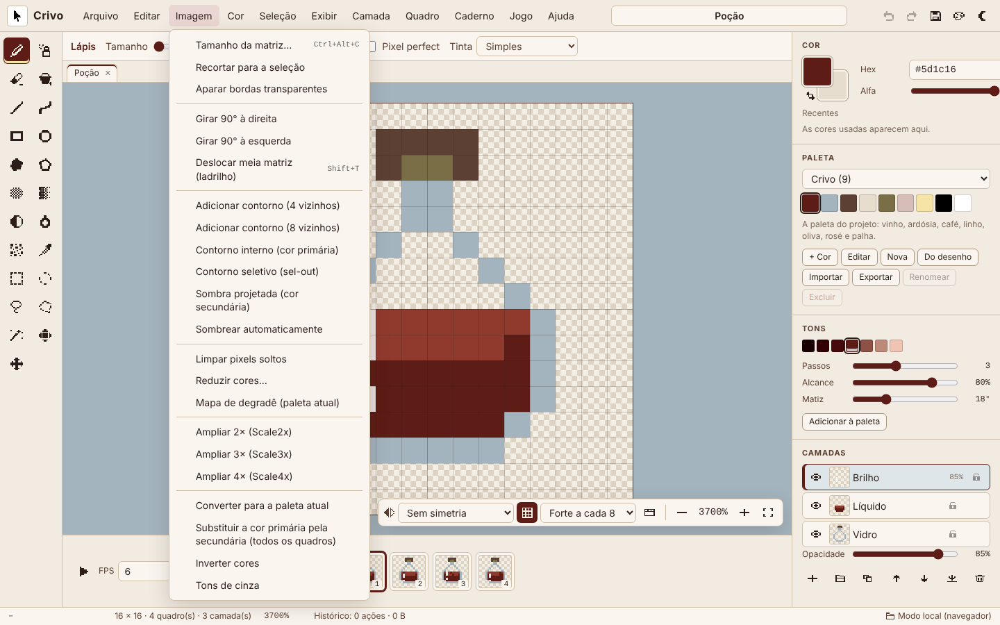
</p>

**Pixel art: comandos novos no menu Imagem**

| Comando | O que faz |
|---|---|
| Contorno interno | Pinta com a cor primária a borda de dentro do desenho (os pixels que encostam no transparente) |
| Contorno seletivo (sel-out) | Contorna por fora com um tom mais escuro de cada vizinho, puxado para o azul no OKLCH, em vez de uma cor só |
| Sombra projetada | Desenha a sombra do desenho 1 px para baixo e para a direita, com a cor secundária, só onde está vazio |
| Sombrear automaticamente | Clareia (puxando para o amarelo) o lado do desenho virado para a luz, no alto à esquerda, e escurece (puxando para o azul) o lado oposto |
| Limpar pixels soltos | Apaga pixels isolados e troca o pixel solitário cercado por uma cor só por essa cor |
| Reduzir cores… | Escolhe a melhor paleta com N cores por corte mediano e k-médias no OKLab e troca cada pixel pela mais próxima |
| Mapa de degradê | Repinta o desenho com a paleta atual, ordenada da cor mais escura para a mais clara, conforme a luz de cada pixel |
| Ampliar 2×, 3× e 4× | **Scale2x**, **Scale3x** e Scale4x (EPX): ampliam todas as camadas e quadros suavizando as diagonais sem criar cores novas, ao contrário do vizinho mais próximo |

No menu **Cor**, **Rampa com desvio de matiz…** cria, a partir da cor principal, uma rampa de 3 a 16 cores no OKLCH e acrescenta à paleta: a cor principal fica no meio, as sombras escurecem puxando para o azul e as luzes clareiam puxando para o amarelo e perdendo um pouco de saturação, como os artistas de pixel art fazem à mão. Numa paleta predefinida, o Crivo pede o nome de uma cópia.

Todos respeitam a seleção (só mudam o que está dentro dela) e são um passo só no histórico. O núcleo fica em `js/core/pixelart.js`, sem DOM e testado no Node, e o menu em `js/features/pixelart.js`, ligado pelo `install(app)`.

**Formato:** o `.crivojogo` passa para a versão 2, com os campos novos das cenas (`ambient`, `ambientColor`, `weather`, `camera`, `zoom`, `parallax`, `persistent`), dos atores (`light`), dos tilesets (`anims`) e do jogo (`filter`, `transition`, `textSpeed`, `hpBars`, `damageNumbers`). Jogos da 2.4.0 abrem normalmente e ganham os valores padrão; tudo o que chega continua validado. Nada muda no formato `.crivo`, na API nem no banco de dados.

<p align="center">
  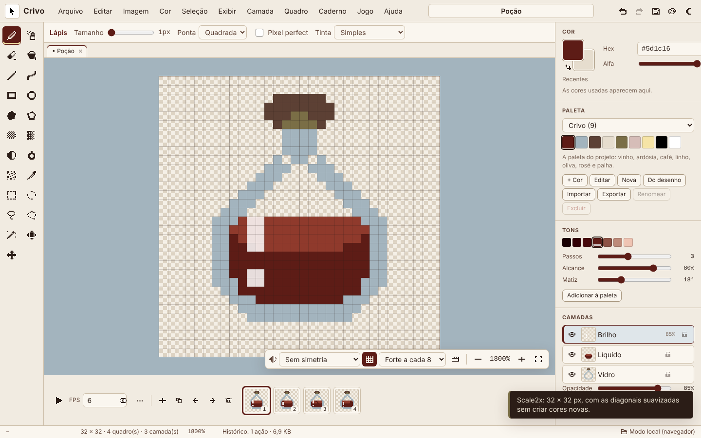
</p>

## Estúdio de jogo (2.4.0)

<p align="center">
  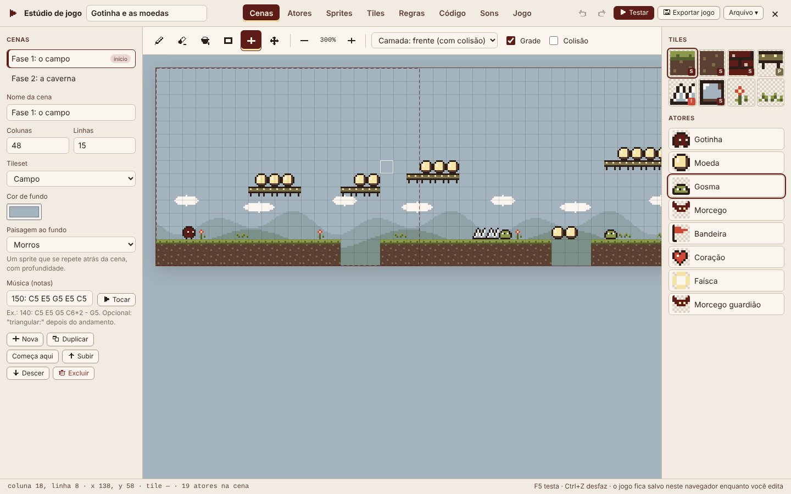
</p>

<p align="center">
  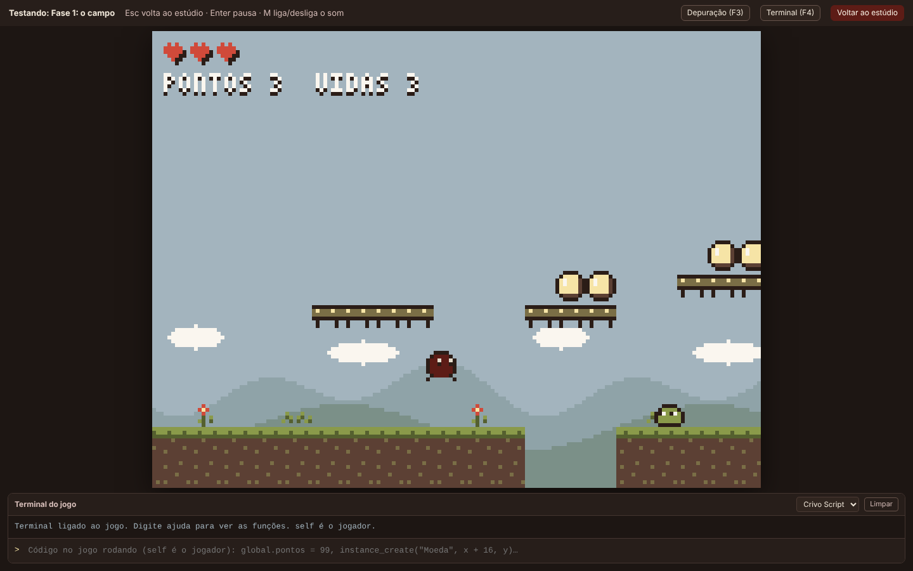
  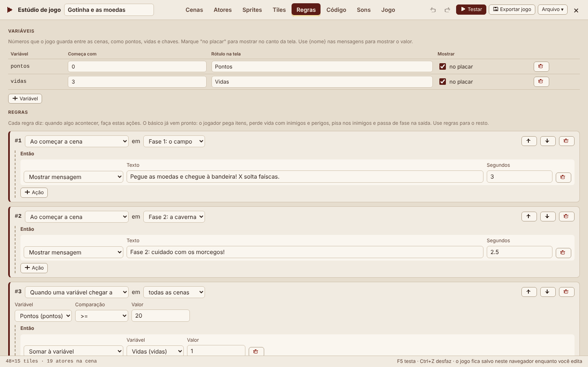
</p>

O **Estúdio de jogo** transforma as pixel arts do Crivo em jogos 2D que rodam no navegador, sem escrever código. Ele tem menu próprio na barra, **Jogo** (entre **Caderno** e **Ajuda**), e abre por cima do editor com **Jogo → Abrir o estúdio de jogo…** (F9). Na primeira vez, ele já vem com um jogo de exemplo completo, *Gotinha e as moedas*: duas fases, moedas, gosmas, morcegos, coração, faíscas, sons e música, para jogar com F5 e estudar como foi feito.

| Aba | O que faz |
|---|---|
| Cenas | Monta as fases: lista de cenas (nova, duplicar, subir, descer, cena inicial), tamanho em tiles (até 512 × 512), tileset, duas camadas de tiles (frente, com colisão, e fundo, só enfeite), cor de fundo, paisagem ao fundo com profundidade (parallax) e música. Ferramentas Pintar tile (`B`), Apagar tile (`E`), Balde de tiles (`G`), Retângulo de tiles (`U`), Colocar ator (`A`) e Mover ator (`V`), com zoom, grade, camada de colisão e a moldura do tamanho da tela. Botão direito apaga; `F` espelha o ator escolhido e `Delete` tira ele da cena; com `Alt`, o ator fica fora da grade. O **inspetor** mostra a posição, o espelho e o **código da instância** do ator escolhido |
| Atores | Tudo o que se mexe ou interage: sprite, comportamento, pai, profundidade, propriedades, animações (as tags do sprite para parado, andando, pulando, caindo e machucado), sons, área de colisão automática (os pixels visíveis) ou manual, com prévia animada, e os **eventos** do ator, cada um com condição e ações |
| Sprites | Os desenhos do jogo: o desenho atual, um projeto de outra aba, um arquivo `.crivo` ou uma imagem PNG, GIF, JPEG ou WebP. **Editar no Crivo** abre o sprite numa aba do editor e, ao voltar ao estúdio, ele é atualizado sozinho |
| Tiles | Recorta um sprite em tiles de 2 a 1024 px (com os tamanhos prontos de 8 a 1024) e marca cada um como vazio, sólido, plataforma (sobe por baixo) ou perigo |
| Regras | Variáveis (pontos, vidas, chaves…), com placar na tela, e regras "quando… então…" sem código |
| Código | Scripts em **Crivo Script**, **C++** ou **Lua**, num editor com cores por linguagem, números de linha, posição do cursor, recuo automático, comentar com Ctrl+/ e erro marcado na linha, e um **terminal** que roda código num sandbox da cena aberta |
| Sons | Efeitos de 8 bits gerados na hora (ondas quadrada, triangular, dente de serra, senoidal e ruído), com sete modelos (pulo, moeda, dano, explosão, power-up, tiro e blip), botão **Aleatório** e o desenho da onda |
| Jogo | **Tamanho base** de 8, 16, 32, 64, 128, 256, 512 ou 1024 px por tile, resolução (32 a 3840 px), cor de fundo, gravidade, queda máxima, cena inicial, variáveis de pontos e de vidas, mensagens e sons de vitória e de fim de jogo, conferência do que falta e tabela de controles |

- **Comportamentos prontos:** 12 ao todo. Jogador de plataforma (aceleração, pulo mais alto segurando o botão, *coyote time*, pulo guardado, pulo duplo ou mais, descer de plataformas com Baixo + pulo e tiro), jogador com visão de cima (oito direções, para RPG e labirinto), inimigo que patrulha (vira na parede e na beirada), inimigo que persegue, inimigo voador, item coletável (pontos e vida), perigo, saída para outra cena, projétil, bloco sólido (pode quebrar com tiros), decoração e objeto livre (só eventos).
- **Objetos com eventos e ações:** cada ator funciona como um objeto, com eventos próprios e ações que valem para ele mesmo ("este ator") e, na colisão, para o outro: **Criar**, **Passo** (a cada quadro), **Destruir**, **Alarme** 0 a 3, **Colisão com** um ator, **Tecla apertada**, **segurada** e **solta**, **Saiu da cena**, **Fim da animação** e **Início da cena**. Cada evento pode ter uma condição (variável global, variável do ator, quantidade de atores de um tipo, sorte em %, no chão ou no ar).
- **Pai, profundidade e variáveis do ator:** um ator pode ter um **pai** e herda os eventos dele (o filho troca um evento igual pelo seu), e colisões, regras e "destruir todos" com o pai valem também para os filhos. A **profundidade** decide quem é desenhado na frente (menor fica na frente). Cada ator na cena tem as próprias variáveis, que as ações somam e mudam e as condições comparam.
- **Objeto livre:** o comportamento **Objeto livre (só eventos)** não traz lógica pronta e anda com a velocidade que os eventos derem: **Mover numa direção** (graus, 0 para a direita e 90 para cima), **Ir em direção ao jogador**, **Inverter o movimento**, **Parar**, gravidade e colisão com os tiles opcionais e atrito. As ações novas também ligam alarmes, trocam a animação, voltam o ator ao ponto de partida, tocam e param a música e voltam para a cena anterior. No exemplo, o **Morcego guardião** da Fase 2 é feito só de eventos.
- **Três linguagens:** **Crivo Script**, **C++ adaptado** e **Lua** rodam no mesmo motor, com as mesmas funções, e uma função escrita numa linguagem pode ser chamada pelas outras (no exemplo, `chuva_de_moedas` em Lua chama `bonus_por_vida` em C++). O Crivo lê e interpreta as três, sem compilador nem `eval`, então elas funcionam com a Content-Security-Policy do editor e do jogo exportado.
  - **C++ adaptado:** `int`, `float`, `double`, `bool`, `auto`, `std::string` e `std::vector<T>` (com `push_back`, `size`, `at`, `front`, `back`), funções com tipo de retorno e parâmetros, `->` e `.`, `global::pontos`, `std::cout << … << std::endl`, `printf` com `%d`, `%f`, `%s` e largura, conversões `(int)` e `static_cast<int>`, `switch`, `do … while`, `for (auto v : lista)` e `++i`; `#include` e `using namespace` são aceitos e ignorados, e variáveis `int` cortam a parte decimal como no C++.
  - **Lua:** `local`, `if … then … elseif … else … end`, `while … do … end`, `for i = 1, 10, 2 do … end`, `for i, v in ipairs(t) do … end`, `repeat … until`, `function … end` (também anônimas), tabelas `{1, 2, 3}` indexadas a partir de 1, `#t`, `..`, `~=`, `//`, `^`, `nil`, atribuição múltipla e métodos como `("texto"):upper()` e `player():motion_set(0, 50)`; só `nil` e `false` são falsos (`0` e `""` contam como verdadeiro), como em Lua.
- **Crivo Script:** a linguagem própria do Crivo. Tem `var`, `if`/`else`, `while`, `for`, `repeat`, `do … until`, `break`, `continue`, `function` com `return` e recursão, listas (`[1, 2]`, `lista[0]`), textos, `and`/`or`/`not`, `mod`/`div`, `self`, `other`, `global.nome` e `noone`. Variáveis sem `var` são do ator, como `x`, `y`, `hspeed`, `vspeed`, `speed`, `direction`, `health` ou qualquer nome novo. São mais de 100 funções prontas, para criar e destruir atores, testar colisão, mover, ligar alarmes, ler teclas, mexer nos tiles, tocar sons e música, soltar partículas, trocar de cena, além de matemática, texto e listas. Erros mostram a linha e laços sem fim param sozinhos.
- **Onde codar:** na aba **Código** (scripts com funções em qualquer das três linguagens; o que fica fora das funções roda quando o jogo começa), na ação **Executar código** de qualquer evento ou regra e no **código da instância** de cada ator colocado na cena.
- **Terminal:** tem o seletor de linguagem (Crivo Script, C++ ou Lua) no topo. Na aba Código, roda código num sandbox da cena aberta (`print(placar())`, `instance_number("Moeda")`, `step(60)` avança um segundo, `reset()` recomeça, `inspect(player())`, `vars()`). No teste, **Terminal (F4)** liga o terminal ao jogo rodando, com `self` sendo o jogador (`global.pontos = 99`, `instance_create("Moeda", x + 16, y)`, `pause()`, `resume()`), e mostra os `print` e os erros do jogo. `ajuda` lista a linguagem e as funções; ↑ e ↓ voltam aos comandos anteriores.
- **Editor de código:** cores para palavras-chave, funções, textos, números e comentários em cada linguagem, números de linha, Ln e Col, recuo automático depois de `{`, `then` e `do`, Tab com dois espaços, Ctrl+/ para comentar e descomentar, Ctrl+S para gravar e a conferência na hora, que pinta de vermelho a linha com erro.
- **Depuração:** **Depuração (F3)** no teste mostra as caixas de colisão, o FPS, a quantidade de atores e as posições da câmera e do jogador.
- **Tamanho base (8 a 1024 px):** na aba Jogo, a escala de 8, 16, 32, 64, 128, 256, 512 ou 1024 pixels por tile ajusta a resolução (de 160 × 120 até 3840 × 2160), multiplica gravidade, queda, velocidades, pulos e alcances na mesma proporção e vira o tamanho dos tilesets e sprites novos. Os tiles vão de 2 a 1024 px e os sprites até 1024 × 1024, o limite da matriz do Crivo.
- **O básico funciona sem nenhuma regra:** o jogador pega itens, perde vida com inimigos, perigos e tiles de perigo (pisca e é empurrado), pisa nos inimigos, cai nos buracos, perde uma vida e recomeça a fase, passa de fase na saída, vence na última e vê o fim de jogo quando as vidas acabam.
- **Regras globais:** 11 gatilhos (começar a cena, um ator tocar outro, apertar um botão, a cada N segundos, uma variável chegar a um valor, ator destruído, não sobrar nenhum ator de um tipo, o jogador levar dano, morrer, pular e chegar à saída) e as mesmas 32 ações dos eventos (somar e mudar variável global ou do ator, destruir, destruir todos de um tipo, dar dano, recuperar vida, criar ator, tocar som, mostrar mensagem com `{variável}`, impulsionar, mudar a velocidade, mover numa direção, ir em direção ao jogador, inverter, parar, gravidade, teletransportar, voltar ao ponto de partida, trocar a animação, ligar alarme, tremer a tela, tocar e parar a música, ir para uma cena, próxima cena, cena anterior, reiniciar a cena, vencer e perder), valendo para todas as cenas ou só para uma.
- **Música:** cada cena pode ter uma melodia escrita em texto, como `140: C5 E5 G5 C6*2 - G5` (andamento, notas de C0 a B8 com `#` e `b`, `-` para pausa e `*2` para dobrar a duração; `triangular:` depois do andamento troca a onda), que toca em loop.
- **Testar:** **Testar** (F5 no estúdio, ou **Jogo → Testar o jogo**, Shift+F9, no editor) roda o jogo a partir da cena aberta, por cima do estúdio; Esc volta.
- **Exportar jogo:** gera um único arquivo `.html` com o jogo inteiro, que abre em qualquer navegador, sem servidor nem internet, com tela de título, pausa, som, controle (gamepad) e botões de toque no celular. A página leva a própria Content-Security-Policy, com o script conferido por hash SHA-256 e sem acesso à rede. **Exportar dados do jogo (JSON)** entrega as cenas, os atores e os sprites (em RLE, como no `.crivo`) para usar em outro motor.
- **Arquivo `.crivojogo`:** **Arquivo ▾ → Salvar arquivo .crivojogo…** guarda o jogo inteiro num JSON, com os sprites dentro, e **Abrir arquivo .crivojogo…** abre de novo (tudo o que chega é validado). Enquanto você edita, o jogo fica guardado no navegador, com desfazer e refazer (Ctrl+Z e Ctrl+Y) de até 120 passos. A pasta [`examples/`](examples) traz o jogo de exemplo (`gotinha.crivojogo`).

### Como fazer seu primeiro jogo

1. **Abra o estúdio:** **Jogo → Abrir o estúdio de jogo…** (F9). Para começar do zero, use **Arquivo ▾ → Novo jogo em branco**; para estudar, aperte F5 no jogo de exemplo.
2. **Escolha a escala:** na aba **Jogo**, escolha o **tamanho base** (8 px para um jogo de portátil, 16 ou 32 px para mais detalhe, até 1024 px) e confira a resolução.
3. **Desenhe os sprites no Crivo:** o personagem com tags `parado`, `andando` e `pulando` (**Quadro → Nova tag**), uma folha de tiles com os quadradinhos lado a lado e os itens e inimigos. Na aba **Sprites**, use **Usar o desenho atual**, **Escolher de uma aba…** ou **Abrir arquivo…**. Para retocar depois, **Editar no Crivo** abre o sprite numa aba e o estúdio atualiza quando você volta (F9).
4. **Crie o tileset:** na aba **Tiles**, **Novo tileset**, escolha o sprite e o tamanho do tile e marque cada tile como **sólido**, **plataforma** ou **perigo**.
5. **Crie os atores:** na aba **Atores**, **Novo ator**, escolha o sprite e o comportamento (o primeiro, **Jogador (plataforma)**, já anda e pula), ligue as tags às animações e escolha os sons. Faça também os itens, os inimigos e a **Saída**.
6. **Monte a cena:** na aba **Cenas**, escolha o tileset, pinte com o **Pintar tile** (B), use o **Balde** (G) e o **Retângulo** (U), troque para a **camada de fundo** para os enfeites e coloque os atores com **Colocar ator** (A). A moldura tracejada mostra o tamanho da tela.
7. **Dê comportamento:** use as **Regras** para o que vale no jogo todo (pontos, vidas, mensagens), os **eventos** de cada ator para a lógica dele (Criar, Passo, Alarme, Colisão, Teclas) e a ação **Executar código** ou a aba **Código** quando quiser programar em Crivo Script, C++ ou Lua.
8. **Teste:** aperte **F5**. **F4** abre o terminal ligado ao jogo e **F3** mostra as colisões; Esc volta ao estúdio.
9. **Salve e publique:** **Arquivo ▾ → Salvar arquivo .crivojogo…** guarda o projeto; **Exportar jogo** gera o `.html` que qualquer pessoa abre no navegador, no computador ou no celular.

O mesmo trecho nas três linguagens (um inimigo que corre atrás do jogador quando ele chega perto), para usar no evento **Passo** com a ação **Executar código**:

**Crivo Script**

```c
if distance_to(player()) < 64 { move_towards_point(player().x, player().y, 40) } else { hspeed = 0 }
```

**C++**

```cpp
if (distance_to(player()) < 64) { move_towards_point(player()->x, player()->y, 40); } else { self->hspeed = 0; }
```

**Lua**

```lua
if distance_to(player()) < 64 then move_towards_point(player().x, player().y, 40) else hspeed = 0 end
```

| Controle do jogo | Teclado | Gamepad |
|---|---|---|
| Andar | Setas ou WASD (no jogo de plataforma, Cima pula ou sobe a escada) | Direcional ou alavanca |
| Pular (e nadar) | `Z`, `Espaço` ou `K` | A |
| Ação (atirar, falar e avançar o diálogo) | `X`, `J` ou `C` | B ou X |
| Investida (2.5.0) | `Shift` ou `L` | Y ou RB |
| Clicar nos atores (2.5.0) | Mouse ou toque | — |
| Começar e pausar | `Enter` | Start |
| Recomeçar (na pausa) / ligar e desligar o som | `R` / `M` | — |

<p align="center">
  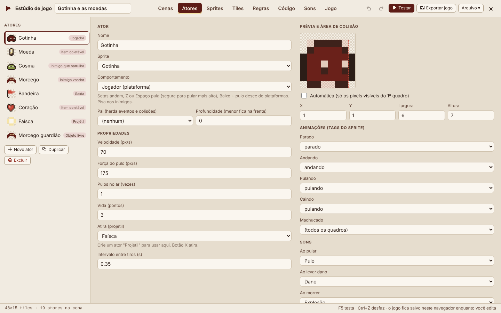
  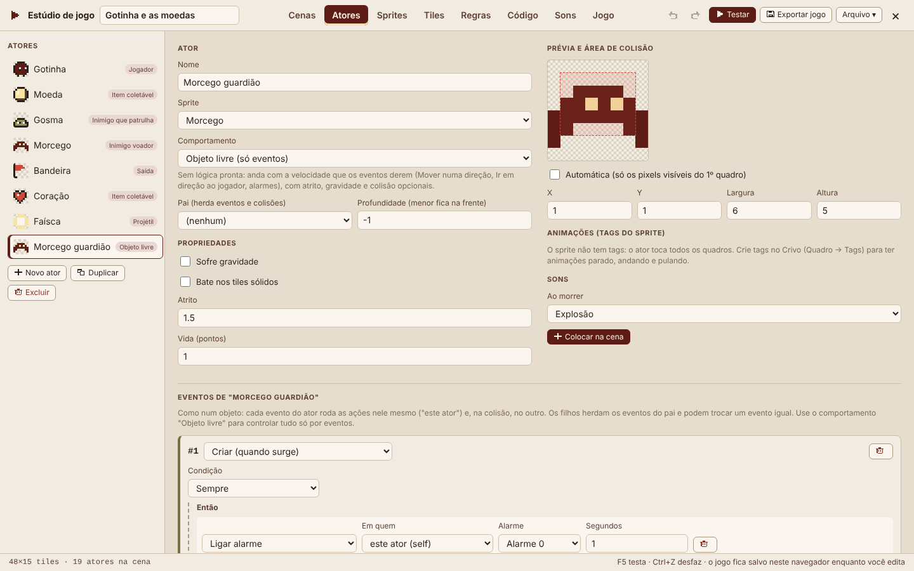
</p>

<p align="center">
  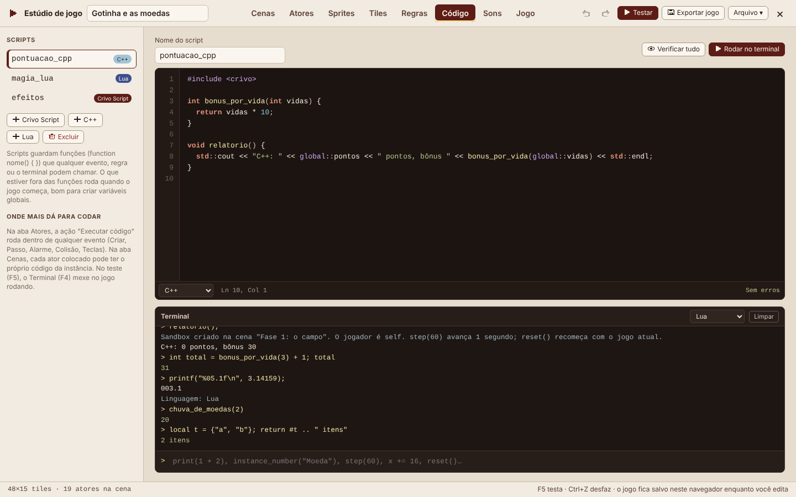
  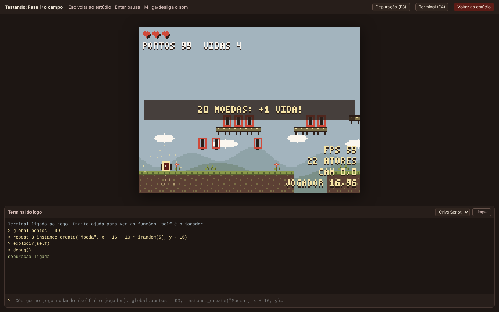
</p>

<p align="center">
  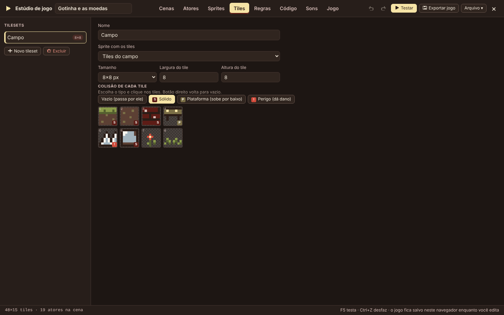
  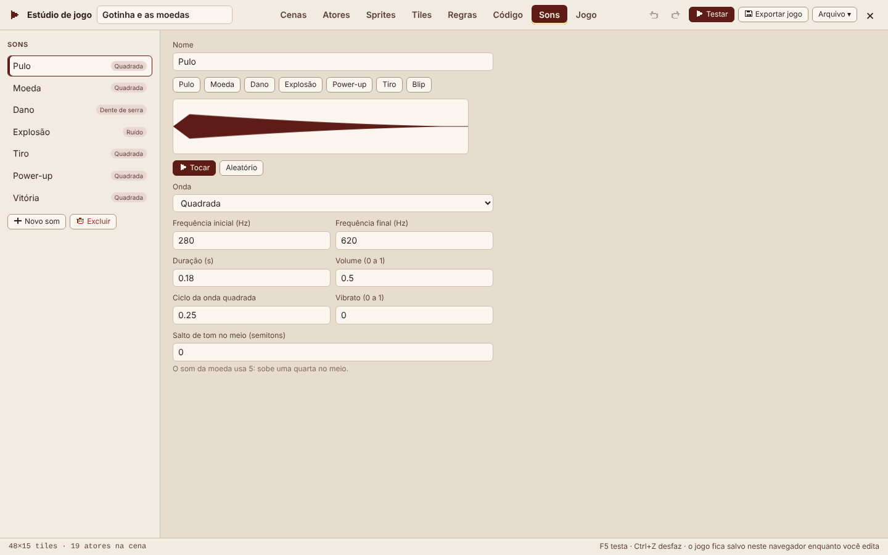
</p>

O motor fica em `js/core/game/`, sem DOM e testado no Node: `engine.js` (física com passo fixo de 1/60 s, colisão com tiles e blocos, comportamentos, objetos com eventos, alarmes, herança e variáveis do ator, regras, animação e câmera), `script.js` (as linguagens: leitores e analisadores de Crivo Script, C++ e Lua e um interpretador comum com limite de passos), `audio.js` (sintetizador de 8 bits e melodias), `project.js` (formato `.crivojogo` e validação de tudo o que é aberto), `compile.js` (sprites em RLE, tags e tilesets), `bundle.js` (a página `.html` exportada) e `sample.js` (o jogo de exemplo). A tela do jogo fica em `js/ui/game-player.js`, o estúdio em `js/ui/game-studio.js`, o terminal em `js/ui/game-terminal.js`, o editor de código em `js/ui/code-editor.js` e o menu em `js/features/game.js`. O motor, a linguagem, o som e a tela são as mesmas funções no estúdio e no jogo exportado, então o que você testa é o que vai para o `.html`. Funciona nas três maneiras de rodar e nos temas claro e escuro. Nada muda no formato `.crivo`, na API nem no banco.

## Caderno (2.3.0)

<p align="center">
  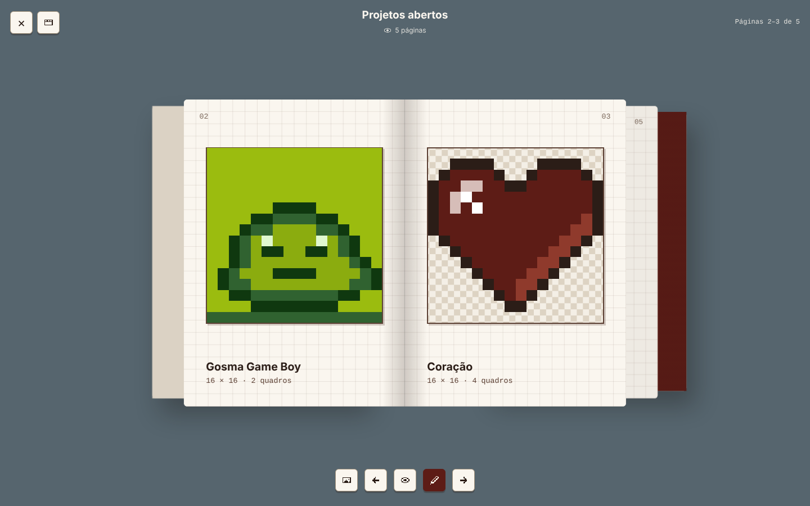
</p>

<p align="center">
  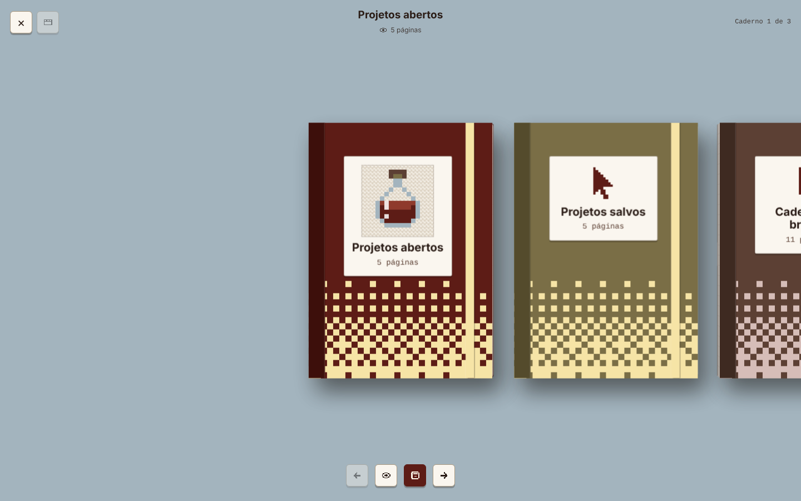
  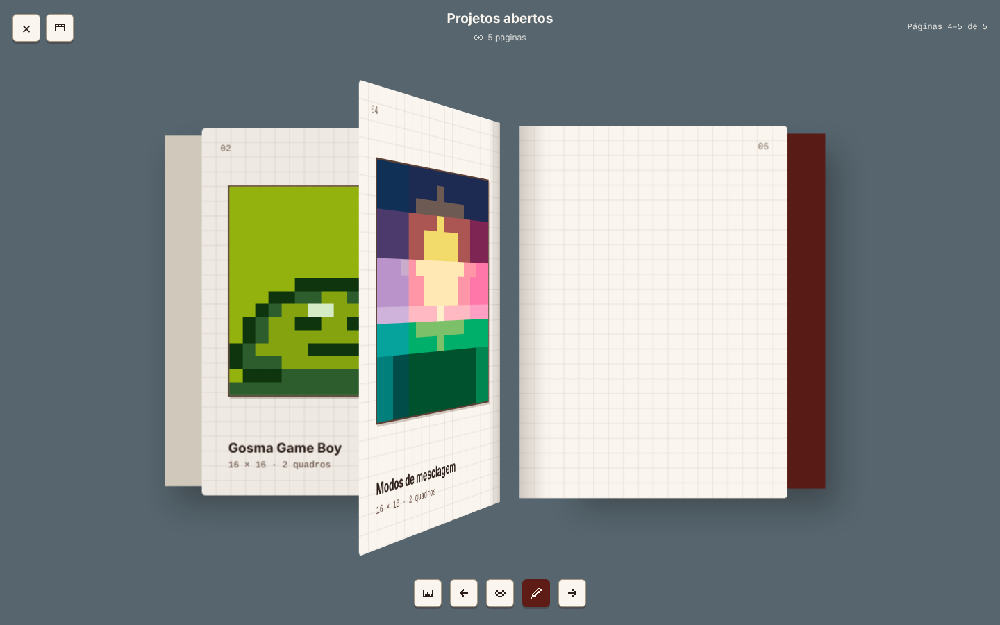
</p>

O **Caderno** tem menu próprio na barra, entre **Quadro** e **Ajuda**: **Abrir a estante…** (F8) abre, por cima do editor, uma estante de cadernos, e **Projetos abertos**, **Projetos salvos** e **Caderno em branco** abrem direto o caderno escolhido, já com a animação. As capas usam a paleta Crivo (vinho, oliva e café, com elástico e degradê pontilhado de Bayer em palha e rosé) e o fundo é a ardósia da área de desenho, que escurece quando um caderno abre.

| Caderno | O que tem dentro |
|---|---|
| Projetos abertos | As abas abertas, inclusive o que ainda não foi salvo |
| Projetos salvos | Os projetos de **Projetos salvos** (no navegador, no app desktop ou no servidor), até 36 |
| Caderno em branco | Só páginas quadriculadas, prontas para rascunhos |

- **Abrir:** o caderno se ergue, gira até mostrar a lombada, cresce até o centro e volta de frente já aberto, com a capa virada e as folhas em leque: as já viradas empilhadas à esquerda e as próximas à direita, em perspectiva.
- **Folhear:** cada folha gira em 3D em torno da lombada. Cada página mostra uma pixel art em tamanho inteiro, com pixels nítidos sobre o xadrez de transparência, nome, tamanho e número de quadros; projetos animados tocam a animação na própria página, com a duração de cada quadro. O fim do caderno se despede com "tchau :p" em letras de pixel nas duas páginas.
- **Com ou sem pixel arts:** o olho (ou o subtítulo "N páginas") mostra ou oculta as pixel arts, e o caderno fica só com as páginas quadriculadas. A escolha fica guardada no navegador. Sem nenhuma pixel art ainda, o caderno abre em branco, com um aviso na primeira página.
- **Editar esta página:** o botão do lápis fecha o caderno e leva ao projeto da página: troca para a aba dele ou abre o projeto salvo numa aba nova.
- **Fechar:** o caderno se dobra, gira até mostrar a borda das folhas e volta para a estante; Esc de novo fecha a janela.
- **Nome e foto de capa:** na estante, o botão da foto (ou **Caderno → Personalizar caderno…**) abre uma janela para dar nome ao caderno (até 40 letras) e escolher uma foto de capa, com prévia. A foto é recortada na proporção da capa e fica por baixo da lombada e do elástico, com o nome numa etiqueta embaixo; o nome aparece também no título, na folha de guarda e no menu Caderno. **Remover foto** volta à capa pontilhada e **Restaurar padrão** volta ao nome e à capa originais. Cada um dos três cadernos guarda o próprio nome e a própria foto no navegador (a foto é reduzida para 360 × 500).

<p align="center">
  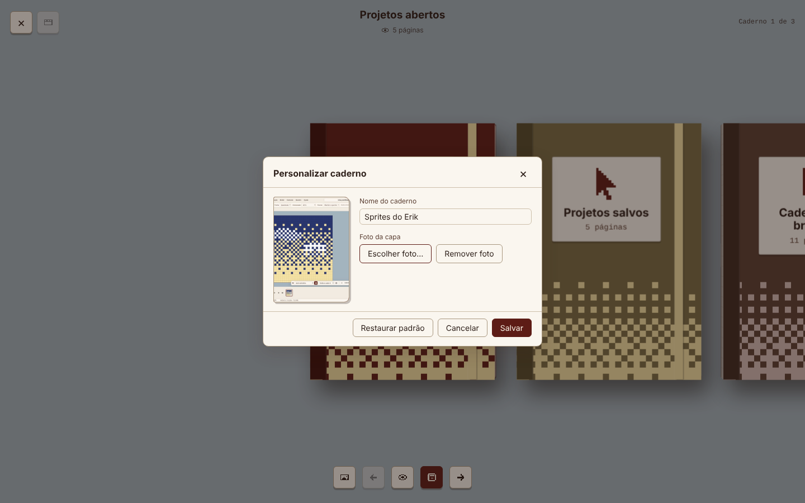
</p>

| Tecla ou gesto | Na estante | Com o caderno aberto |
|---|---|---|
| `←` `→` ou arrastar | Caderno anterior / próximo | Página anterior / próxima |
| `Enter`, `Espaço` ou clique | Abre o caderno | Vira a página (clique na metade direita avança, na esquerda volta) |
| `Home` / `End` | Primeiro / último caderno | Primeira página / fim |
| `Esc` | Fecha a janela | Fecha o caderno e volta à estante |

Funciona nas três maneiras de rodar e nos temas claro e escuro. Com `prefers-reduced-motion`, as páginas trocam sem o giro e as animações não tocam. A paginação e a geometria das folhas ficam em `js/core/sketchbook.js`, sem DOM e testadas no Node; a janela em `js/ui/sketchbook.js`; o menu e o atalho em `js/features/sketchbook.js`.

## Salvar e tutorial rápido (2.2.0)

<p align="center">
  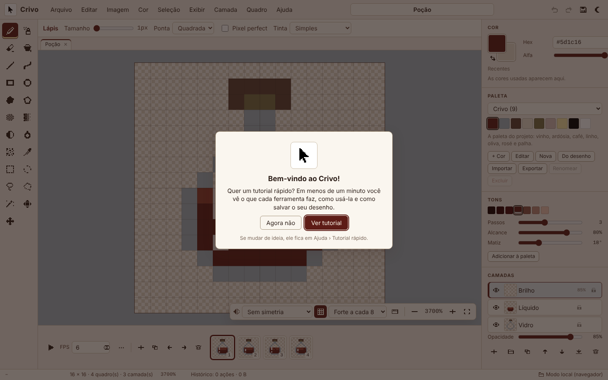
  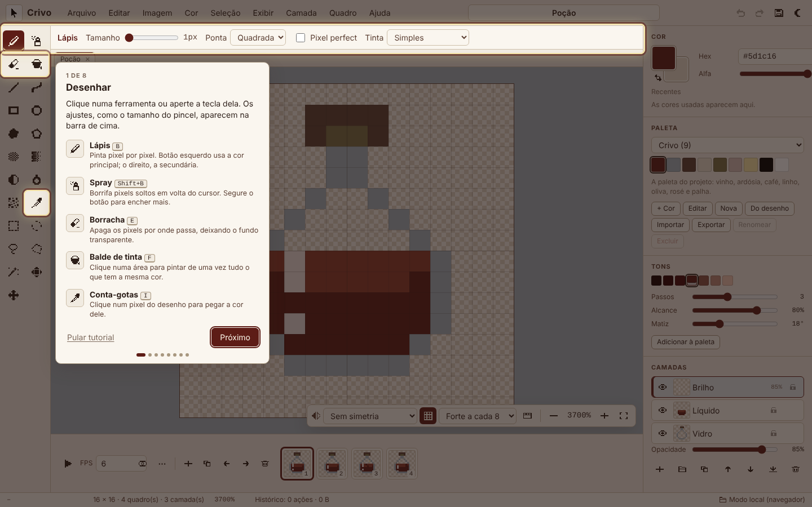
</p>

### Salvar escolhendo a pasta

- **Ctrl+S** (ou o disquete) abre, na primeira vez, a janela **Salvar como** do Windows, a mesma de qualquer programa: escolha a pasta e o nome (que já vem com o nome do projeto) e o Crivo grava o `.crivo` lá. Os próximos Ctrl+S gravam no mesmo arquivo, sem perguntar. O projeto continua indo também para **Projetos salvos**.
- **Salvar como…** (**Ctrl+Shift+S**, antes "Salvar como cópia") sempre pergunta e passa a usar o arquivo novo. Se o arquivo já existir, o Windows pergunta se quer substituir; cancelar não salva nada.
- **Exportações** (PNG, JPEG, GIF, PNG animado, quadros em `.zip`, sprite sheet, dados da matriz, paletas e `.ase`) abrem a mesma janela; o botão **Baixar** dos diálogos virou **Salvar…**, e cancelar mantém o diálogo aberto.

| Onde o Crivo roda | A janela | Para onde vai o arquivo |
|---|---|---|
| App desktop (`Crivo.exe`) | A janela nativa do Windows (`desktop/save_windows.go`) | A pasta e o nome que você escolher |
| Chrome e Edge (servidor ou `Crivo.html`) | A do navegador (File System Access API), que no Windows é a mesma | A pasta e o nome que você escolher |
| Firefox, Safari e outros | Não abre (esses navegadores não têm essa janela) | Ctrl+S guarda em Projetos salvos; **Baixar arquivo .crivo** e as exportações vão para Downloads |

No app desktop, o editor manda o conteúdo para o programa em Go, que grava o arquivo no lugar escolhido (primeiro num arquivo temporário da mesma pasta, para não estragar o anterior se algo falhar). Ele só aceita gravar arquivos escolhidos na janela durante a sessão.

### Tutorial rápido

Na primeira vez que o Crivo abre, uma janela pergunta se você quer um tutorial rápido: **Ver tutorial** ou **Agora não**. Ele aparece uma vez só (em cada maneira de rodar) e fica sempre em **Ajuda → Tutorial rápido**. São oito passos curtos que escurecem a tela e acendem a parte explicada:

| Passo | O que mostra |
|---|---|
| 1. Desenhar | Lápis, spray, borracha, balde, conta-gotas e a barra de opções |
| 2. Formas | Linha, curva, retângulo, elipse, contorno livre e polígono |
| 3. Efeitos e sombras | Pontilhado, degradê pontilhado, clarear e escurecer, desfocar e embaralhar |
| 4. Selecionar e mover | Seleção retangular e elíptica, laço, laço poligonal, varinha mágica, mover pixels e mover a visão |
| 5. Cores | Cor principal e secundária, paleta e a tecla X |
| 6. Camadas e animação | Painel de camadas e linha do tempo |
| 7. Zoom e desfazer | Roda do mouse, Espaço, Ctrl+Z e Ctrl+Y, grade e simetria |
| 8. Salvar e exportar | Ctrl+S, a janela Salvar como e o menu Arquivo |

Cada ferramenta aparece com o ícone, o nome, o atalho e uma frase sobre o que faz e como usar; passar o mouse sobre ela destaca o botão na barra. **Próximo** e **Voltar** (ou as setas → e ←) andam entre os passos, e **Pular tutorial** ou **Esc** fecham.

## Recursos avançados (2.1.0)

A versão 2.1.0 traz para o Crivo os recursos de um editor de pixel art completo: camadas em grupos, modos de mistura, animação com tags, tilemaps, slices, modos de cor e arquivos `.ase` com camadas, tudo escrito do zero (o formato `.ase` foi implementado a partir da especificação pública).

<p align="center">
  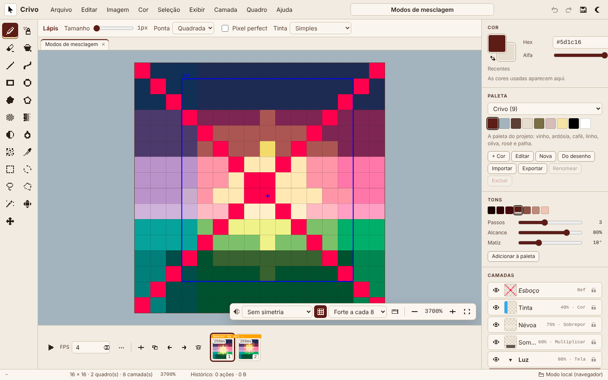
  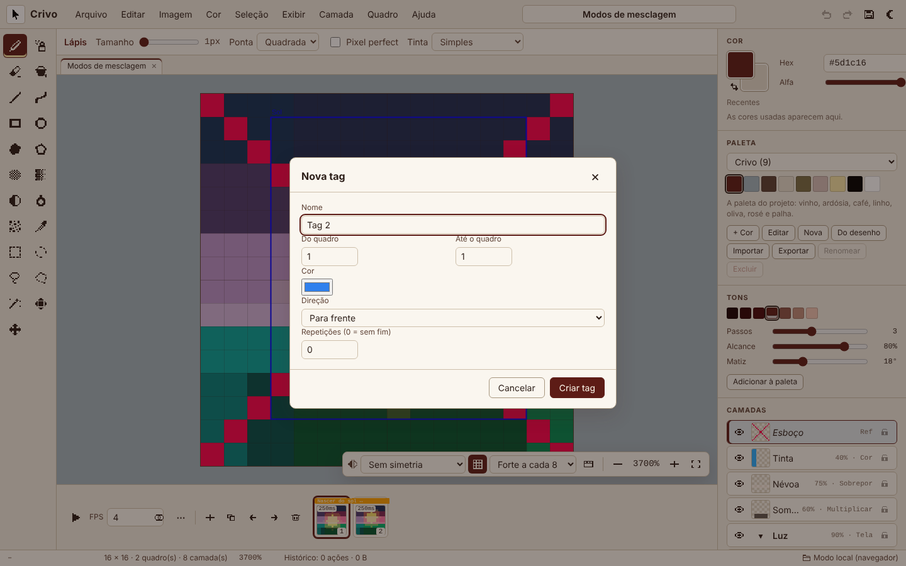
</p>

### Camadas, grupos e modos de mistura

- **Grupos:** **Camada → Novo grupo** ou **Agrupar a camada atual**; o grupo abre e fecha (▸/▾) e as camadas de dentro aparecem recuadas. A visibilidade, a opacidade e o modo de mistura do grupo valem para tudo o que está nele. Um grupo **normal a 100%** é "pass-through": as camadas de dentro se misturam direto com o que está abaixo; com outro modo ou opacidade, o conteúdo é composto à parte e misturado como uma camada só.
- **Modos de mistura (19):** normal, multiplicar, tela, sobrepor, escurecer, clarear, subexposição de cor, superexposição de cor, luz forte, luz suave, diferença, exclusão, matiz, saturação, cor, luminosidade, adição, subtração e divisão, escolhidos em **Propriedades da camada…** (F2 ou duplo clique na camada). O normal continua idêntico, bit a bit, ao da 2.0.
- **Camada de referência:** aparece no editor, mas fica fora de todas as exportações (PNG, GIF, sprite sheet, dados, servidor e Java).
- **Camadas de tiles:** **Nova camada de tiles…** cria um tileset (tamanho do tile) e um tilemap. No **modo tile**, o lápis põe o tile escolhido, a borracha põe o tile 0 (vazio) e o conta-gotas pega um tile; no **modo pixel**, editar um tile atualiza todas as cópias. O painel mostra os tiles e o botão **+ Tile**.

### Animação: tags, cels vinculados e papel cebola

- **Tags:** **Quadro → Nova tag…** dá nome, cor, primeiro e último quadro, direção (para frente, para trás ou pingue-pongue) e repetições (0 = sem fim). As tags aparecem como faixas coloridas acima dos quadros (clique para editar) e a reprodução fica presa na tag do quadro atual.
- **Cels vinculados:** **Novo quadro vinculado** e **Vincular célula a quadros…** fazem vários quadros dividirem a mesma célula: editar uma muda todas. O "∞" marca as células vinculadas; **Desvincular célula** faz uma cópia independente.
- **Duração por quadro:** **Propriedades do quadro…** (ou duplo clique no quadro) define a duração em ms, mostrada na linha do tempo.
- **Papel cebola configurável:** **Exibir → Configurar papel cebola…** (ou o botão "⋯" da linha do tempo) mostra de 0 a 3 quadros antes e depois, normal ou tingido de vermelho e azul.
- **Slices:** **Exibir → Editar slices…** cria áreas com nome, cor, retângulo, centro de 9-slice e pivô opcionais, exportadas no `.ase` e no JSON da sprite sheet; **Exibir → Slices** mostra ou esconde as áreas.

### Ferramentas e atalhos

| Ferramenta | Atalho | Ferramenta | Atalho |
|---|---|---|---|
| Lápis | `B` | Spray **(novo)** | `Shift+B` |
| Borracha | `E` | Balde de tinta | `F` |
| Linha | `L` | Curva **(novo)** | `Shift+L` |
| Retângulo | `R` | Elipse e círculo | `O` |
| Contorno livre **(novo)** | `Shift+D` | Polígono **(novo)** | `Shift+O` |
| Pontilhado | `D` | Degradê pontilhado | `U` |
| Clarear e escurecer | `Q` | Desfocar **(novo)** | `Shift+Q` |
| Embaralhar **(novo)** | `Shift+J` | Conta-gotas | `I` |
| Seleção retangular | `S` | Seleção elíptica **(novo)** | `Shift+S` |
| Laço **(novo)** | `A` | Laço poligonal **(novo)** | `Shift+A` |
| Varinha mágica **(novo)** | `W` | Mover pixels | `V` |
| Mover a visão | `H` | | |

- **Polígono, laço poligonal e curva:** clique nos pontos; duplo clique, Enter ou clicar no primeiro ponto fecha; Backspace tira o último ponto e Esc cancela.
- **Modos de seleção** (em todas as ferramentas de seleção e na barra de opções): substituir, somar (Shift), subtrair (Alt) e interseção (Shift+Alt). Seleções de qualquer forma valem para copiar, recortar, colar, apagar, balde, degradê, filtros, substituir cor, recortar para a seleção e mover pixels.
- **Modos de tinta** (opção **Tinta** no lápis, linha, retângulo, elipse, spray, curva, contorno e polígono): Simples, Composição alfa, Travar alfa e Atrás.
- **Pincel personalizado:** **Seleção → Usar seleção como pincel** (Ctrl+B) transforma a seleção num pincel; **Pincel padrão** volta ao normal.

| Atalho novo | Ação |
|---|---|
| `Shift+N` / `Alt+N` | Nova camada / novo quadro |
| `F2` | Propriedades da camada |
| `F7` | Pré-visualização |
| `F8` | Caderno: abrir a estante (2.3.0) |
| `F9` / `Shift+F9` | Estúdio de jogo / testar o jogo (2.4.0) |
| `F3` / `F4` (no teste do jogo) | Depuração / terminal do jogo (2.4.0) |
| `Shift+F5` (no estúdio, com o mouse na cena) | Testar daqui: o jogador começa onde o mouse passou (2.5.0) |
| `F6` (no teste do jogo) | Grava o jogo e, apertando de novo, salva um GIF animado (2.5.0) |
| `.` (com o jogo pausado) | Avança um quadro (2.5.0) |
| `Ctrl+Tab` / `Ctrl+Shift+Tab` | Próxima aba / aba anterior |
| `Ctrl+U` / `Ctrl+M` | Matiz, saturação e luminosidade / curva de cores |
| `Ctrl+B` | Usar a seleção como pincel |
| `Ctrl+Shift+D` / `Ctrl+Shift+I` | Reselecionar / inverter a seleção |
| `Ctrl+S` / `Ctrl+Shift+S` | Salvar (na primeira vez, o Windows pergunta a pasta) / Salvar como (2.2.0) |
| `Shift` / `Alt` / `Shift+Alt` com uma ferramenta de seleção | Somar, subtrair ou fazer a interseção |

A lista completa fica em **Ajuda → Atalhos do teclado** (`?`).

### Menus

| Menu | Comandos |
|---|---|
| Arquivo | Novo projeto, projetos salvos, **abrir arquivo** (`.crivo`, `.json` e `.ase`, numa aba nova), importar imagem ou sprite sheet, **fechar projeto (aba)**, salvar, **salvar como…**, baixar `.crivo`, **exportar como `.ase`**, exportar imagem, GIF animado, **PNG animado (APNG)**, **quadros em PNG (.zip)**, sprite sheet e dados |
| Editar | Desfazer, refazer, copiar, recortar, colar, apagar, selecionar tudo, desmarcar e espelhar |
| Imagem | Tamanho da matriz, recortar para a seleção, aparar, girar, deslocar meia matriz, contorno, **contorno interno**, **contorno seletivo (sel-out)**, **sombra projetada**, **sombrear automaticamente**, **limpar pixels soltos**, **reduzir cores…**, **mapa de degradê**, **ampliar 2×, 3× e 4× (Scale2x, Scale3x e Scale4x)** (2.5.0), converter para a paleta, substituir cor, inverter e tons de cinza |
| **Cor** | Modo de cor RGBA, indexado (com pontilhado Bayer 4×4 opcional) ou tons de cinza, editar paleta, **rampa com desvio de matiz**, escolher cor principal e secundária (seletor HSV com alfa e hexadecimal), brilho e contraste, matiz/saturação/luminosidade, curva de cores, posterizar, remover ruído, matriz de convolução (suavizar, nitidez, realce de bordas, desfoque gaussiano), converter para a paleta, substituir cor, inverter e tons de cinza |
| **Seleção** | Selecionar tudo, desmarcar, reselecionar, inverter, expandir e contrair (1 a 10 px), selecionar por cor, transformar seleção (rotação em qualquer ângulo com RotSprite, escala de 10% a 800%, espelho, com prévia e um passo no histórico), usar seleção como pincel e pincel padrão |
| Exibir | Grade, papel cebola, **configurar papel cebola**, modo ladrilho, **slices**, **editar slices**, zoom, tema, **pré-visualização**, **próxima aba** e **aba anterior** |
| Caderno (2.3.0) | **Abrir a estante…** (F8), **Projetos abertos**, **Projetos salvos**, **Caderno em branco** e **Personalizar caderno…** |
| Jogo (2.4.0) | **Abrir o estúdio de jogo…** (F9), **Testar o jogo** (Shift+F9), **Usar o desenho atual como sprite**, **Abrir o jogo de exemplo…**, **Abrir arquivo .crivojogo…**, **Salvar arquivo .crivojogo…** e **Exportar jogo (HTML)…** |
| **Camada** | Nova camada, novo grupo, nova camada de tiles, duplicar, excluir, subir, descer, mesclar com a de baixo, agrupar, desfazer o grupo, propriedades da camada, camada de referência e modo tile |
| **Quadro** | Novo quadro, novo quadro vinculado, duplicar, excluir, propriedades do quadro, vincular e desvincular célula, nova tag, editar e excluir a tag do quadro, tocar ou pausar |
| Ajuda | **Tutorial rápido**, atalhos do teclado e sobre o Crivo |

<p align="center">
  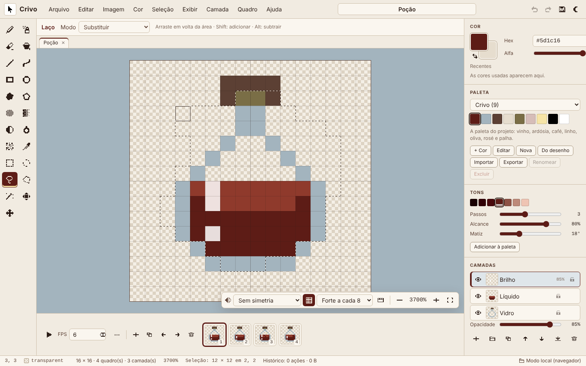
  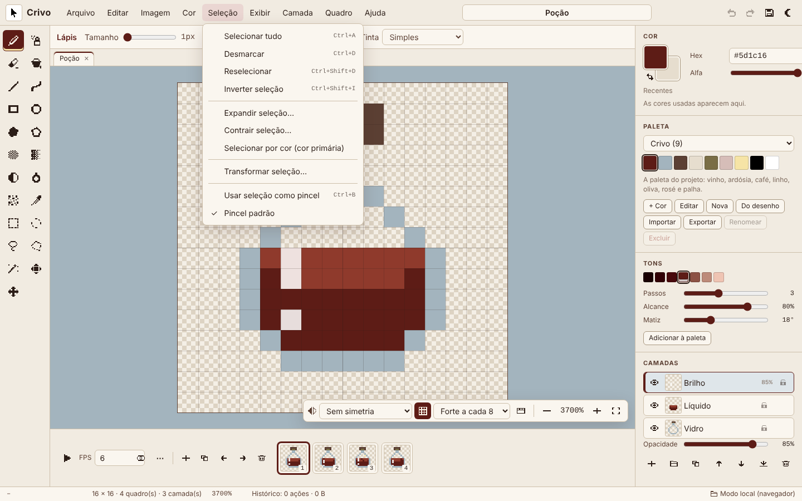
</p>

### Cor, paleta e ajustes

- **Modos de cor:** no **indexado**, toda cor vai para a mais próxima da paleta (também em traços, colagens e filtros), e mudar uma cor no editor de paleta recolore todas as células num único passo do histórico; no **tons de cinza**, tudo continua cinza.
- **Editor de paleta** (**Cor → Editar paleta…** ou o botão **Editar** do painel): editar, adicionar, remover e reordenar cores, ordenar por matiz, luminosidade ou saturação, inverter, tirar duplicadas, criar uma rampa entre duas cores e mudar o tamanho. Uma paleta predefinida editada é salva como paleta sua.
- **Ajustes:** prévia ao vivo, Cancelar volta ao que era e OK vira um passo do histórico; podem valer para todos os quadros da camada e respeitam a seleção.

<p align="center">
  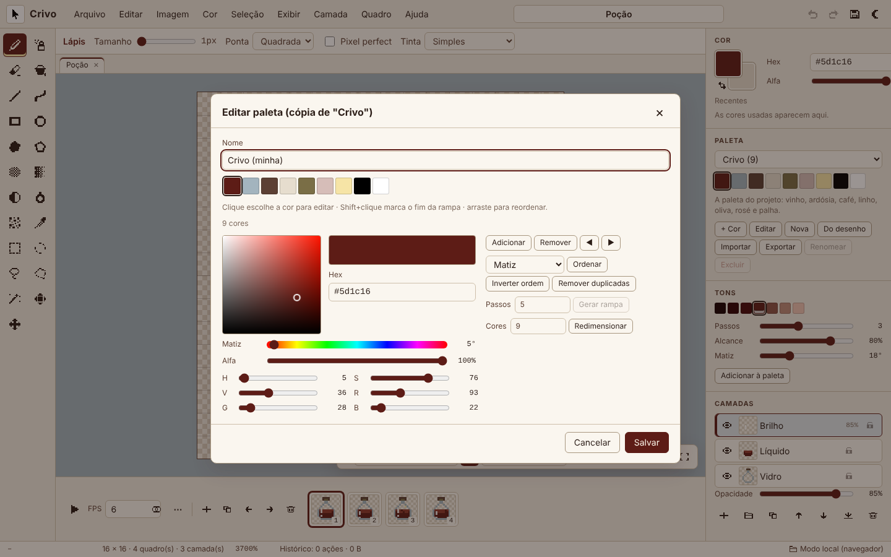
  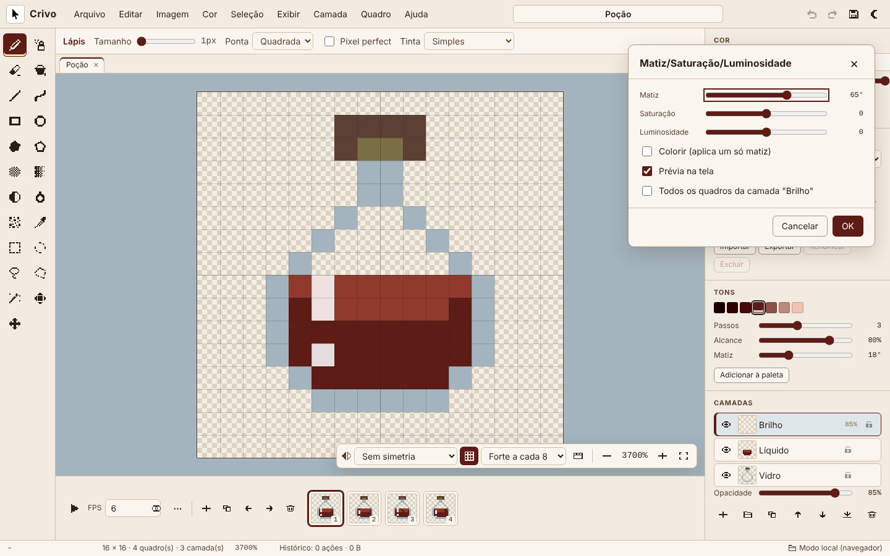
</p>

### Arquivos, abas e pré-visualização

| Formato | Abrir | Exportar | Detalhes |
|---|---|---|---|
| `.crivo` | Sim | Sim | Versão 2, com as chaves opcionais da 2.1.0 (veja [Formato `.crivo`](#formato-crivo)) |
| `.ase` | Sim | Sim | Abre 32 bits, tons de cinza de 16 bits e indexado de 8 bits, com camadas (visibilidade, bloqueio, opacidade, modo de mistura, grupos, fechados e referência), cels normais, vinculados, comprimidos e de tilemap, paletas, tags, slices e tilesets. Exporta em RGBA de 32 bits, com cels comprimidos e vinculados, grupos, modos, opacidade, referência, tags, slices, paleta, durações e tilesets |
| PNG animado (APNG) | — | Sim | **Arquivo → Exportar PNG animado (APNG)…**, com a duração de cada quadro e transparência total |
| Quadros em PNG (`.zip`) | — | Sim | **Arquivo → Exportar quadros em PNG (.zip)…**, um PNG por quadro |
| Sprite sheet + JSON | — | Sim | **Formato do JSON**: Crivo, hash (quadros por nome) ou array (lista de quadros), no layout de sprite sheet que Phaser, PixiJS e os importadores do Godot leem (`frames`, `meta.frameTags`, `meta.layers`, `meta.slices`) |
| PNG, JPEG, GIF, dados | Imagens | Sim | Como antes; camadas de referência ficam de fora |

- **Abas:** cada projeto aberto (novo, salvo, importado ou arrastado para a tela) ganha uma aba acima da matriz; clique do meio fecha. **Ctrl+Tab** e **Ctrl+Shift+Tab** andam entre elas.
- **Pré-visualização** (F7): uma janela com o quadro inteiro e o retângulo da parte visível; clicar ou arrastar move a visão, e ela tem a própria reprodução.
- **Arrastar e soltar:** `.crivo` e `.ase` abrem numa aba; imagens vão para o diálogo de importação.
- **Salvar como (2.2.0):** todas as exportações abrem a janela Salvar como, para escolher a pasta e o nome (no Firefox e no Safari, vão para Downloads).

<p align="center">
  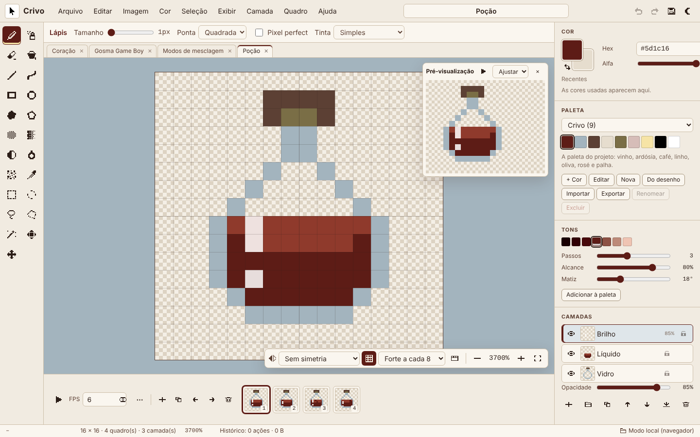
  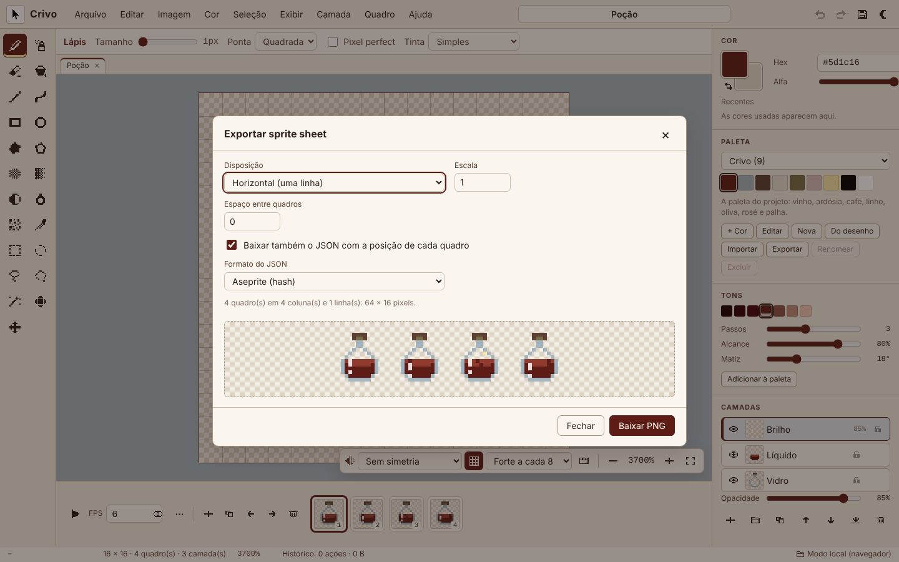
</p>

### Servidor, banco e Java

- A API v2 aceita e devolve os campos novos do documento, validados com mensagens em português; documentos da 2.0 vão e voltam sem mudança.
- O PNG e as exportações do servidor compõem grupos e modos de mistura e deixam de fora as camadas de referência, com os mesmos pixels do editor e da ferramenta em Java (um teste de paridade confere isso em 30 documentos aleatórios).
- A migração `0004_advanced_features` acrescenta `project.color_mode`; `layer.blend_mode`, `kind`, `parent_key`, `collapsed`, `tileset_key` e `reference`; `cell.link_frame_key` e `cell.tiles`; e as tabelas `tag`, `slice` e `tileset` (veja [Banco de dados](#banco-de-dados)).
- A ferramenta em Java lê os campos novos, compõe grupos e modos de mistura, mostra grupos, tipos, modos, modo de cor, tags, slices e tilesets no `info` e ganha o comando `tags`.

## Arquitetura

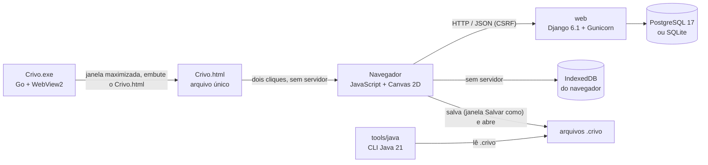

| Parte | Linguagem | Responsabilidade |
|---|---|---|
| `editor/static/editor/js/core` | JavaScript | Núcleo sem DOM: cores e OKLCH, geometria (Bresenham, elipse, curvas, polígonos, pincel, simetria, pixel perfect), flood fill, pontilhado de Bayer e degradês, seleção com máscara, filtros e ajustes, modos de mistura (`blend.js`), modos de cor (`colormode.js`), ferramentas de paleta, pincel personalizado (`brush.js`), transformação com RotSprite (`transform.js`), tilemaps (`tilemap.js`), tags e reprodução (`animation.js`), codificadores GIF, APNG (`apng.js`), ZIP (`zip.js`) e zlib (`zlib.js`), leitor e gravador `.ase` (`ase-file.js`), RLE, documento, histórico, formato `.crivo`, exportação e paletas; na 2.4.0, o motor de jogo em `game/` (física, comportamentos, regras, sons de 8 bits, formato `.crivojogo`, jogo de exemplo e a página `.html` exportada); na 2.5.0, o motor ganhou escadas, água, plataformas móveis, A*, raios, tweens, sinais, diálogos, luz, clima, câmera, salvar o progresso, desenho e grade espacial, e `pixelart.js` traz Scale2x/3x, sel-out, sombras, limpeza, redução de cores e rampas com desvio de matiz |
| `editor/static/editor/js/features` | JavaScript | Recursos da 2.1.0 que se ligam ao editor pelo ponto de extensão `install(app)` do `main.js`: `layers.js` (menus Camada e Quadro), `selection.js` (menu Seleção), `color.js` (menu Cor) e `files.js` (abrir, abas, exportações novas); na 2.3.0, `sketchbook.js` (menu Caderno); na 2.4.0, `game.js` (menu Jogo); na 2.5.0, `pixelart.js` (comandos novos do menu Imagem) |
| `editor/static/editor/js/ui` | JavaScript | Visor em canvas, ferramentas, painéis, diálogos, armazenamento e atalhos; na 2.1.0, também `layer-dialogs.js` (propriedades de camada e quadro, tags, slices, papel cebola), `palette-editor.js`, `color-picker.js`, `adjustments.js`, `tabs.js` e `minimap.js` (pré-visualização); na 2.2.0, `save-file.js` (janela Salvar como) e `tutorial.js` (tutorial rápido); na 2.4.0, `game-studio.js` (Estúdio de jogo) e `game-player.js` (a tela do jogo, a mesma do `.html` exportado) |
| `Crivo.exe` e `desktop/` | Go | App desktop para Windows, gerado por `scripts/build-desktop.js`: janela própria com o WebView2, maximizada (F11 alterna a tela cheia), com o `Crivo.html` embutido, atalho no menu Iniciar e a janela Salvar como nativa do Windows (`save_windows.go`) |
| `Crivo.html` | HTML + JavaScript | O editor inteiro num arquivo só, gerado por `scripts/build-portable.js`: abre direto do disco, sem servidor nem backend |
| `editor/` | Python (Django) | API REST, validação (inclusive dos campos da 2.1.0), versões dos projetos, paletas, exportação pelo servidor (dados e PNG, com grupos e os modos de mistura de `editor/blend.py`), cabeçalhos de segurança e limite de escritas |
| `tools/java` | Java 21 | Linha de comando: informações, tags, paleta, PNG, sprite sheet e matriz em Java a partir de um `.crivo`, com grupos e modos de mistura (`Blend.java`) |
| `postgres` | — | Fonte da verdade quando há servidor: projetos, camadas, quadros, células, tags, slices, tilesets, versões e paletas |

### Como a matriz é guardada

Cada pixel é um inteiro de 32 bits com os bytes `R, G, B, A` na ordem da memória, o mesmo layout do `ImageData`. Uma célula (quadro × camada) é codificada em RLE: para cada sequência de pixels iguais, o tamanho da sequência em varint (7 bits por byte) seguido dos 4 bytes da cor. Um sprite 32×32 com fundo transparente costuma caber em poucas dezenas de bytes. O mesmo formato é lido pelo JavaScript, pelo Python e pelo Java.

### Como o histórico funciona

| Ação | O que fica guardado |
|---|---|
| Traço pequeno (lápis, linha, forma, pontilhado, mover pixels, colar, filtros) | Índices alterados + cor antes + cor depois (12 bytes por pixel) |
| Mudança grande (balde ou degradê numa área enorme) | RLE da célula antes e depois |
| Estrutura (camadas, grupos, quadros, tags, slices, vínculos, tamanho, giro, recortar, aparar, modo de cor) | Instantâneo do documento inteiro em RLE |

Desfazer e refazer aplicam o lado "antes" ou "depois" da entrada. Uma nova ação apaga o futuro, como em qualquer editor.

<p align="center">
  
  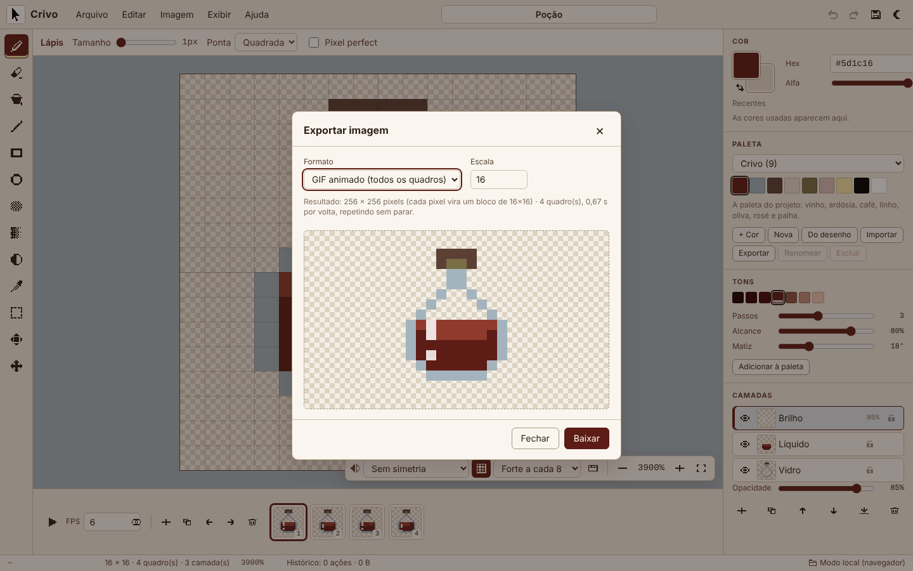
</p>

<p align="center">
  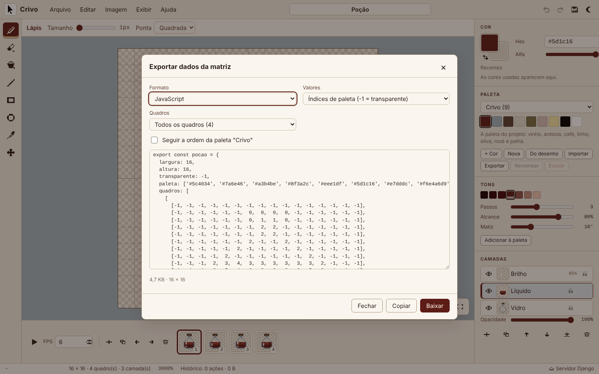
  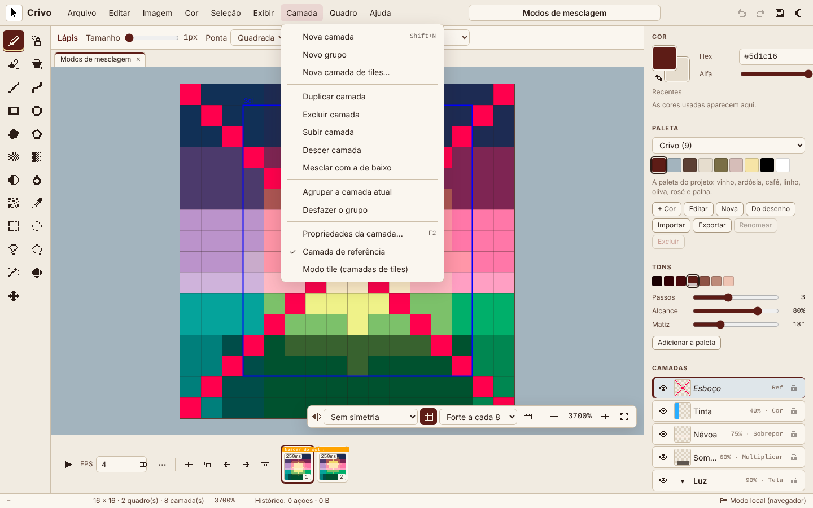
</p>

## Como rodar

O Crivo sobe de **três maneiras**. O editor é o mesmo nas três; o que muda é o que precisa estar instalado e onde os projetos ficam guardados. Os arquivos `.crivo` abrem em todas, então dá para levar um desenho de uma para outra.

| Maneira | Como subir | Precisa de | Onde ficam os projetos |
|---|---|---|---|
| **1. App desktop** (`Crivo.exe`) | Dois cliques no `Crivo.exe` (ou pesquise **Crivo** no menu Iniciar depois da primeira vez); abre **maximizado** | Windows 10 ou 11 (64 bits); nada para instalar | Neste computador, em `%LOCALAPPDATA%\Crivo`, e o `.crivo` na pasta que você escolher ao salvar |
| **2. Servidor local e backend** (Django + banco) | `start.cmd`, `./start.sh` ou `python manage.py runserver` | Docker Desktop, ou Python 3.12+ | No banco de dados (PostgreSQL ou SQLite), com histórico de versões e API |
| **3. Arquivo único** (`Crivo.html`) | Dois cliques no `Crivo.html`; abre no navegador | Um navegador atual; nada para instalar | No navegador em que foi aberto (IndexedDB) |

Para só desenhar no Windows, o app desktop é o caminho mais direto. Para usar a API, o histórico de versões ou guardar os projetos num banco, suba o servidor. Para abrir em qualquer sistema sem instalar nada, use o `Crivo.html`.

### 1. App desktop (Crivo.exe)

Baixe o [`Crivo.exe`](Crivo.exe) e dê dois cliques. O Crivo abre **maximizado** (janela cheia, com a barra de título e a barra de tarefas à vista), numa janela própria, sem servidor, sem backend e sem navegador. Não há instalador: o arquivo pode ficar em qualquer pasta.

- **F11** leva à tela cheia (sem barra de título nem barra de tarefas) e volta para a janela maximizada; **Alt+F4** (ou **Arquivo → Sair do Crivo**) fecha o app, gravando o rascunho antes.
- Na primeira vez que abre, o Crivo cria um atalho no **menu Iniciar** (só para o seu usuário, sem pedir administrador). Depois disso, basta pesquisar **Crivo** no Windows. Se você apagar o atalho, ele não volta, a não ser que o `Crivo.exe` seja aberto de outra pasta.
- **Ctrl+S** abre a janela **Salvar como** do Windows na primeira vez, para escolher a pasta e o nome do arquivo `.crivo`; depois, grava no mesmo arquivo. As exportações abrem a mesma janela.
- Na primeira abertura, o Crivo também oferece um **tutorial rápido** (dá para recusar; ele fica em **Ajuda → Tutorial rápido**).
- Projetos, paletas e o rascunho ficam em `%LOCALAPPDATA%\Crivo` e continuam lá na próxima vez, mesmo trocando o `.exe` por uma versão nova. A barra de status mostra **Desktop (este computador)**.
- Na primeira vez, o Windows pode mostrar **O Windows protegeu o computador**, porque o executável não tem assinatura digital paga: clique em **Mais informações → Executar assim mesmo**. O app não pede permissão de administrador.
- Usa o Microsoft Edge WebView2, que já vem no Windows 10 e 11. Se faltar, o Crivo avisa e oferece abrir a página de download da Microsoft.
- Por dentro, é um programa pequeno em Go ([`desktop/`](desktop/), cerca de 3 MB) com o `Crivo.html` embutido: o editor, os testes e a segurança são os mesmos do arquivo único.

Para gerar o `Crivo.exe` a partir do código (precisa do Node.js 20 e do Go; a versão exata fica em `desktop/go.mod`):

```bash
npm run desktop                   # atualiza o Crivo.html e gera o Crivo.exe na raiz
npm run desktop -- --check        # confere se o Crivo.exe do repositório corresponde ao código
```

O build é reproduzível: o mesmo código gera sempre o mesmo `Crivo.exe`, byte a byte, de qualquer sistema. O ícone é o logo do projeto ([`docs/images/logo.svg`](docs/images/logo.svg)), desenhado com pixels inteiros em cada tamanho do Windows, e as propriedades do arquivo trazem a versão e o copyright.

### 2. Servidor local e backend (editor + API + banco de dados)

#### Com Docker

Você só precisa do **Docker** com Docker Compose.

**Windows:** dê dois cliques em `start.cmd`.

**Linux ou macOS:**

```bash
./start.sh
```

Na primeira vez o script cria o arquivo `.env` com uma senha aleatória para o banco e uma chave secreta aleatória, sobe o PostgreSQL e a aplicação e abre **http://localhost:8080**.

| Endereço | O que é |
|---|---|
| http://localhost:8080 | Editor |
| http://localhost:8080/api/v2 | Lista das rotas da API |
| http://localhost:8080/api/v2/health | Saúde do banco |

#### Sem Docker (Python)

```bash
python -m venv .venv
. .venv/bin/activate              # no Windows: .venv\Scripts\activate
pip install -r requirements.txt
python manage.py migrate
python manage.py runserver        # http://localhost:8000
```

Sem configurar nada, o Django usa um arquivo SQLite (`crivo.sqlite3`). Para usar PostgreSQL, defina `CRIVO_DB_ENGINE=postgresql` e as variáveis `CRIVO_DB_*`. Ao atualizar uma instalação da 1.x, rode `python manage.py migrate` de novo: a migração `0003_english_schema` renomeia as tabelas e colunas para o inglês sem perder dados (com Docker, as migrações rodam sozinhas ao subir).

#### Só o editor, num servidor de arquivos (Node.js)

```bash
npm run serve                     # http://localhost:5173
```

Nesse modo não há API: projetos e paletas ficam no IndexedDB do navegador. Qualquer servidor de arquivos estáticos apontado para `editor/static/editor/` também funciona.

### 3. Arquivo único (Crivo.html)

Baixe o [`Crivo.html`](Crivo.html) e dê dois cliques. O editor abre no navegador direto da pasta, sem servidor local, sem backend e sem internet, com todas as ferramentas, camadas, animação e exportações.

Para usar sem baixar, abra a [versão online](https://ravelroot.github.io/Pixel-Art-Matrix-Editor/): é o mesmo `Crivo.html`, publicado no GitHub Pages, e os projetos também ficam guardados no navegador.

Os projetos e as paletas ficam guardados no navegador em que o arquivo foi aberto. No Chrome e no Edge, **Ctrl+S** também abre a janela **Salvar como** para gravar o `.crivo` na pasta que você escolher; nos outros navegadores, use **Arquivo → Baixar arquivo .crivo**, que vai para Downloads. Para continuar em outro computador, abra o arquivo com **Arquivo → Abrir arquivo…**.

O `Crivo.html` existe porque os navegadores não carregam módulos JavaScript de páginas abertas direto do disco: ele junta os módulos do editor num script só, embute o CSS e o ícone e traz a própria Content-Security-Policy. Depois de mudar o editor, rode `npm run portable` (o `npm run desktop` também faz isso).

## Usando a API

```bash
# listar projetos
curl http://localhost:8080/api/v2/projects

# criar um projeto a partir de um arquivo .crivo (com CRIVO_API_TOKEN definido no .env)
curl -H "Authorization: Bearer $TOKEN" -H "Content-Type: application/json" \
     -d "{\"data\": $(cat examples/potion.crivo)}" http://localhost:8080/api/v2/projects

# baixar a matriz do quadro 1 como módulo Python, pronta para o seu jogo
curl -o potion.py "http://localhost:8080/api/v2/projects/<id>/export?format=py&frame=1&download=1"

# ou como cabeçalho C e classe Java
curl -o potion.h "http://localhost:8080/api/v2/projects/<id>/export?format=c&download=1"
curl -o Pocao.java "http://localhost:8080/api/v2/projects/<id>/export?format=java&mode=hex&download=1"

# PNG do quadro 2 ampliado 8 vezes, gerado no servidor
curl -o potion.png "http://localhost:8080/api/v2/projects/<id>/png?frame=2&scale=8"
```

| Rota | O que faz |
|---|---|
| `GET /api/v2` | Nome, versão e lista das rotas |
| `GET /api/v2/health` | Saúde do servidor e do banco (`{"status", "version", "database"}`; 503 se o banco não responder) |
| `GET /api/v2/projects` | Lista os projetos (`{"projects": [...]}`; `q` filtra pelo nome) |
| `POST /api/v2/projects` | Cria um projeto (`data` no formato `.crivo`, `thumbnail` PNG opcional, `name`) |
| `GET/PUT/DELETE /api/v2/projects/{id}` | Abre (resumo + `data`), salva (com `revision` para detectar conflitos) e exclui |
| `GET /api/v2/projects/{id}/thumbnail` | Miniatura PNG |
| `GET /api/v2/projects/{id}/export` | Matriz em `format=json`, `csv`, `js`, `py`, `c` ou `java`, com `mode=indices` ou `hex`, de um quadro (`frame=N`) ou de todos (`frame=all`); `download=1` baixa o arquivo |
| `GET /api/v2/projects/{id}/png` | PNG de um quadro composto (`frame`, `scale` de 1 a 32, até 2048 px de lado, `download=1`), gerado em Python puro |
| `GET /api/v2/projects/{id}/revisions` | Versões anteriores guardadas a cada salvamento (`{"current_revision", "revisions": [...]}`) |
| `POST /api/v2/projects/{id}/revisions/{number}/restore` | Volta para uma versão |
| `GET/POST /api/v2/palettes` | Lista as paletas (`{"palettes": [...]}`; `presets=0` esconde as predefinidas) e cria uma nova (`name`, `colors`) |
| `GET/PUT/DELETE /api/v2/palettes/{id}` | Abre, altera e exclui uma paleta sua |

O resumo de um projeto traz `id`, `name`, `width`, `height`, `fps`, `revision`, `frames` e `layers` (quantidades), `thumbnail_url`, `created_at` e `updated_at`. Os erros vêm como `{"error": "mensagem"}`, com a mensagem em português; o conflito (409) inclui `current_revision`.

**Desde a 2.1.0**, o campo `data` aceita e devolve as chaves opcionais do formato (`colorMode`, `tags`, `slices` e `tilesets`; nas camadas, `blendMode`, `kind`, `parent`, `collapsed`, `tileset` e `reference`; nas células, `link` e `tiles`). Elas são validadas (modo de mistura conhecido, grupo que existe e não contém a si mesmo, tag apontando para quadros existentes, vínculo para uma célula da mesma camada, tiles dentro do tileset) e um erro responde 422 com a mensagem em português. Projetos sem essas chaves são gravados e devolvidos exatamente como na 2.0. O PNG e as exportações compõem grupos e modos de mistura e deixam de fora as camadas de referência.

> **Desde a 2.0.0**, a API fica em `/api/v2`, com rotas, parâmetros e campos em inglês. A `/api/v1` foi removida: scripts feitos para a 1.x precisam trocar o endereço e os nomes dos campos (veja o [CHANGELOG](CHANGELOG.md)). A API continua aceitando projetos no formato `.crivo` antigo no campo `data`.

Pedidos que alteram dados exigem o cookie CSRF do Django (o editor cuida disso) ou o cabeçalho `Authorization: Bearer <CRIVO_API_TOKEN>`. Acima de `CRIVO_WRITE_LIMIT` alterações por minuto vindas do mesmo IP, a API responde **429** com `Retry-After`; JSON inválido responde **422** e corpo acima do limite, **413**.

## Ferramenta em Java

A pasta [`tools/java`](tools/java) traz uma linha de comando sem dependências externas, só com o JDK 21:

```bash
cd tools/java
./crivo.sh info ../../examples/potion.crivo
./crivo.sh tags ../../examples/blend-modes.crivo
./crivo.sh palette ../../examples/heart.crivo
./crivo.sh png ../../examples/potion.crivo potion.png --scale 8 --frame 2
./crivo.sh sheet ../../examples/heart.crivo heart.png --layout grid --columns 2 --spacing 2
./crivo.sh matrix ../../examples/game-boy-slime.crivo --class Slime > Slime.java
./test.sh
```

No Windows, use `crivo.cmd` no lugar de `./crivo.sh`. A primeira execução compila as classes em `tools/java/out`.

| Comando | O que faz |
|---|---|
| `info <projeto>` | Nome, tamanho, quadros, FPS, camadas (com grupos, tipo, opacidade e modo de mistura), modo de cor, quantidade de cores, tags, slices e tilesets (só quando existem) |
| `tags <projeto>` | Lista as tags: nome, quadros, direção, repetições e cor (novo na 2.1.0) |
| `palette <projeto>` | Cores usadas, da mais usada para a menos usada |
| `png <projeto> <saida.png> [--frame N] [--scale N]` | Um quadro em PNG, ampliado por vizinho mais próximo |
| `sheet <projeto> <saida.png> [--layout horizontal\|vertical\|grid] [--columns N] [--spacing N] [--scale N]` | Sprite sheet |
| `matrix <projeto> [--frame N\|all] [--mode indices\|argb] [--class Nome]` | Classe Java com a matriz, na saída padrão |
| `check <projeto>` | Confere se o arquivo é um projeto válido |

Desde a 2.0.0, os comandos e as opções estão em inglês. Os nomes da 1.x (`paleta`, `folha`, `matriz`, `verificar`, `--quadro`, `--escala`, `--disposicao` com `grade`, `--colunas`, `--espaco`, `--modo`, `--classe` e o valor `todos`) continuam funcionando como apelidos, e a ajuda e as mensagens seguem em português. A ferramenta lê arquivos `.crivo` das versões 1 e 2, inclusive as chaves opcionais da 2.1.0: compõe grupos e os 19 modos de mistura com os mesmos pixels do editor e do servidor e deixa as camadas de referência fora do PNG e da sprite sheet.

Sprites grandes (mais de 4096 valores) saem numa classe compacta: a matriz vai em texto e é lida quando a classe carrega, porque um literal desse tamanho passaria do limite de 64 KB por método do Java. Quem usa a classe continua acessando `PALETTE` e `FRAMES` do mesmo jeito. O editor e a API geram o mesmo formato.

## Formato `.crivo`

É um JSON legível, salvo pelo **Ctrl+S** (na pasta escolhida na janela Salvar como) e por **Arquivo → Baixar arquivo .crivo** e aberto por **Arquivo → Abrir arquivo…**:

```json
{
  "format": "crivo",
  "version": 2,
  "name": "Poção",
  "width": 16,
  "height": 16,
  "fps": 6,
  "palette": ["#5d1c16", "#a3b4be"],
  "layers": [{ "id": "c1", "name": "Vidro", "visible": true, "opacity": 100, "locked": false }],
  "frames": [{ "id": "q1", "duration": null }],
  "cells": [{ "frame": "q1", "layer": "c1", "rle": "<RLE em base64>" }]
}
```

Esta é a versão 2 do formato, usada desde o Crivo 2.0.0, com as chaves em inglês. Arquivos da versão 1 (salvos pela 1.x, com `"formato"`, `"versao"`, `"largura"`, `"camadas"` etc.) continuam abrindo no editor, na API e na ferramenta em Java: são convertidos na leitura, e o próximo salvamento já grava a versão 2. Um arquivo com `version` maior que 2 foi salvo por um Crivo mais novo e é recusado.

A 2.1.0 continua gravando a versão 2, só com **chaves opcionais** novas, que leitores antigos ignoram e que só são gravadas quando diferem do padrão:

| Onde | Chave | Valor |
|---|---|---|
| Raiz | `colorMode` | `"rgba"` (padrão), `"indexed"` ou `"grayscale"` |
| Raiz | `tags` | `[{ "id", "name", "from", "to", "direction": "forward" \| "reverse" \| "pingpong", "repeat", "color" }]` (`from` e `to` são ids de quadros) |
| Raiz | `slices` | `[{ "id", "name", "color", "x", "y", "width", "height", "center": {x, y, width, height} \| null, "pivot": {x, y} \| null }]` |
| Raiz | `tilesets` | `[{ "id", "name", "tileWidth", "tileHeight", "tiles": ["<RLE em base64>", ...] }]` (o tile 0 é o vazio) |
| Camada | `blendMode`, `kind`, `parent`, `collapsed`, `tileset`, `reference` | Modo de mistura, `"image"` \| `"group"` \| `"tilemap"`, id do grupo, grupo fechado, id do tileset e camada de referência |
| Célula | `link`, `tiles` | Id do quadro da célula de origem (a célula continua com a própria cópia em `rle`) e o RLE dos índices de tiles (o `rle` guarda os pixels já desenhados) |

Assim, um `.crivo` da 2.1.0 aberto num Crivo 2.0 mostra os mesmos pixels (sem grupos, modos e tags), e um arquivo da 2.0 abre e salva igual na 2.1.0.

A pasta [`examples/`](examples) tem quatro projetos para abrir e estudar: uma poção com o líquido animado (`potion.crivo`), um coração batendo (`heart.crivo`), uma gosma na paleta do Game Boy (`game-boy-slime.crivo`) e um nascer do sol com grupo, modos de mistura, camada de referência, tag e slice (`blend-modes.crivo`, novo na 2.1.0).

## Configuração

As principais variáveis do `.env` (a lista completa está no manual):

| Variável | Padrão | O que faz |
|---|---|---|
| `CRIVO_PORT` | `8080` | Porta no navegador |
| `CRIVO_SECRET_KEY` | — | Chave do Django. Gerada pelos scripts; nunca publique a sua |
| `CRIVO_ALLOWED_HOSTS` | `localhost,127.0.0.1` | Endereços pelos quais o Crivo é acessado |
| `CRIVO_HTTPS` / `CRIVO_CSRF_TRUSTED_ORIGINS` | `false` / vazio | Use atrás de um proxy com HTTPS |
| `CRIVO_API_TOKEN` | vazio | Token para scripts alterarem dados pela API sem o cookie CSRF |
| `CRIVO_MAX_REVISIONS` | `20` | Quantas versões anteriores de cada projeto ficam guardadas |
| `CRIVO_WRITE_LIMIT` | `120` | Alterações por minuto aceitas de cada IP na API, contadas em cada processo do Gunicorn (`0` desliga) |
| `CRIVO_TRUSTED_PROXY` | `false` | Atrás de um proxy confiável, usa o último endereço de `X-Forwarded-For` como IP do cliente |
| `CRIVO_MAX_UPLOAD_MB` | `24` | Tamanho máximo do corpo dos pedidos |
| `CRIVO_HSTS_SECONDS` | `31536000` | Duração do HSTS quando `CRIVO_HTTPS=true` |
| `CRIVO_HSTS_SUBDOMAINS` / `CRIVO_HTTPS_REDIRECT` | `false` / `false` | Estende o HSTS aos subdomínios / faz o Django redirecionar HTTP para HTTPS |
| `CRIVO_DB_NAME` / `CRIVO_DB_USER` / `CRIVO_DB_PASSWORD` | `crivo` / `crivo` / — | PostgreSQL |
| `CRIVO_WORKERS` | `2` | Processos do Gunicorn |

Na 2.0.0, sete variáveis ganharam nomes em inglês: `CRIVO_TAMANHO_MAXIMO_MB` → `CRIVO_MAX_UPLOAD_MB`, `CRIVO_HSTS_SEGUNDOS` → `CRIVO_HSTS_SECONDS`, `CRIVO_HSTS_SUBDOMINIOS` → `CRIVO_HSTS_SUBDOMAINS`, `CRIVO_REDIRECIONAR_HTTPS` → `CRIVO_HTTPS_REDIRECT`, `CRIVO_MAX_REVISOES` → `CRIVO_MAX_REVISIONS`, `CRIVO_LIMITE_ESCRITAS` → `CRIVO_WRITE_LIMIT` e `CRIVO_PROXY_CONFIAVEL` → `CRIVO_TRUSTED_PROXY`. Os nomes antigos ainda funcionam quando o novo não está definido, mas estão obsoletos e podem sair numa versão futura: troque-os no seu `.env`.

<p align="center">
  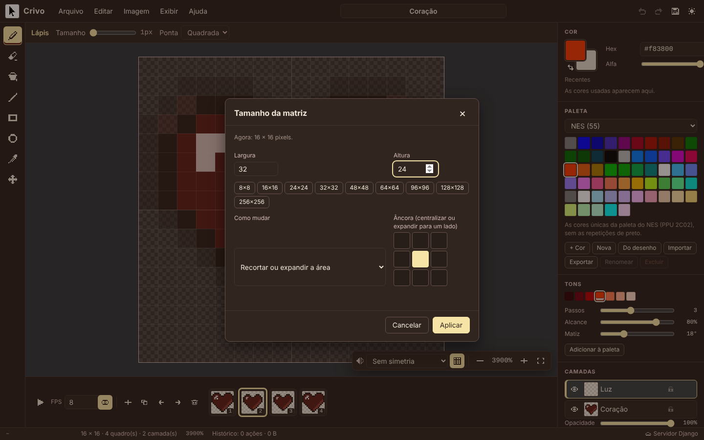
  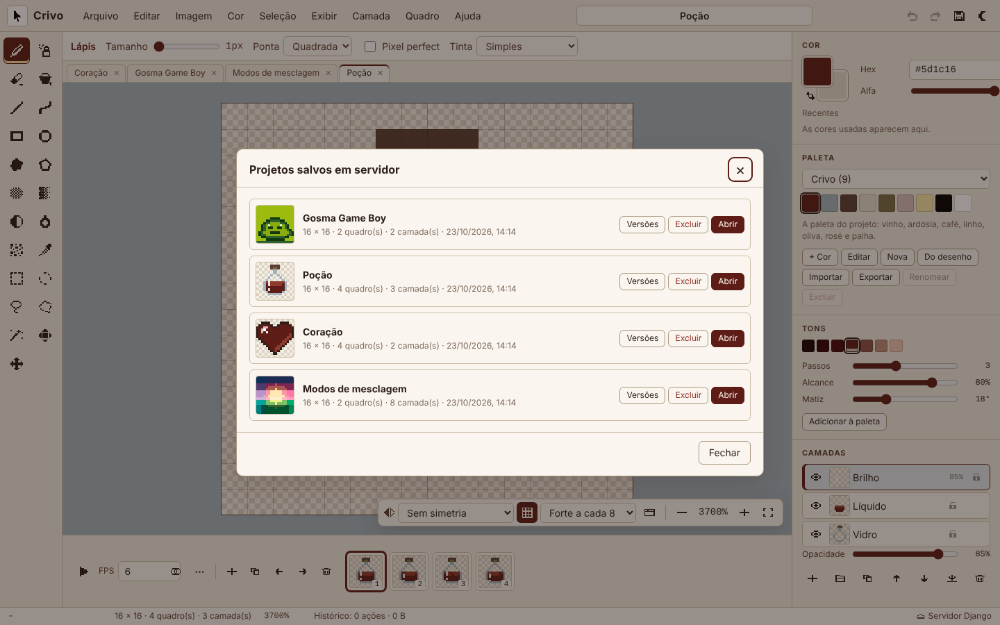
</p>

## Banco de dados

As tabelas são `project`, `layer`, `frame`, `cell`, `revision`, `palette` e `palette_color` e, desde a 2.1.0, `tag`, `slice` e `tileset` (o detalhe de cada campo está no [`Banco-de-Dados-Crivo.pdf`](Banco-de-Dados-Crivo.pdf)). A migração `0004_advanced_features` só acrescenta: toda coluna nova tem valor padrão ou aceita nulo, então os projetos existentes continuam iguais.

| Tabela | O que a 2.1.0 acrescenta |
|---|---|
| `project` | `color_mode` (`rgba`, `indexed` ou `grayscale`) |
| `layer` | `blend_mode` (19 valores), `kind` (`image`, `group` ou `tilemap`), `parent_key` (grupo), `collapsed`, `tileset_key` (só em tilemaps) e `reference` |
| `cell` | `link_frame_key` (célula vinculada) e `tiles` (RLE dos índices de tiles) |
| `tag` (nova) | `project_id`, `key`, `position`, `name`, `from_frame_key`, `to_frame_key`, `direction`, `repeat` e `color` |
| `slice` (nova) | `project_id`, `key`, `position`, `name`, `color`, `x`, `y`, `width`, `height`, `center_x/y/width/height` e `pivot_x/y` (todos ou nenhum) |
| `tileset` (nova) | `project_id`, `key`, `position`, `name`, `tile_width`, `tile_height`, `tile_count` e `tiles` (RLE de todos os tiles) |

Ao atualizar uma instalação, rode `python manage.py migrate` (com Docker, as migrações rodam sozinhas ao subir).

## Personalizando o Crivo

Dá para deixar o Crivo do seu jeito sem mexer no código:

| Quero... | Onde |
|---|---|
| Ter paletas minhas | **Cor → Editar paleta…** (ou o botão **Editar** do painel); uma paleta predefinida editada vira uma paleta sua |
| Criar rampas de sombra e luz | Gerador de tons, a partir da cor escolhida |
| Ajustar a visualização | Menu **Exibir**: grade (G), linha forte a cada 4, 8, 16 ou 32 pixels, papel cebola e **Configurar papel cebola…**, modo ladrilho e tema |
| Configurar o servidor | Variáveis do `.env` (veja [Configuração](#configuração)) |

Alterar o código-fonte, criar versões modificadas ou reaproveitar partes do código em outros projetos não é permitido pela [licença](#licença).

## Desenvolvimento e testes

```bash
npm test                                   # 170 testes do núcleo em JavaScript (Node 20+)
python manage.py test editor               # 72 testes da API Django (funcionamento, segurança, migrações e recursos da 2.1.0)
bash tools/java/test.sh                    # 36 testes da ferramenta em Java
python -m unittest discover -s tests/e2e   # 62 testes ponta a ponta no Chromium (Playwright): 30 com o Django e 32 no Crivo.html
npm run portable                           # gera o Crivo.html de novo a partir do código do editor
npm run desktop                            # gera o Crivo.exe (precisa do Go); -- --check só confere
ruff check .                               # estilo, bugs prováveis e regras de segurança no Python
bandit -q -r editor crivo -x editor/tests  # análise de segurança do Python
```

Para o teste ponta a ponta, instale antes `pip install playwright` e `python -m playwright install chromium`.

O `Crivo.html` é gerado a partir de `editor/static/editor/` por `scripts/build-portable.js`, sem bibliotecas: os módulos viram um único script embutido, o CSS e o ícone vão junto e a página ganha uma Content-Security-Policy própria. Ele existe porque o navegador não carrega módulos JavaScript de páginas abertas direto do disco. Depois de mudar o editor, rode `npm run portable`; o CI confere se o arquivo está em dia (`npm run portable -- --check`).

O `Crivo.exe` é gerado por `scripts/build-desktop.js`, que copia o `Crivo.html` para `desktop/`, desenha o ícone, grava a versão nas propriedades do arquivo e compila o código Go de `desktop/` para Windows de 64 bits. O build é reproduzível, e o CI gera o `.exe` de novo e compara byte a byte com o do repositório (`npm run desktop -- --check`), além de rodar o `go vet`. O GitHub Actions roda tudo isso a cada push (a API contra um PostgreSQL de verdade), além de `manage.py check --deploy`, gera os PNGs dos exemplos com a ferramenta em Java e constrói a imagem Docker.

## Qualidade e segurança

Resultado da rodada de testes da versão 2.5.0: **304 testes do núcleo, da API e da interface**, e nenhum problema apontado pelas ferramentas de análise; a ferramenta em Java passa nos seus 36 testes. Um teste ponta a ponta antigo, a migração das preferências da 1.x no `Crivo.html` aberto do disco, falha às vezes também na 2.4.0: o Chromium perde o `localStorage` de páginas `file://` recarregadas logo depois de gravar, e nada mudou nesse código. Na versão 1.1.0, uma revisão de código independente apontou 10 problemas (entre eles, desfazer durante um arraste embaralhava o histórico, a colagem furava o fundo ao ser movida e a classe Java de sprites médios não compilava); todos foram corrigidos e ganharam testes.

| Verificação | O que cobre | Resultado |
|---|---|---|
| Núcleo JavaScript (170) | Cores, geometria, flood fill, RLE, histórico, formato, exportação (inclusive Java compacta e C com muitas cores), pontilhado, degradês, pixel perfect, seleção, aparar, ladrilho, contorno, filtros e GIF (LZW de ida e volta); na 2.1.0, grupos, modos de mistura, tags, cels vinculados, tilemaps, slices, seleções com máscara, ferramentas novas, modos de tinta, pincel, transformação, modos de cor, ajustes, paleta, `.ase` de ida e volta, APNG, ZIP e o JSON hash e array da sprite sheet; na 2.3.0, paginação, leque das folhas, legenda das páginas, durações dos quadros, detecção de página em branco e leitura do nome e da foto de capa do Caderno; na 2.4.0, o motor de jogo: leitura do RLE igual à do editor, sprites, tags e tilesets, validação do `.crivojogo`, física de plataforma e de visão de cima, plataformas de mão única, itens, perigos, buracos e vidas, pisão nos inimigos, saídas e vitória, regras, objetos com eventos (criar, alarmes, passo com condições, teclas, colisão com herança do pai, destruir, saiu da cena e fim da animação), tiros, animações, as linguagens (Crivo Script, C++ adaptado e Lua: laços, funções, listas, tipos do C++, tabelas do Lua, chamadas entre as três, erros com a linha, limite de passos, terminal) e o código nos eventos, nas instâncias e nos scripts, sintetizador de 8 bits, melodias e a CSP com hash da página exportada; na 2.5.0, escadas, água, gelo e molas, pulo na parede e investida, plataformas móveis, molas e pontos de controle com volta ao morrer, diálogos com páginas e sinais, tweens e curvas, A* e raios, torres com linha de visão, áreas de gatilho, emissores de partículas, geradores de atores, a ação esperar, cenas persistentes, vibração do controle, barras de vida, números de dano, salvar e carregar, mapas e tabelas nas três linguagens, eventos de desenho, câmera, câmera lenta, hitstop, efeitos, luz, clima, grade espacial, mouse, tiles animados, a Fase 3 do exemplo e os comandos de pixel art (Scale2x, Scale3x, Scale4x, contornos, sombra, sombreamento, limpeza, redução de cores, mapa de degradê e rampa com desvio de matiz) | 170 de 170 |
| API Django (72) | Ciclo de projetos e paletas, revisões, conflitos, exportação, PNG, formatos C e Java (a classe grande é compilada e executada com o JDK quando ele existe), o conjunto de segurança abaixo, as migrações e os campos da 2.1.0 (validação, ida e volta, documentos da 2.0 inalterados) | 72 de 72 |
| Ferramenta Java (36) | Leitura do `.crivo`, RLE, PNG, sprite sheet e matriz, inclusive uma classe grande compilada em memória com o compilador do JDK; na 2.1.0, chaves opcionais, modos de mistura, grupos, `info` e `tags` | 36 de 36 |
| Paridade de composição | 30 documentos aleatórios com os 19 modos de mistura, grupos (inclusive "pass-through" normais a 100%) e camadas ocultas ou de referência, compostos no editor (JS), no servidor (Python) e na ferramenta Java (`tests/fixtures/blend-parity.json`) | Mesmos pixels nos três |
| Interface (62) | Editor aberto no Chromium de dois jeitos, contra o Django e como `Crivo.html` direto do disco, inclusive a integração com o app desktop (F11, sair e rascunho): cada ferramenta nova, seleção, colagem flutuante, gestos protegidos (Ctrl+Z no meio do arraste, setas no menu), comandos de imagem, desfazer, preferências inválidas, salvar no servidor e no navegador, baixar e reabrir o `.crivo`, baixar o PNG e o GIF, na 2.1.0 laço, varinha mágica, polígono, curva e modos de tinta, e na 2.2.0 a janela Salvar como (no navegador e no app desktop, com cancelar e Salvar como…) e o tutorial rápido (aparece uma vez, pode ser recusado e cobre as 23 ferramentas), e na 2.3.0 o Caderno (menu próprio, F8, estante, abrir, virar, fim, ocultar as pixel arts, Esc, editar a página e nome e foto de capa), e na 2.4.0 o Estúdio de jogo (F9, pintar tiles, colocar atores, eventos do ator, desfazer e refazer, rascunho no navegador, testar com F5 e Esc, usar o desenho como sprite, exportar a página `.html` e jogar nela, salvar o `.crivojogo`, aba Código, terminal em Lua e C++ no sandbox e no jogo rodando, editor de código), e na 2.5.0 o menu Imagem (Scale2x com desfazer, sombreamento, redução de cores e sel-out), a rampa com desvio de matiz do menu Cor e a Fase 3 no estúdio (campos de luz e clima, fala do NPC, área de gatilho, tiles animados, diálogo no teste, escada e gravação em GIF), sem nenhum erro no console nem violação de CSP | 61 de 62 (a falha intermitente explicada acima) |
| Ruff e Bandit | Estilo, bugs prováveis e padrões inseguros no Python | 0 problemas |
| App desktop | Build reproduzível do `Crivo.exe` (gerado de novo e comparado byte a byte) e `go vet` no código Go | Idêntico; 0 problemas |
| `check --deploy` | Configuração de produção do Django | Só avisos opcionais (HSTS em subdomínios, preload e redirecionamento HTTPS, que ficam a cargo do proxy) |

Os testes de segurança (`editor/tests/test_security.py`) conferem:

- **Cabeçalhos** em todas as respostas: `Content-Security-Policy` (só scripts do próprio site, sem `eval`, sem objetos, sem ser embutido em outras páginas), `X-Frame-Options: DENY`, `X-Content-Type-Options: nosniff`, `Referrer-Policy`, `Cross-Origin-Opener-Policy`, `Permissions-Policy` e `Cache-Control: no-store` nas respostas JSON; HSTS só quando há HTTPS.
- **Autenticação das escritas:** sem cookie CSRF ou token a API recusa (403); tokens errados, vazios, sem `Bearer` ou com um caractere a menos também; o token não vale fora de `/api/`.
- **Entradas maliciosas:** JSON aninhado 100 mil níveis (não derruba o servidor), corpo que não é objeto, corpo grande demais (413), miniatura falsa (SVG com script, HTML, base64 inválido, PNG acima de 512 KB), tamanhos e quantidades fora dos limites, RLE corrompido, IDs e parâmetros inválidos e métodos não permitidos.
- **Nome com HTML ou comandos:** volta como texto no JSON e vira um nome de arquivo seguro (`[A-Za-z0-9_-]`) nos downloads.
- **Limite de escritas por IP** (429 com `Retry-After`; leituras e pedidos já recusados pelo CSRF não contam; atrás de proxy confiável o IP vem do `X-Forwarded-For` sem aceitar endereços forjados pelo cliente) e **chave secreta fraca**: com `CRIVO_DEBUG=false`, o servidor não inicia com a chave de exemplo ou com menos de 32 caracteres.

No editor, nenhum dado do usuário passa por `innerHTML`, preferências gravadas no navegador só são aceitas se estiverem na lista de valores válidos, e os atalhos do teclado ficam bloqueados enquanto um gesto do mouse está em andamento (só o Esc vale, para cancelar): nomes de projetos, camadas e paletas entram sempre como texto, e o servidor de arquivos em Node (`npm run serve`) envia os mesmos cabeçalhos de segurança do Django. O `Crivo.html` leva a própria Content-Security-Policy numa tag `<meta>`: só executa o script embutido nele (conferido por hash SHA-256), não carrega nada de fora e não abre nenhuma conexão de rede (`connect-src 'none'`). O app desktop carrega esse mesmo arquivo, roda sem permissão de administrador, não abre portas, desliga as ferramentas de desenvolvedor e o menu de contexto do navegador e só grava arquivos que você escolheu na janela Salvar como.

### Estrutura

```text
Crivo.exe                   app desktop para Windows, que abre maximizado (gerado)
Crivo.html                  o editor inteiro num arquivo só, que abre sem servidor (gerado)
desktop/                    código do app desktop em Go (janela WebView2, tela cheia, atalho no menu Iniciar, janela Salvar como, manifesto)
editor/                     aplicação Django (modelos, API, validação, exportação, versões)
  static/editor/            o editor: index.html, css/, img/ e js/
    js/core/                núcleo em JavaScript, sem DOM, testado no Node
      game/                 motor de jogo: física, regras, sons, formato .crivojogo, exportação e jogo de exemplo
    js/features/            recursos ligados pelo install(app): camadas, seleção, cor, arquivos, Caderno, Jogo e pixel art
    js/ui/                  interface: visor, ferramentas, painéis, diálogos, abas, pré-visualização, armazenamento, salvar como, tutorial, Caderno e Estúdio de jogo
  migrations/               esquema do banco, paletas predefinidas, nomes em inglês (0003) e recursos avançados (0004)
  tests/                    testes da API e de segurança
crivo/                      configurações do projeto Django
tools/java/                 linha de comando em Java 21
tests/js/                   testes do núcleo em JavaScript
tests/fixtures/             documentos do teste de paridade dos modos de mistura (JS, Python e Java)
tests/e2e/                  teste ponta a ponta da interface (Playwright)
examples/                   projetos .crivo de exemplo (formato 2), inclusive blend-modes.crivo, e o jogo de exemplo gotinha.crivojogo
scripts/                    servidor estático em Node, geradores do Crivo.html e do Crivo.exe e criação do .env no Windows
docs/                       manuais em PDF e imagens do README
.github/workflows/          CI (testes, Ruff, Bandit, check --deploy, Playwright, Docker e build do Crivo.exe) e publicação no GitHub Pages
ruff.toml                   regras do Ruff
```

### Componentes de terceiros

O Crivo depende de componentes com licenças próprias, que continuam valendo para cada um deles:

| Componente | Uso no projeto | Licença |
|---|---|---|
| [Django](https://www.djangoproject.com/) | Back-end e API | BSD-3-Clause |
| [WhiteNoise](https://whitenoise.readthedocs.io/) | Entrega dos arquivos estáticos | MIT |
| [Gunicorn](https://gunicorn.org/) | Servidor de aplicação | MIT |
| [psycopg](https://www.psycopg.org/) | Driver do PostgreSQL | LGPL-3.0 |
| [Playwright](https://playwright.dev/python/) | Teste ponta a ponta (só no desenvolvimento) | Apache-2.0 |
| [Ruff](https://docs.astral.sh/ruff/) | Análise estática do Python (só no desenvolvimento) | MIT |
| [Bandit](https://bandit.readthedocs.io/) | Análise de segurança do Python (só no desenvolvimento) | Apache-2.0 |
| [go-webview2](https://github.com/jchv/go-webview2) | Janela do app desktop com o WebView2 (embutido no `Crivo.exe`) | MIT |
| [go-winloader](https://github.com/jchv/go-winloader) | Carregamento do WebView2 pelo go-webview2 (embutido no `Crivo.exe`) | ISC |
| [golang.org/x/sys](https://pkg.go.dev/golang.org/x/sys) | Chamadas ao Windows no app desktop (embutido no `Crivo.exe`) | BSD-3-Clause |
| [goversioninfo](https://github.com/josephspurrier/goversioninfo) | Ícone, versão e manifesto do `Crivo.exe` (só no build) | MIT |

O Microsoft Edge WebView2 Runtime faz parte do Windows e não é redistribuído no `Crivo.exe`. O editor não usa bibliotecas externas: os ícones são desenhados em pixel art no próprio código e a interface usa as fontes do sistema. PostgreSQL roda como serviço externo via Docker e não é redistribuído neste repositório; ele segue a licença da sua própria imagem.

As paletas Game Boy, NES, Pico-8, CGA e Commodore 64 reproduzem as cores dos respectivos sistemas apenas como referência. Os nomes pertencem aos seus donos.

## Licença

Copyright (©) 2026 Erik Pimenta. Todos os direitos reservados.

O Crivo é distribuído sob uma [licença de uso](LICENSE) própria:

| Pode | Não pode |
|---|---|
| Baixar e usar de graça, como app desktop, servidor local ou `Crivo.html` | Modificar o Crivo ou criar versões derivadas |
| Configurar pelo `.env` e pelas preferências e paletas do editor | Copiar o código, no todo ou em parte, para outros projetos |
| Usar como quiser o que você cria ou exporta, inclusive em jogos comerciais | Redistribuir, publicar ou vender o Crivo |

Para pedir uma autorização que a licença não dá, fale com o autor pelo [GitHub](https://github.com/ravelroot). O texto completo está em [`LICENSE`](LICENSE).
