<p align="center">
  
</p>

<h1 align="center">Crivo<br><sub><sup><sup><sub>Copyright (©) 2026 Erik Pimenta</sub></sup></sup></sub></h1>

<p align="center">
  Editor de pixel art que roda no navegador e trata a imagem como ela é: uma matriz de pixels RGBA. Desenhe com lápis, spray, balde, linhas, curvas, formas, pontilhado e degradês, selecione com retângulo, elipse, laço ou varinha mágica, organize em camadas e grupos com modos de mistura, anime quadro a quadro com tags e cels vinculados e exporte PNG, GIF e PNG animados, sprite sheets, arquivos <code>.ase</code> com camadas ou a própria matriz em JSON, CSV, JavaScript, Python, C e Java para usar direto no seu jogo.<br>
  Roda de três maneiras: app desktop para Windows (<code>Crivo.exe</code>), servidor local com backend ou arquivo único no navegador (<code>Crivo.html</code>).<br>
  Pronto para baixar e usar.
</p>

<p align="center">
  JavaScript (módulos ES, Canvas 2D) · HTML5 · CSS3 · Python 3.13 · Django 6.1 · PostgreSQL 17 · Java 21 · Go 1.24 + WebView2 (app desktop) · Docker Compose · Node Test Runner · Playwright · Ruff · Bandit
</p>

---

> **Manual completo:** [`Manual-Crivo.pdf`](Manual-Crivo.pdf) explica as três maneiras de rodar (app desktop, servidor local e arquivo único), cada uma das 23 ferramentas, seleção, camadas e grupos, modos de mistura, tags, tilemaps, slices, cor e paletas, ajustes, arquivos `.ase`, abas, exportação, a matemática por trás dos algoritmos (Bresenham, flood fill, OKLCH, pontilhado de Bayer, LZW do GIF, RLE), a API, a ferramenta em Java, a configuração, a segurança, os testes e a solução de problemas, passo a passo (cópia em [`docs/`](docs/Manual-Crivo.pdf)).

> **Banco de dados:** [`Banco-de-Dados-Crivo.pdf`](Banco-de-Dados-Crivo.pdf) traz o diagrama de relacionamentos, todas as tabelas (inclusive `tag`, `slice` e `tileset`, da 2.1.0) com campos, tipos, chaves e restrições, o formato binário das células, o controle de versões, consultas prontas, como preparar o PostgreSQL e as regras de integridade e segurança dos dados.

> **Versão 2.1.1 (Atual)** o Crivo deixou a licença MIT e passou a ter uma licença de uso própria. Você pode baixar e usar de graça, e o que você cria com ele é seu; modificar, copiar o código e redistribuir não são permitidos. Nada muda no editor. Detalhes em [Licença](#licença).

<p align="center">
  
</p>

## O que o Crivo faz

- **Ferramentas de desenho:** 23 ao todo. Lápis com pincel quadrado ou redondo de 1 a 32 px e modo **pixel perfect** (tira os cantos em L dos traços), spray, borracha (transparente ou com a cor secundária), balde de tinta com 4 ou 8 vizinhos, tolerância e modo global, linha, curva, retângulo, elipse e polígono (vazados ou preenchidos, com Shift para 45°, quadrado e círculo perfeitos), contorno livre, desfocar, embaralhar e conta-gotas, com **modos de tinta** (simples, composição alfa, travar alfa e atrás) e **pincel personalizado** feito de uma seleção.
- **Pontilhado e degradê:** pincel de pontilhado com o padrão de Bayer 4×4 em sete densidades (de 12,5% a 87,5%) e **degradê pontilhado** linear ou radial entre a cor primária e a secundária, com matriz de Bayer 2×2, 4×4 ou 8×8. O padrão é fixo na matriz, então traços vizinhos se encaixam sem emendas.
- **Clarear e escurecer:** um pincel que sobe ou desce cada pixel um degrau na rampa da paleta (ordenada por luminosidade OKLab) ou soma/subtrai luz no OKLCH mantendo matiz e croma. Botão esquerdo clareia, direito escurece.
- **Seleção e área de transferência:** seleção retangular (S), elíptica (Shift+S), laço (A), laço poligonal (Shift+A) e varinha mágica (W), com os modos substituir, somar (Shift), subtrair (Alt) e interseção (Shift+Alt), inverter, expandir, contrair, reselecionar e transformar (rotação em qualquer ângulo com RotSprite, escala e espelho); a seleção, de qualquer forma, limita todas as ferramentas de pintura; **mover pixels** (V) com o mouse ou as setas, copiar, recortar, colar, apagar, selecionar tudo e desmarcar. A colagem flutua sobre o fundo: dá para arrastá-la, levar até fora da borda e trazer de volta sem furar nem perder pixels.
- **Comandos de imagem:** recortar para a seleção, aparar bordas transparentes, adicionar contorno (4 ou 8 vizinhos), converter para a paleta atual (cor mais próxima no OKLab), substituir uma cor por outra em todos os quadros, espelhar só a seleção, inverter cores, tons de cinza e deslocar meia matriz para pintar emendas de tiles.
- **Matriz de verdade:** cada camada é um `Uint32Array` com os canais RGBA de cada pixel. A tela é composta direto num `ImageData` e ampliada sem suavização, então o que você vê é exatamente o que será exportado.
- **Camadas e animação:** camadas com visibilidade, opacidade, bloqueio, duplicação e mescla, **grupos** que abrem e fecham, **19 modos de mistura**, camadas de **referência** e camadas de **tiles**; quadros com duração própria, duplicação, reordenação, FPS, **cels vinculados**, **tags** (para frente, para trás ou pingue-pongue, com repetições), papel cebola configurável e reprodução.
- **Histórico ilimitado sem estourar a memória:** cada traço guarda só os pixels que mudaram; mudanças grandes viram RLE da célula inteira; ações estruturais guardam instantâneos comprimidos. A barra de status mostra quanto o histórico ocupa.
- **Visualização:** vários projetos abertos em **abas**, janela de **pré-visualização** (F7), zoom no ponto do cursor (100% a 12800%), arrastar com espaço ou botão do meio, ajustar à tela, grade com linha forte a cada 4, 8, 16 ou 32 pixels, **modo ladrilho** (repete o desenho 3×3 para conferir texturas) e simetria horizontal, vertical ou nos dois eixos.
- **Tamanho da matriz:** de 1×1 a 1024×1024, com âncora de nove posições para centralizar ou expandir para um lado, ou escalando o desenho por vizinho mais próximo. Também gira 90° e espelha camadas.
- **Paletas e cor:** Crivo, Game Boy, NES, Pico-8, CGA, CGA modo 4, Commodore 64 e 1 bit já incluídas. Crie, renomeie, importe (`.hex`, `.gpl`, `.json`, `.txt` do Paint.NET) e exporte as suas, gere uma paleta a partir das cores do desenho ou edite tudo no **editor de paleta**. Modos de cor **RGBA**, **indexado** (com pontilhado opcional) e **tons de cinza**, seletor HSV com alfa e **ajustes** com prévia: brilho e contraste, matiz/saturação/luminosidade, curva de cores, posterizar, remover ruído e matriz de convolução.
- **Gerador de tons:** a partir da cor escolhida, cria rampas de sombra e luz no espaço de cor OKLCH, com o desvio de matiz típico da pixel art (sombras puxam para o azul, luzes para o amarelo).
- **Importação e exportação:** PNG e JPEG em tamanho real ou ampliados por vizinho mais próximo; **GIF animado** com transparência e a duração de cada quadro (codificador LZW próprio, sem bibliotecas); **PNG animado (APNG)** e quadros em PNG num `.zip`; arquivos **`.ase`** com camadas, tags e slices (abrir e exportar); sprite sheet horizontal, vertical ou em grade, com JSON das posições no formato do Crivo ou nos formatos hash e array que os motores de jogo leem; dados da matriz em JSON, CSV, JavaScript, Python, C e Java; importação de imagens com detecção automática do tamanho do pixel e fatiamento de sprite sheets.
- **Salva onde você estiver:** no app desktop, projetos e paletas ficam neste computador; com o servidor Django, vão para o banco de dados, com histórico de versões; no [`Crivo.html`](Crivo.html), ficam no navegador (IndexedDB). Um rascunho automático recupera o trabalho se a janela fechar.
- **Seguro por padrão:** Content-Security-Policy restrita, CSRF, token de API comparado em tempo constante, limite de escritas por IP, validação de tudo que chega à API e recusa de iniciar em produção com chave secreta fraca. Detalhes em [Qualidade e segurança](#qualidade-e-segurança).

<p align="center">
  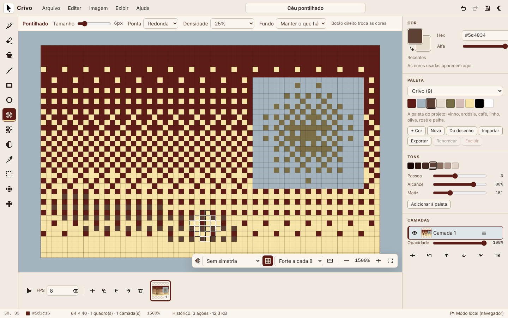
  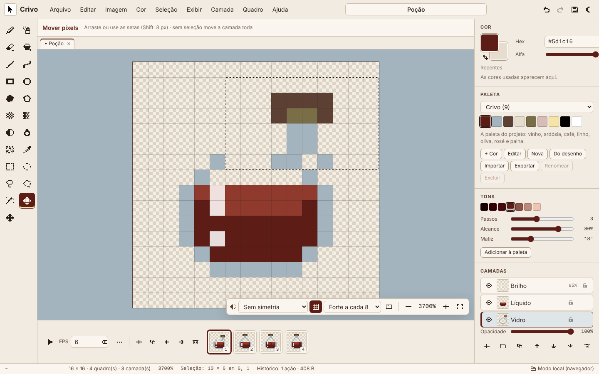
</p>

<p align="center">
  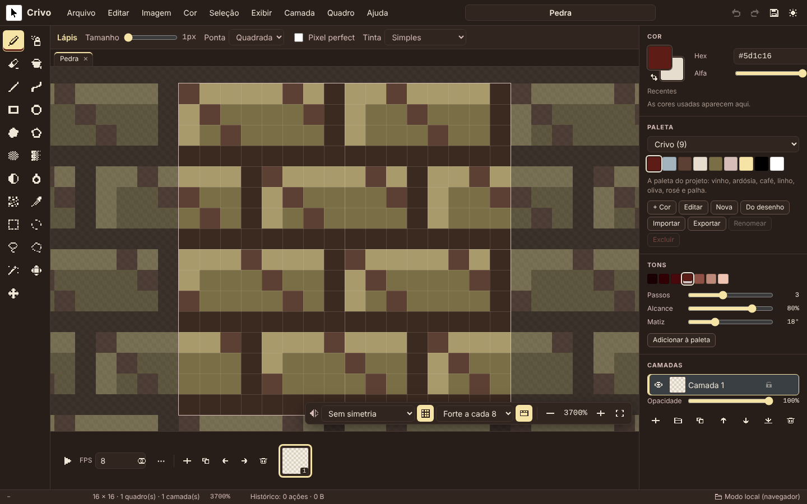
  
</p>

## Recursos avançados (2.1.0)

A versão 2.1.0 traz para o Crivo os recursos de um editor de pixel art completo: camadas em grupos, modos de mistura, animação com tags, tilemaps, slices, modos de cor e arquivos `.ase` com camadas, tudo escrito do zero (o formato `.ase` foi implementado a partir da especificação pública).

<p align="center">
  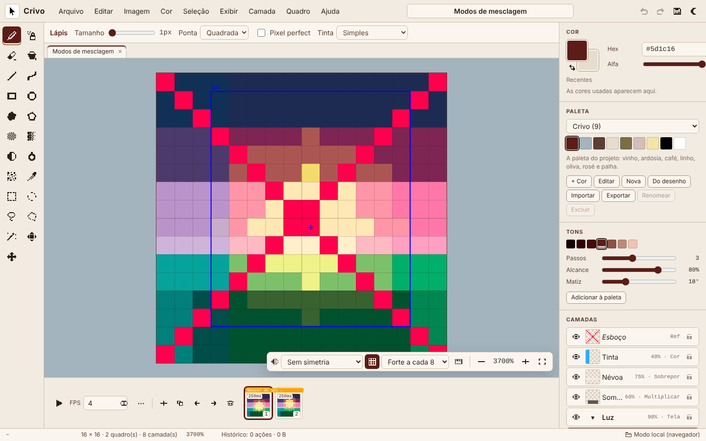
  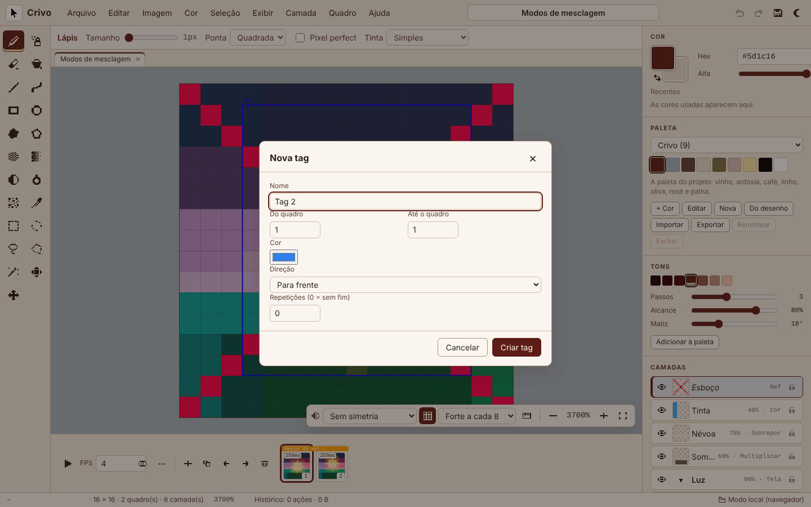
</p>

### Camadas, grupos e modos de mistura

- **Grupos:** **Camada → Novo grupo** ou **Agrupar a camada atual**; o grupo abre e fecha (▸/▾) e as camadas de dentro aparecem recuadas. A visibilidade, a opacidade e o modo de mistura do grupo valem para tudo o que está nele. Um grupo **normal a 100%** é "pass-through": as camadas de dentro se misturam direto com o que está abaixo; com outro modo ou opacidade, o conteúdo é composto à parte e misturado como uma camada só.
- **Modos de mistura (19):** normal, multiplicar, tela, sobrepor, escurecer, clarear, subexposição de cor, superexposição de cor, luz forte, luz suave, diferença, exclusão, matiz, saturação, cor, luminosidade, adição, subtração e divisão, escolhidos em **Propriedades da camada…** (F2 ou duplo clique na camada). O normal continua idêntico, bit a bit, ao da 2.0.
- **Camada de referência:** aparece no editor, mas fica fora de todas as exportações (PNG, GIF, sprite sheet, dados, servidor e Java).
- **Camadas de tiles:** **Nova camada de tiles…** cria um tileset (tamanho do tile) e um tilemap. No **modo tile**, o lápis põe o tile escolhido, a borracha põe o tile 0 (vazio) e o conta-gotas pega um tile; no **modo pixel**, editar um tile atualiza todas as cópias. O painel mostra os tiles e o botão **+ Tile**.

### Animação: tags, cels vinculados e papel cebola

- **Tags:** **Quadro → Nova tag…** dá nome, cor, primeiro e último quadro, direção (para frente, para trás ou pingue-pongue) e repetições (0 = sem fim). As tags aparecem como faixas coloridas acima dos quadros (clique para editar) e a reprodução fica presa na tag do quadro atual.
- **Cels vinculados:** **Novo quadro vinculado** e **Vincular célula a quadros…** fazem vários quadros dividirem a mesma célula: editar uma muda todas. O "∞" marca as células vinculadas; **Desvincular célula** faz uma cópia independente.
- **Duração por quadro:** **Propriedades do quadro…** (ou duplo clique no quadro) define a duração em ms, mostrada na linha do tempo.
- **Papel cebola configurável:** **Exibir → Configurar papel cebola…** (ou o botão "⋯" da linha do tempo) mostra de 0 a 3 quadros antes e depois, normal ou tingido de vermelho e azul.
- **Slices:** **Exibir → Editar slices…** cria áreas com nome, cor, retângulo, centro de 9-slice e pivô opcionais, exportadas no `.ase` e no JSON da sprite sheet; **Exibir → Slices** mostra ou esconde as áreas.

### Ferramentas e atalhos

| Ferramenta | Atalho | Ferramenta | Atalho |
|---|---|---|---|
| Lápis | `B` | Spray **(novo)** | `Shift+B` |
| Borracha | `E` | Balde de tinta | `F` |
| Linha | `L` | Curva **(novo)** | `Shift+L` |
| Retângulo | `R` | Elipse e círculo | `O` |
| Contorno livre **(novo)** | `Shift+D` | Polígono **(novo)** | `Shift+O` |
| Pontilhado | `D` | Degradê pontilhado | `U` |
| Clarear e escurecer | `Q` | Desfocar **(novo)** | `Shift+Q` |
| Embaralhar **(novo)** | `Shift+J` | Conta-gotas | `I` |
| Seleção retangular | `S` | Seleção elíptica **(novo)** | `Shift+S` |
| Laço **(novo)** | `A` | Laço poligonal **(novo)** | `Shift+A` |
| Varinha mágica **(novo)** | `W` | Mover pixels | `V` |
| Mover a visão | `H` | | |

- **Polígono, laço poligonal e curva:** clique nos pontos; duplo clique, Enter ou clicar no primeiro ponto fecha; Backspace tira o último ponto e Esc cancela.
- **Modos de seleção** (em todas as ferramentas de seleção e na barra de opções): substituir, somar (Shift), subtrair (Alt) e interseção (Shift+Alt). Seleções de qualquer forma valem para copiar, recortar, colar, apagar, balde, degradê, filtros, substituir cor, recortar para a seleção e mover pixels.
- **Modos de tinta** (opção **Tinta** no lápis, linha, retângulo, elipse, spray, curva, contorno e polígono): Simples, Composição alfa, Travar alfa e Atrás.
- **Pincel personalizado:** **Seleção → Usar seleção como pincel** (Ctrl+B) transforma a seleção num pincel; **Pincel padrão** volta ao normal.

| Atalho novo | Ação |
|---|---|
| `Shift+N` / `Alt+N` | Nova camada / novo quadro |
| `F2` | Propriedades da camada |
| `F7` | Pré-visualização |
| `Ctrl+Tab` / `Ctrl+Shift+Tab` | Próxima aba / aba anterior |
| `Ctrl+U` / `Ctrl+M` | Matiz, saturação e luminosidade / curva de cores |
| `Ctrl+B` | Usar a seleção como pincel |
| `Ctrl+Shift+D` / `Ctrl+Shift+I` | Reselecionar / inverter a seleção |
| `Shift` / `Alt` / `Shift+Alt` com uma ferramenta de seleção | Somar, subtrair ou fazer a interseção |

A lista completa fica em **Ajuda → Atalhos do teclado** (`?`).

### Menus

| Menu | Comandos |
|---|---|
| Arquivo | Novo projeto, projetos salvos, **abrir arquivo** (`.crivo`, `.json` e `.ase`, numa aba nova), importar imagem ou sprite sheet, **fechar projeto (aba)**, salvar, salvar como cópia, baixar `.crivo`, **exportar como `.ase`**, exportar imagem, GIF animado, **PNG animado (APNG)**, **quadros em PNG (.zip)**, sprite sheet e dados |
| Editar | Desfazer, refazer, copiar, recortar, colar, apagar, selecionar tudo, desmarcar e espelhar |
| Imagem | Tamanho da matriz, recortar para a seleção, aparar, girar, deslocar meia matriz, contorno, converter para a paleta, substituir cor, inverter e tons de cinza |
| **Cor** | Modo de cor RGBA, indexado (com pontilhado Bayer 4×4 opcional) ou tons de cinza, editar paleta, escolher cor principal e secundária (seletor HSV com alfa e hexadecimal), brilho e contraste, matiz/saturação/luminosidade, curva de cores, posterizar, remover ruído, matriz de convolução (suavizar, nitidez, realce de bordas, desfoque gaussiano), converter para a paleta, substituir cor, inverter e tons de cinza |
| **Seleção** | Selecionar tudo, desmarcar, reselecionar, inverter, expandir e contrair (1 a 10 px), selecionar por cor, transformar seleção (rotação em qualquer ângulo com RotSprite, escala de 10% a 800%, espelho, com prévia e um passo no histórico), usar seleção como pincel e pincel padrão |
| Exibir | Grade, papel cebola, **configurar papel cebola**, modo ladrilho, **slices**, **editar slices**, zoom, tema, **pré-visualização**, **próxima aba** e **aba anterior** |
| **Camada** | Nova camada, novo grupo, nova camada de tiles, duplicar, excluir, subir, descer, mesclar com a de baixo, agrupar, desfazer o grupo, propriedades da camada, camada de referência e modo tile |
| **Quadro** | Novo quadro, novo quadro vinculado, duplicar, excluir, propriedades do quadro, vincular e desvincular célula, nova tag, editar e excluir a tag do quadro, tocar ou pausar |
| Ajuda | Atalhos do teclado e sobre o Crivo |

<p align="center">
  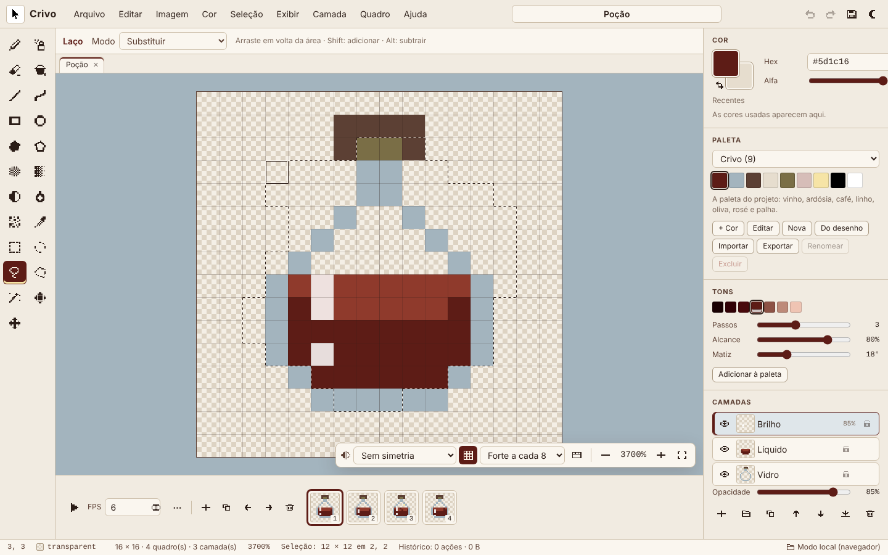
  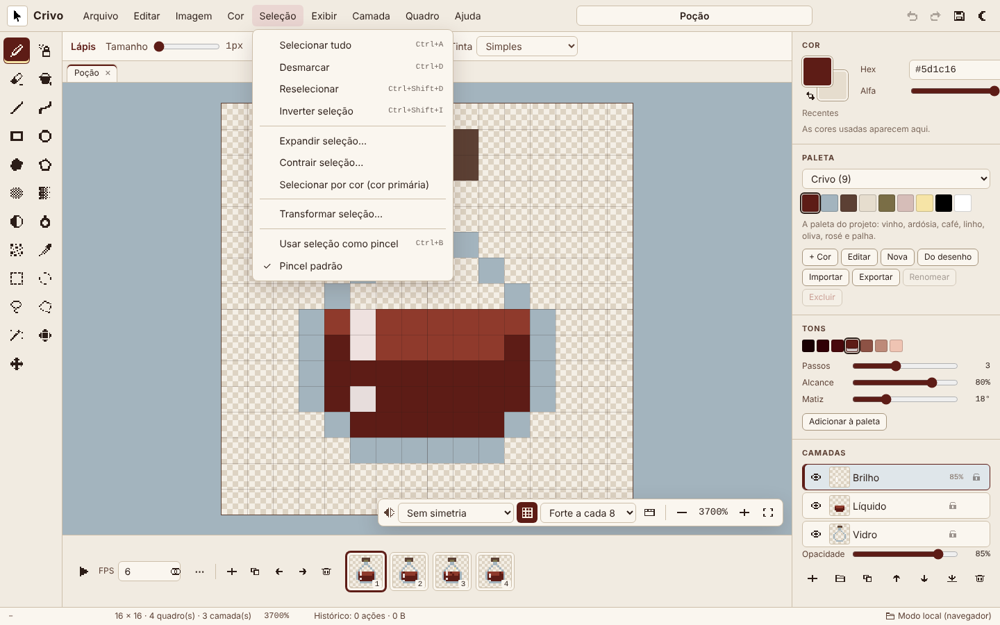
</p>

### Cor, paleta e ajustes

- **Modos de cor:** no **indexado**, toda cor vai para a mais próxima da paleta (também em traços, colagens e filtros), e mudar uma cor no editor de paleta recolore todas as células num único passo do histórico; no **tons de cinza**, tudo continua cinza.
- **Editor de paleta** (**Cor → Editar paleta…** ou o botão **Editar** do painel): editar, adicionar, remover e reordenar cores, ordenar por matiz, luminosidade ou saturação, inverter, tirar duplicadas, criar uma rampa entre duas cores e mudar o tamanho. Uma paleta predefinida editada é salva como paleta sua.
- **Ajustes:** prévia ao vivo, Cancelar volta ao que era e OK vira um passo do histórico; podem valer para todos os quadros da camada e respeitam a seleção.

<p align="center">
  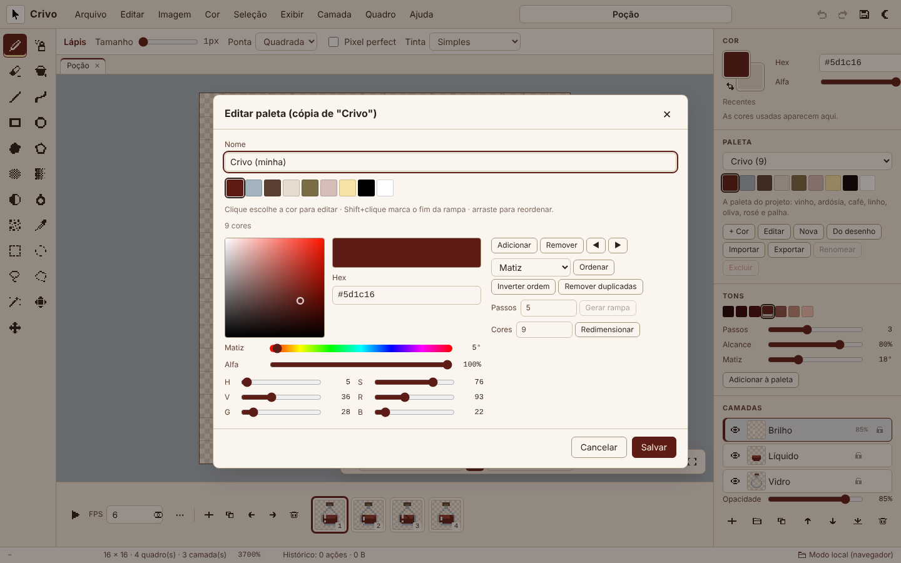
  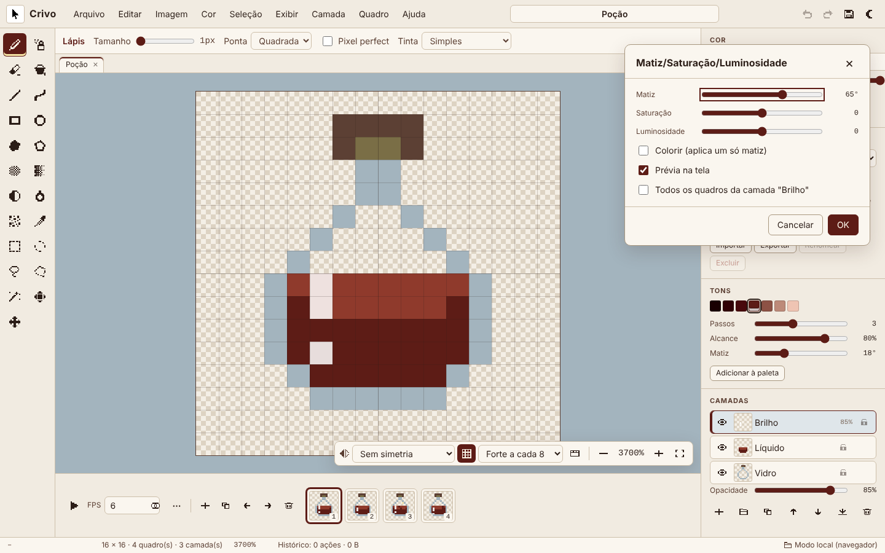
</p>

### Arquivos, abas e pré-visualização

| Formato | Abrir | Exportar | Detalhes |
|---|---|---|---|
| `.crivo` | Sim | Sim | Versão 2, com as chaves opcionais da 2.1.0 (veja [Formato `.crivo`](#formato-crivo)) |
| `.ase` | Sim | Sim | Abre 32 bits, tons de cinza de 16 bits e indexado de 8 bits, com camadas (visibilidade, bloqueio, opacidade, modo de mistura, grupos, fechados e referência), cels normais, vinculados, comprimidos e de tilemap, paletas, tags, slices e tilesets. Exporta em RGBA de 32 bits, com cels comprimidos e vinculados, grupos, modos, opacidade, referência, tags, slices, paleta, durações e tilesets |
| PNG animado (APNG) | — | Sim | **Arquivo → Exportar PNG animado (APNG)…**, com a duração de cada quadro e transparência total |
| Quadros em PNG (`.zip`) | — | Sim | **Arquivo → Exportar quadros em PNG (.zip)…**, um PNG por quadro |
| Sprite sheet + JSON | — | Sim | **Formato do JSON**: Crivo, hash (quadros por nome) ou array (lista de quadros), no layout de sprite sheet que Phaser, PixiJS e os importadores do Godot leem (`frames`, `meta.frameTags`, `meta.layers`, `meta.slices`) |
| PNG, JPEG, GIF, dados | Imagens | Sim | Como antes; camadas de referência ficam de fora |

- **Abas:** cada projeto aberto (novo, salvo, importado ou arrastado para a tela) ganha uma aba acima da matriz; clique do meio fecha. **Ctrl+Tab** e **Ctrl+Shift+Tab** andam entre elas.
- **Pré-visualização** (F7): uma janela com o quadro inteiro e o retângulo da parte visível; clicar ou arrastar move a visão, e ela tem a própria reprodução.
- **Arrastar e soltar:** `.crivo` e `.ase` abrem numa aba; imagens vão para o diálogo de importação.

<p align="center">
  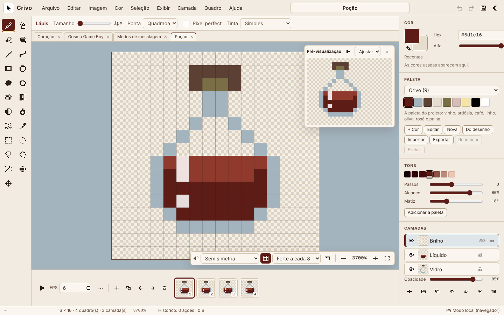
  
</p>

### Servidor, banco e Java

- A API v2 aceita e devolve os campos novos do documento, validados com mensagens em português; documentos da 2.0 vão e voltam sem mudança.
- O PNG e as exportações do servidor compõem grupos e modos de mistura e deixam de fora as camadas de referência, com os mesmos pixels do editor e da ferramenta em Java (um teste de paridade confere isso em 30 documentos aleatórios).
- A migração `0004_advanced_features` acrescenta `project.color_mode`; `layer.blend_mode`, `kind`, `parent_key`, `collapsed`, `tileset_key` e `reference`; `cell.link_frame_key` e `cell.tiles`; e as tabelas `tag`, `slice` e `tileset` (veja [Banco de dados](#banco-de-dados)).
- A ferramenta em Java lê os campos novos, compõe grupos e modos de mistura, mostra grupos, tipos, modos, modo de cor, tags, slices e tilesets no `info` e ganha o comando `tags`.

## Arquitetura

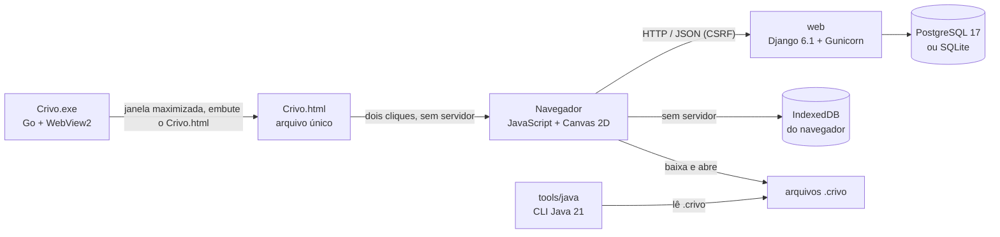

| Parte | Linguagem | Responsabilidade |
|---|---|---|
| `editor/static/editor/js/core` | JavaScript | Núcleo sem DOM: cores e OKLCH, geometria (Bresenham, elipse, curvas, polígonos, pincel, simetria, pixel perfect), flood fill, pontilhado de Bayer e degradês, seleção com máscara, filtros e ajustes, modos de mistura (`blend.js`), modos de cor (`colormode.js`), ferramentas de paleta, pincel personalizado (`brush.js`), transformação com RotSprite (`transform.js`), tilemaps (`tilemap.js`), tags e reprodução (`animation.js`), codificadores GIF, APNG (`apng.js`), ZIP (`zip.js`) e zlib (`zlib.js`), leitor e gravador `.ase` (`ase-file.js`), RLE, documento, histórico, formato `.crivo`, exportação e paletas |
| `editor/static/editor/js/features` | JavaScript | Recursos da 2.1.0 que se ligam ao editor pelo ponto de extensão `install(app)` do `main.js`: `layers.js` (menus Camada e Quadro), `selection.js` (menu Seleção), `color.js` (menu Cor) e `files.js` (abrir, abas, exportações novas) |
| `editor/static/editor/js/ui` | JavaScript | Visor em canvas, ferramentas, painéis, diálogos, armazenamento e atalhos; na 2.1.0, também `layer-dialogs.js` (propriedades de camada e quadro, tags, slices, papel cebola), `palette-editor.js`, `color-picker.js`, `adjustments.js`, `tabs.js` e `minimap.js` (pré-visualização) |
| `Crivo.exe` e `desktop/` | Go | App desktop para Windows, gerado por `scripts/build-desktop.js`: janela própria com o WebView2, maximizada (F11 alterna a tela cheia), com o `Crivo.html` embutido e atalho no menu Iniciar |
| `Crivo.html` | HTML + JavaScript | O editor inteiro num arquivo só, gerado por `scripts/build-portable.js`: abre direto do disco, sem servidor nem backend |
| `editor/` | Python (Django) | API REST, validação (inclusive dos campos da 2.1.0), versões dos projetos, paletas, exportação pelo servidor (dados e PNG, com grupos e os modos de mistura de `editor/blend.py`), cabeçalhos de segurança e limite de escritas |
| `tools/java` | Java 21 | Linha de comando: informações, tags, paleta, PNG, sprite sheet e matriz em Java a partir de um `.crivo`, com grupos e modos de mistura (`Blend.java`) |
| `postgres` | — | Fonte da verdade quando há servidor: projetos, camadas, quadros, células, tags, slices, tilesets, versões e paletas |

### Como a matriz é guardada

Cada pixel é um inteiro de 32 bits com os bytes `R, G, B, A` na ordem da memória, o mesmo layout do `ImageData`. Uma célula (quadro × camada) é codificada em RLE: para cada sequência de pixels iguais, o tamanho da sequência em varint (7 bits por byte) seguido dos 4 bytes da cor. Um sprite 32×32 com fundo transparente costuma caber em poucas dezenas de bytes. O mesmo formato é lido pelo JavaScript, pelo Python e pelo Java.

### Como o histórico funciona

| Ação | O que fica guardado |
|---|---|
| Traço pequeno (lápis, linha, forma, pontilhado, mover pixels, colar, filtros) | Índices alterados + cor antes + cor depois (12 bytes por pixel) |
| Mudança grande (balde ou degradê numa área enorme) | RLE da célula antes e depois |
| Estrutura (camadas, grupos, quadros, tags, slices, vínculos, tamanho, giro, recortar, aparar, modo de cor) | Instantâneo do documento inteiro em RLE |

Desfazer e refazer aplicam o lado "antes" ou "depois" da entrada. Uma nova ação apaga o futuro, como em qualquer editor.

<p align="center">
  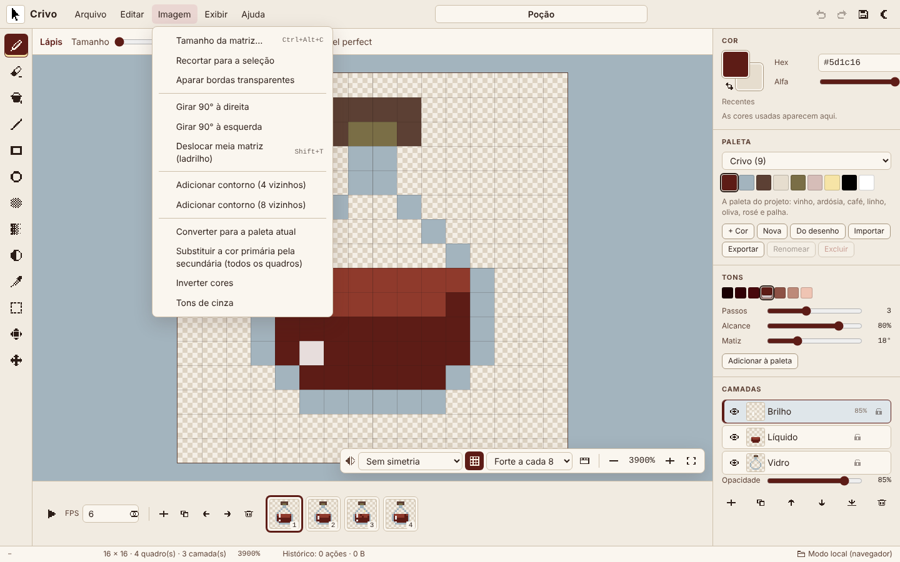
  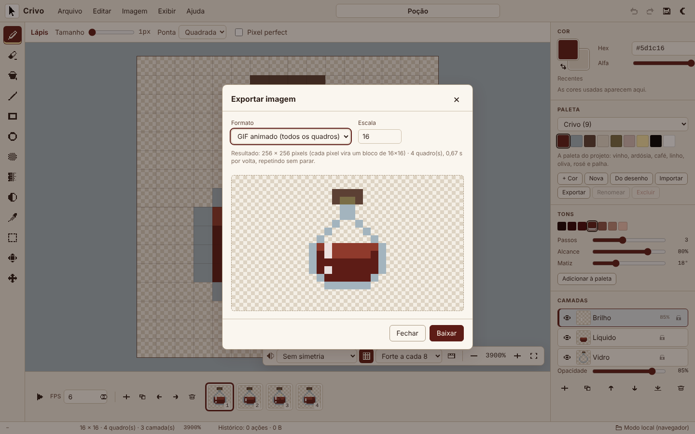
</p>

<p align="center">
  
  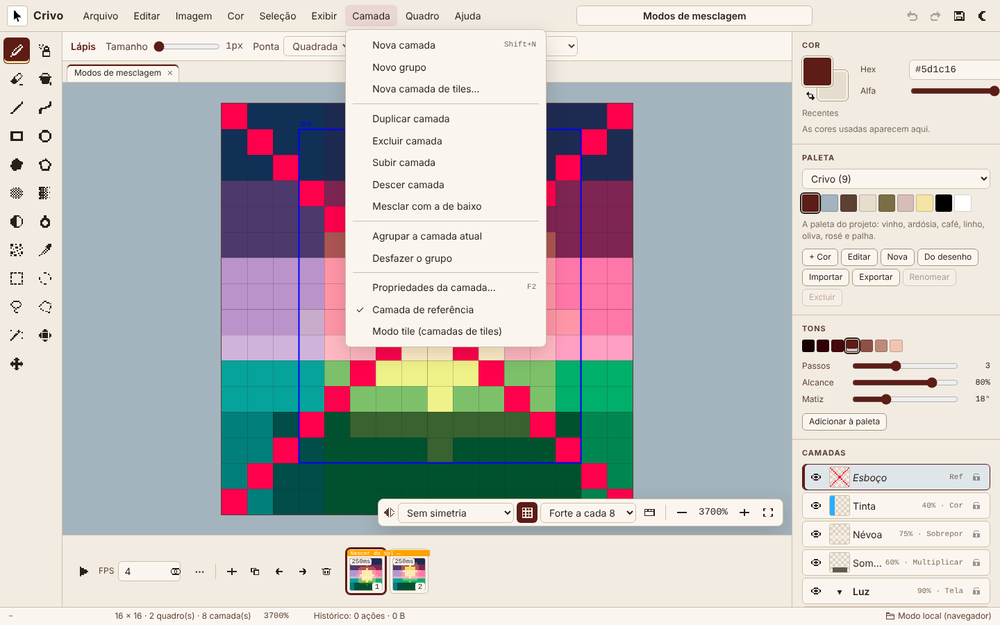
</p>

## Como rodar

O Crivo sobe de **três maneiras**. O editor é o mesmo nas três; o que muda é o que precisa estar instalado e onde os projetos ficam guardados. Os arquivos `.crivo` abrem em todas, então dá para levar um desenho de uma para outra.

| Maneira | Como subir | Precisa de | Onde ficam os projetos |
|---|---|---|---|
| **1. App desktop** (`Crivo.exe`) | Dois cliques no `Crivo.exe` (ou pesquise **Crivo** no menu Iniciar depois da primeira vez); abre **maximizado** | Windows 10 ou 11 (64 bits); nada para instalar | Neste computador, em `%LOCALAPPDATA%\Crivo` |
| **2. Servidor local e backend** (Django + banco) | `start.cmd`, `./start.sh` ou `python manage.py runserver` | Docker Desktop, ou Python 3.12+ | No banco de dados (PostgreSQL ou SQLite), com histórico de versões e API |
| **3. Arquivo único** (`Crivo.html`) | Dois cliques no `Crivo.html`; abre no navegador | Um navegador atual; nada para instalar | No navegador em que foi aberto (IndexedDB) |

Para só desenhar no Windows, o app desktop é o caminho mais direto. Para usar a API, o histórico de versões ou guardar os projetos num banco, suba o servidor. Para abrir em qualquer sistema sem instalar nada, use o `Crivo.html`.

### 1. App desktop (Crivo.exe)

Baixe o [`Crivo.exe`](Crivo.exe) e dê dois cliques. O Crivo abre **maximizado** (janela cheia, com a barra de título e a barra de tarefas à vista), numa janela própria, sem servidor, sem backend e sem navegador. Não há instalador: o arquivo pode ficar em qualquer pasta.

- **F11** leva à tela cheia (sem barra de título nem barra de tarefas) e volta para a janela maximizada; **Alt+F4** (ou **Arquivo → Sair do Crivo**) fecha o app, gravando o rascunho antes.
- Na primeira vez que abre, o Crivo cria um atalho no **menu Iniciar** (só para o seu usuário, sem pedir administrador). Depois disso, basta pesquisar **Crivo** no Windows. Se você apagar o atalho, ele não volta, a não ser que o `Crivo.exe` seja aberto de outra pasta.
- Projetos, paletas e o rascunho ficam em `%LOCALAPPDATA%\Crivo` e continuam lá na próxima vez, mesmo trocando o `.exe` por uma versão nova. A barra de status mostra **Desktop (este computador)**.
- Na primeira vez, o Windows pode mostrar **O Windows protegeu o computador**, porque o executável não tem assinatura digital paga: clique em **Mais informações → Executar assim mesmo**. O app não pede permissão de administrador.
- Usa o Microsoft Edge WebView2, que já vem no Windows 10 e 11. Se faltar, o Crivo avisa e oferece abrir a página de download da Microsoft.
- Por dentro, é um programa pequeno em Go ([`desktop/`](desktop/), cerca de 3 MB) com o `Crivo.html` embutido: o editor, os testes e a segurança são os mesmos do arquivo único.

Para gerar o `Crivo.exe` a partir do código (precisa do Node.js 20 e do Go; a versão exata fica em `desktop/go.mod`):

```bash
npm run desktop                   # atualiza o Crivo.html e gera o Crivo.exe na raiz
npm run desktop -- --check        # confere se o Crivo.exe do repositório corresponde ao código
```

O build é reproduzível: o mesmo código gera sempre o mesmo `Crivo.exe`, byte a byte, de qualquer sistema. O ícone é o logo do projeto ([`docs/images/logo.svg`](docs/images/logo.svg)), desenhado com pixels inteiros em cada tamanho do Windows, e as propriedades do arquivo trazem a versão e o copyright.

### 2. Servidor local e backend (editor + API + banco de dados)

#### Com Docker

Você só precisa do **Docker** com Docker Compose.

**Windows:** dê dois cliques em `start.cmd`.

**Linux ou macOS:**

```bash
./start.sh
```

Na primeira vez o script cria o arquivo `.env` com uma senha aleatória para o banco e uma chave secreta aleatória, sobe o PostgreSQL e a aplicação e abre **http://localhost:8080**.

| Endereço | O que é |
|---|---|
| http://localhost:8080 | Editor |
| http://localhost:8080/api/v2 | Lista das rotas da API |
| http://localhost:8080/api/v2/health | Saúde do banco |

#### Sem Docker (Python)

```bash
python -m venv .venv
. .venv/bin/activate              # no Windows: .venv\Scripts\activate
pip install -r requirements.txt
python manage.py migrate
python manage.py runserver        # http://localhost:8000
```

Sem configurar nada, o Django usa um arquivo SQLite (`crivo.sqlite3`). Para usar PostgreSQL, defina `CRIVO_DB_ENGINE=postgresql` e as variáveis `CRIVO_DB_*`. Ao atualizar uma instalação da 1.x, rode `python manage.py migrate` de novo: a migração `0003_english_schema` renomeia as tabelas e colunas para o inglês sem perder dados (com Docker, as migrações rodam sozinhas ao subir).

#### Só o editor, num servidor de arquivos (Node.js)

```bash
npm run serve                     # http://localhost:5173
```

Nesse modo não há API: projetos e paletas ficam no IndexedDB do navegador. Qualquer servidor de arquivos estáticos apontado para `editor/static/editor/` também funciona.

### 3. Arquivo único (Crivo.html)

Baixe o [`Crivo.html`](Crivo.html) e dê dois cliques. O editor abre no navegador direto da pasta, sem servidor local, sem backend e sem internet, com todas as ferramentas, camadas, animação e exportações.

Os projetos e as paletas ficam guardados no navegador em que o arquivo foi aberto. Para guardar uma cópia ou levar um desenho para outro computador, use **Arquivo → Baixar arquivo .crivo** e, depois, **Arquivo → Abrir arquivo .crivo…**.

O `Crivo.html` existe porque os navegadores não carregam módulos JavaScript de páginas abertas direto do disco: ele junta os módulos do editor num script só, embute o CSS e o ícone e traz a própria Content-Security-Policy. Depois de mudar o editor, rode `npm run portable` (o `npm run desktop` também faz isso).

## Usando a API

```bash
# listar projetos
curl http://localhost:8080/api/v2/projects

# criar um projeto a partir de um arquivo .crivo (com CRIVO_API_TOKEN definido no .env)
curl -H "Authorization: Bearer $TOKEN" -H "Content-Type: application/json" \
     -d "{\"data\": $(cat examples/potion.crivo)}" http://localhost:8080/api/v2/projects

# baixar a matriz do quadro 1 como módulo Python, pronta para o seu jogo
curl -o potion.py "http://localhost:8080/api/v2/projects/<id>/export?format=py&frame=1&download=1"

# ou como cabeçalho C e classe Java
curl -o potion.h "http://localhost:8080/api/v2/projects/<id>/export?format=c&download=1"
curl -o Pocao.java "http://localhost:8080/api/v2/projects/<id>/export?format=java&mode=hex&download=1"

# PNG do quadro 2 ampliado 8 vezes, gerado no servidor
curl -o potion.png "http://localhost:8080/api/v2/projects/<id>/png?frame=2&scale=8"
```

| Rota | O que faz |
|---|---|
| `GET /api/v2` | Nome, versão e lista das rotas |
| `GET /api/v2/health` | Saúde do servidor e do banco (`{"status", "version", "database"}`; 503 se o banco não responder) |
| `GET /api/v2/projects` | Lista os projetos (`{"projects": [...]}`; `q` filtra pelo nome) |
| `POST /api/v2/projects` | Cria um projeto (`data` no formato `.crivo`, `thumbnail` PNG opcional, `name`) |
| `GET/PUT/DELETE /api/v2/projects/{id}` | Abre (resumo + `data`), salva (com `revision` para detectar conflitos) e exclui |
| `GET /api/v2/projects/{id}/thumbnail` | Miniatura PNG |
| `GET /api/v2/projects/{id}/export` | Matriz em `format=json`, `csv`, `js`, `py`, `c` ou `java`, com `mode=indices` ou `hex`, de um quadro (`frame=N`) ou de todos (`frame=all`); `download=1` baixa o arquivo |
| `GET /api/v2/projects/{id}/png` | PNG de um quadro composto (`frame`, `scale` de 1 a 32, até 2048 px de lado, `download=1`), gerado em Python puro |
| `GET /api/v2/projects/{id}/revisions` | Versões anteriores guardadas a cada salvamento (`{"current_revision", "revisions": [...]}`) |
| `POST /api/v2/projects/{id}/revisions/{number}/restore` | Volta para uma versão |
| `GET/POST /api/v2/palettes` | Lista as paletas (`{"palettes": [...]}`; `presets=0` esconde as predefinidas) e cria uma nova (`name`, `colors`) |
| `GET/PUT/DELETE /api/v2/palettes/{id}` | Abre, altera e exclui uma paleta sua |

O resumo de um projeto traz `id`, `name`, `width`, `height`, `fps`, `revision`, `frames` e `layers` (quantidades), `thumbnail_url`, `created_at` e `updated_at`. Os erros vêm como `{"error": "mensagem"}`, com a mensagem em português; o conflito (409) inclui `current_revision`.

**Desde a 2.1.0**, o campo `data` aceita e devolve as chaves opcionais do formato (`colorMode`, `tags`, `slices` e `tilesets`; nas camadas, `blendMode`, `kind`, `parent`, `collapsed`, `tileset` e `reference`; nas células, `link` e `tiles`). Elas são validadas (modo de mistura conhecido, grupo que existe e não contém a si mesmo, tag apontando para quadros existentes, vínculo para uma célula da mesma camada, tiles dentro do tileset) e um erro responde 422 com a mensagem em português. Projetos sem essas chaves são gravados e devolvidos exatamente como na 2.0. O PNG e as exportações compõem grupos e modos de mistura e deixam de fora as camadas de referência.

> **Desde a 2.0.0**, a API fica em `/api/v2`, com rotas, parâmetros e campos em inglês. A `/api/v1` foi removida: scripts feitos para a 1.x precisam trocar o endereço e os nomes dos campos (veja o [CHANGELOG](CHANGELOG.md)). A API continua aceitando projetos no formato `.crivo` antigo no campo `data`.

Pedidos que alteram dados exigem o cookie CSRF do Django (o editor cuida disso) ou o cabeçalho `Authorization: Bearer <CRIVO_API_TOKEN>`. Acima de `CRIVO_WRITE_LIMIT` alterações por minuto vindas do mesmo IP, a API responde **429** com `Retry-After`; JSON inválido responde **422** e corpo acima do limite, **413**.

## Ferramenta em Java

A pasta [`tools/java`](tools/java) traz uma linha de comando sem dependências externas, só com o JDK 21:

```bash
cd tools/java
./crivo.sh info ../../examples/potion.crivo
./crivo.sh tags ../../examples/blend-modes.crivo
./crivo.sh palette ../../examples/heart.crivo
./crivo.sh png ../../examples/potion.crivo potion.png --scale 8 --frame 2
./crivo.sh sheet ../../examples/heart.crivo heart.png --layout grid --columns 2 --spacing 2
./crivo.sh matrix ../../examples/game-boy-slime.crivo --class Slime > Slime.java
./test.sh
```

No Windows, use `crivo.cmd` no lugar de `./crivo.sh`. A primeira execução compila as classes em `tools/java/out`.

| Comando | O que faz |
|---|---|
| `info <projeto>` | Nome, tamanho, quadros, FPS, camadas (com grupos, tipo, opacidade e modo de mistura), modo de cor, quantidade de cores, tags, slices e tilesets (só quando existem) |
| `tags <projeto>` | Lista as tags: nome, quadros, direção, repetições e cor (novo na 2.1.0) |
| `palette <projeto>` | Cores usadas, da mais usada para a menos usada |
| `png <projeto> <saida.png> [--frame N] [--scale N]` | Um quadro em PNG, ampliado por vizinho mais próximo |
| `sheet <projeto> <saida.png> [--layout horizontal\|vertical\|grid] [--columns N] [--spacing N] [--scale N]` | Sprite sheet |
| `matrix <projeto> [--frame N\|all] [--mode indices\|argb] [--class Nome]` | Classe Java com a matriz, na saída padrão |
| `check <projeto>` | Confere se o arquivo é um projeto válido |

Desde a 2.0.0, os comandos e as opções estão em inglês. Os nomes da 1.x (`paleta`, `folha`, `matriz`, `verificar`, `--quadro`, `--escala`, `--disposicao` com `grade`, `--colunas`, `--espaco`, `--modo`, `--classe` e o valor `todos`) continuam funcionando como apelidos, e a ajuda e as mensagens seguem em português. A ferramenta lê arquivos `.crivo` das versões 1 e 2, inclusive as chaves opcionais da 2.1.0: compõe grupos e os 19 modos de mistura com os mesmos pixels do editor e do servidor e deixa as camadas de referência fora do PNG e da sprite sheet.

Sprites grandes (mais de 4096 valores) saem numa classe compacta: a matriz vai em texto e é lida quando a classe carrega, porque um literal desse tamanho passaria do limite de 64 KB por método do Java. Quem usa a classe continua acessando `PALETTE` e `FRAMES` do mesmo jeito. O editor e a API geram o mesmo formato.

## Formato `.crivo`

É um JSON legível, salvo por **Arquivo → Baixar arquivo .crivo** e aberto por **Arquivo → Abrir arquivo…**:

```json
{
  "format": "crivo",
  "version": 2,
  "name": "Poção",
  "width": 16,
  "height": 16,
  "fps": 6,
  "palette": ["#5d1c16", "#a3b4be"],
  "layers": [{ "id": "c1", "name": "Vidro", "visible": true, "opacity": 100, "locked": false }],
  "frames": [{ "id": "q1", "duration": null }],
  "cells": [{ "frame": "q1", "layer": "c1", "rle": "<RLE em base64>" }]
}
```

Esta é a versão 2 do formato, usada desde o Crivo 2.0.0, com as chaves em inglês. Arquivos da versão 1 (salvos pela 1.x, com `"formato"`, `"versao"`, `"largura"`, `"camadas"` etc.) continuam abrindo no editor, na API e na ferramenta em Java: são convertidos na leitura, e o próximo salvamento já grava a versão 2. Um arquivo com `version` maior que 2 foi salvo por um Crivo mais novo e é recusado.

A 2.1.0 continua gravando a versão 2, só com **chaves opcionais** novas, que leitores antigos ignoram e que só são gravadas quando diferem do padrão:

| Onde | Chave | Valor |
|---|---|---|
| Raiz | `colorMode` | `"rgba"` (padrão), `"indexed"` ou `"grayscale"` |
| Raiz | `tags` | `[{ "id", "name", "from", "to", "direction": "forward" \| "reverse" \| "pingpong", "repeat", "color" }]` (`from` e `to` são ids de quadros) |
| Raiz | `slices` | `[{ "id", "name", "color", "x", "y", "width", "height", "center": {x, y, width, height} \| null, "pivot": {x, y} \| null }]` |
| Raiz | `tilesets` | `[{ "id", "name", "tileWidth", "tileHeight", "tiles": ["<RLE em base64>", ...] }]` (o tile 0 é o vazio) |
| Camada | `blendMode`, `kind`, `parent`, `collapsed`, `tileset`, `reference` | Modo de mistura, `"image"` \| `"group"` \| `"tilemap"`, id do grupo, grupo fechado, id do tileset e camada de referência |
| Célula | `link`, `tiles` | Id do quadro da célula de origem (a célula continua com a própria cópia em `rle`) e o RLE dos índices de tiles (o `rle` guarda os pixels já desenhados) |

Assim, um `.crivo` da 2.1.0 aberto num Crivo 2.0 mostra os mesmos pixels (sem grupos, modos e tags), e um arquivo da 2.0 abre e salva igual na 2.1.0.

A pasta [`examples/`](examples) tem quatro projetos para abrir e estudar: uma poção com o líquido animado (`potion.crivo`), um coração batendo (`heart.crivo`), uma gosma na paleta do Game Boy (`game-boy-slime.crivo`) e um nascer do sol com grupo, modos de mistura, camada de referência, tag e slice (`blend-modes.crivo`, novo na 2.1.0).

## Configuração

As principais variáveis do `.env` (a lista completa está no manual):

| Variável | Padrão | O que faz |
|---|---|---|
| `CRIVO_PORT` | `8080` | Porta no navegador |
| `CRIVO_SECRET_KEY` | — | Chave do Django. Gerada pelos scripts; nunca publique a sua |
| `CRIVO_ALLOWED_HOSTS` | `localhost,127.0.0.1` | Endereços pelos quais o Crivo é acessado |
| `CRIVO_HTTPS` / `CRIVO_CSRF_TRUSTED_ORIGINS` | `false` / vazio | Use atrás de um proxy com HTTPS |
| `CRIVO_API_TOKEN` | vazio | Token para scripts alterarem dados pela API sem o cookie CSRF |
| `CRIVO_MAX_REVISIONS` | `20` | Quantas versões anteriores de cada projeto ficam guardadas |
| `CRIVO_WRITE_LIMIT` | `120` | Alterações por minuto aceitas de cada IP na API, contadas em cada processo do Gunicorn (`0` desliga) |
| `CRIVO_TRUSTED_PROXY` | `false` | Atrás de um proxy confiável, usa o último endereço de `X-Forwarded-For` como IP do cliente |
| `CRIVO_MAX_UPLOAD_MB` | `24` | Tamanho máximo do corpo dos pedidos |
| `CRIVO_HSTS_SECONDS` | `31536000` | Duração do HSTS quando `CRIVO_HTTPS=true` |
| `CRIVO_HSTS_SUBDOMAINS` / `CRIVO_HTTPS_REDIRECT` | `false` / `false` | Estende o HSTS aos subdomínios / faz o Django redirecionar HTTP para HTTPS |
| `CRIVO_DB_NAME` / `CRIVO_DB_USER` / `CRIVO_DB_PASSWORD` | `crivo` / `crivo` / — | PostgreSQL |
| `CRIVO_WORKERS` | `2` | Processos do Gunicorn |

Na 2.0.0, sete variáveis ganharam nomes em inglês: `CRIVO_TAMANHO_MAXIMO_MB` → `CRIVO_MAX_UPLOAD_MB`, `CRIVO_HSTS_SEGUNDOS` → `CRIVO_HSTS_SECONDS`, `CRIVO_HSTS_SUBDOMINIOS` → `CRIVO_HSTS_SUBDOMAINS`, `CRIVO_REDIRECIONAR_HTTPS` → `CRIVO_HTTPS_REDIRECT`, `CRIVO_MAX_REVISOES` → `CRIVO_MAX_REVISIONS`, `CRIVO_LIMITE_ESCRITAS` → `CRIVO_WRITE_LIMIT` e `CRIVO_PROXY_CONFIAVEL` → `CRIVO_TRUSTED_PROXY`. Os nomes antigos ainda funcionam quando o novo não está definido, mas estão obsoletos e podem sair numa versão futura: troque-os no seu `.env`.

<p align="center">
  
  
</p>

## Banco de dados

As tabelas são `project`, `layer`, `frame`, `cell`, `revision`, `palette` e `palette_color` e, desde a 2.1.0, `tag`, `slice` e `tileset` (o detalhe de cada campo está no [`Banco-de-Dados-Crivo.pdf`](Banco-de-Dados-Crivo.pdf)). A migração `0004_advanced_features` só acrescenta: toda coluna nova tem valor padrão ou aceita nulo, então os projetos existentes continuam iguais.

| Tabela | O que a 2.1.0 acrescenta |
|---|---|
| `project` | `color_mode` (`rgba`, `indexed` ou `grayscale`) |
| `layer` | `blend_mode` (19 valores), `kind` (`image`, `group` ou `tilemap`), `parent_key` (grupo), `collapsed`, `tileset_key` (só em tilemaps) e `reference` |
| `cell` | `link_frame_key` (célula vinculada) e `tiles` (RLE dos índices de tiles) |
| `tag` (nova) | `project_id`, `key`, `position`, `name`, `from_frame_key`, `to_frame_key`, `direction`, `repeat` e `color` |
| `slice` (nova) | `project_id`, `key`, `position`, `name`, `color`, `x`, `y`, `width`, `height`, `center_x/y/width/height` e `pivot_x/y` (todos ou nenhum) |
| `tileset` (nova) | `project_id`, `key`, `position`, `name`, `tile_width`, `tile_height`, `tile_count` e `tiles` (RLE de todos os tiles) |

Ao atualizar uma instalação, rode `python manage.py migrate` (com Docker, as migrações rodam sozinhas ao subir).

## Personalizando o Crivo

Dá para deixar o Crivo do seu jeito sem mexer no código:

| Quero... | Onde |
|---|---|
| Ter paletas minhas | **Cor → Editar paleta…** (ou o botão **Editar** do painel); uma paleta predefinida editada vira uma paleta sua |
| Criar rampas de sombra e luz | Gerador de tons, a partir da cor escolhida |
| Ajustar a visualização | Menu **Exibir**: grade (G), linha forte a cada 4, 8, 16 ou 32 pixels, papel cebola e **Configurar papel cebola…**, modo ladrilho e tema |
| Configurar o servidor | Variáveis do `.env` (veja [Configuração](#configuração)) |

Alterar o código-fonte, criar versões modificadas ou reaproveitar partes do código em outros projetos não é permitido pela [licença](#licença).

## Desenvolvimento e testes

```bash
npm test                                   # 107 testes do núcleo em JavaScript (Node 20+)
python manage.py test editor               # 72 testes da API Django (funcionamento, segurança, migrações e recursos da 2.1.0)
bash tools/java/test.sh                    # 36 testes da ferramenta em Java
python -m unittest discover -s tests/e2e   # 42 testes ponta a ponta no Chromium (Playwright): 20 com o Django e 22 no Crivo.html
npm run portable                           # gera o Crivo.html de novo a partir do código do editor
npm run desktop                            # gera o Crivo.exe (precisa do Go); -- --check só confere
ruff check .                               # estilo, bugs prováveis e regras de segurança no Python
bandit -q -r editor crivo -x editor/tests  # análise de segurança do Python
```

Para o teste ponta a ponta, instale antes `pip install playwright` e `python -m playwright install chromium`.

O `Crivo.html` é gerado a partir de `editor/static/editor/` por `scripts/build-portable.js`, sem bibliotecas: os módulos viram um único script embutido, o CSS e o ícone vão junto e a página ganha uma Content-Security-Policy própria. Ele existe porque o navegador não carrega módulos JavaScript de páginas abertas direto do disco. Depois de mudar o editor, rode `npm run portable`; o CI confere se o arquivo está em dia (`npm run portable -- --check`).

O `Crivo.exe` é gerado por `scripts/build-desktop.js`, que copia o `Crivo.html` para `desktop/`, desenha o ícone, grava a versão nas propriedades do arquivo e compila o código Go de `desktop/` para Windows de 64 bits. O build é reproduzível, e o CI gera o `.exe` de novo e compara byte a byte com o do repositório (`npm run desktop -- --check`), além de rodar o `go vet`. O GitHub Actions roda tudo isso a cada push (a API contra um PostgreSQL de verdade), além de `manage.py check --deploy`, gera os PNGs dos exemplos com a ferramenta em Java e constrói a imagem Docker.

## Qualidade e segurança

Resultado da rodada de testes da versão 2.1.0: **257 testes, todos passando**, e nenhum problema apontado pelas ferramentas de análise. Na versão 1.1.0, uma revisão de código independente apontou 10 problemas (entre eles, desfazer durante um arraste embaralhava o histórico, a colagem furava o fundo ao ser movida e a classe Java de sprites médios não compilava); todos foram corrigidos e ganharam testes.

| Verificação | O que cobre | Resultado |
|---|---|---|
| Núcleo JavaScript (107) | Cores, geometria, flood fill, RLE, histórico, formato, exportação (inclusive Java compacta e C com muitas cores), pontilhado, degradês, pixel perfect, seleção, aparar, ladrilho, contorno, filtros e GIF (LZW de ida e volta); na 2.1.0, grupos, modos de mistura, tags, cels vinculados, tilemaps, slices, seleções com máscara, ferramentas novas, modos de tinta, pincel, transformação, modos de cor, ajustes, paleta, `.ase` de ida e volta, APNG, ZIP e o JSON hash e array da sprite sheet | 107 de 107 |
| API Django (72) | Ciclo de projetos e paletas, revisões, conflitos, exportação, PNG, formatos C e Java (a classe grande é compilada e executada com o JDK quando ele existe), o conjunto de segurança abaixo, as migrações e os campos da 2.1.0 (validação, ida e volta, documentos da 2.0 inalterados) | 72 de 72 |
| Ferramenta Java (36) | Leitura do `.crivo`, RLE, PNG, sprite sheet e matriz, inclusive uma classe grande compilada em memória com o compilador do JDK; na 2.1.0, chaves opcionais, modos de mistura, grupos, `info` e `tags` | 36 de 36 |
| Paridade de composição | 30 documentos aleatórios com os 19 modos de mistura, grupos (inclusive "pass-through" normais a 100%) e camadas ocultas ou de referência, compostos no editor (JS), no servidor (Python) e na ferramenta Java (`tests/fixtures/blend-parity.json`) | Mesmos pixels nos três |
| Interface (42) | Editor aberto no Chromium de dois jeitos, contra o Django e como `Crivo.html` direto do disco, inclusive a integração com o app desktop (F11, sair e rascunho): cada ferramenta nova, seleção, colagem flutuante, gestos protegidos (Ctrl+Z no meio do arraste, setas no menu), comandos de imagem, desfazer, preferências inválidas, salvar no servidor e no navegador, baixar e reabrir o `.crivo`, baixar o PNG e o GIF, e na 2.1.0 laço, varinha mágica, polígono, curva e modos de tinta, sem nenhum erro no console nem violação de CSP | 42 de 42 |
| Ruff e Bandit | Estilo, bugs prováveis e padrões inseguros no Python | 0 problemas |
| App desktop | Build reproduzível do `Crivo.exe` (gerado de novo e comparado byte a byte) e `go vet` no código Go | Idêntico; 0 problemas |
| `check --deploy` | Configuração de produção do Django | Só avisos opcionais (HSTS em subdomínios, preload e redirecionamento HTTPS, que ficam a cargo do proxy) |

Os testes de segurança (`editor/tests/test_security.py`) conferem:

- **Cabeçalhos** em todas as respostas: `Content-Security-Policy` (só scripts do próprio site, sem `eval`, sem objetos, sem ser embutido em outras páginas), `X-Frame-Options: DENY`, `X-Content-Type-Options: nosniff`, `Referrer-Policy`, `Cross-Origin-Opener-Policy`, `Permissions-Policy` e `Cache-Control: no-store` nas respostas JSON; HSTS só quando há HTTPS.
- **Autenticação das escritas:** sem cookie CSRF ou token a API recusa (403); tokens errados, vazios, sem `Bearer` ou com um caractere a menos também; o token não vale fora de `/api/`.
- **Entradas maliciosas:** JSON aninhado 100 mil níveis (não derruba o servidor), corpo que não é objeto, corpo grande demais (413), miniatura falsa (SVG com script, HTML, base64 inválido, PNG acima de 512 KB), tamanhos e quantidades fora dos limites, RLE corrompido, IDs e parâmetros inválidos e métodos não permitidos.
- **Nome com HTML ou comandos:** volta como texto no JSON e vira um nome de arquivo seguro (`[A-Za-z0-9_-]`) nos downloads.
- **Limite de escritas por IP** (429 com `Retry-After`; leituras e pedidos já recusados pelo CSRF não contam; atrás de proxy confiável o IP vem do `X-Forwarded-For` sem aceitar endereços forjados pelo cliente) e **chave secreta fraca**: com `CRIVO_DEBUG=false`, o servidor não inicia com a chave de exemplo ou com menos de 32 caracteres.

No editor, nenhum dado do usuário passa por `innerHTML`, preferências gravadas no navegador só são aceitas se estiverem na lista de valores válidos, e os atalhos do teclado ficam bloqueados enquanto um gesto do mouse está em andamento (só o Esc vale, para cancelar): nomes de projetos, camadas e paletas entram sempre como texto, e o servidor de arquivos em Node (`npm run serve`) envia os mesmos cabeçalhos de segurança do Django. O `Crivo.html` leva a própria Content-Security-Policy numa tag `<meta>`: só executa o script embutido nele (conferido por hash SHA-256), não carrega nada de fora e não abre nenhuma conexão de rede (`connect-src 'none'`). O app desktop carrega esse mesmo arquivo, roda sem permissão de administrador, não abre portas e desliga as ferramentas de desenvolvedor e o menu de contexto do navegador.

### Estrutura

```text
Crivo.exe                   app desktop para Windows, que abre maximizado (gerado)
Crivo.html                  o editor inteiro num arquivo só, que abre sem servidor (gerado)
desktop/                    código do app desktop em Go (janela WebView2, tela cheia, atalho no menu Iniciar, manifesto)
editor/                     aplicação Django (modelos, API, validação, exportação, versões)
  static/editor/            o editor: index.html, css/, img/ e js/
    js/core/                núcleo em JavaScript, sem DOM, testado no Node
    js/features/            recursos da 2.1.0 ligados pelo install(app): camadas, seleção, cor e arquivos
    js/ui/                  interface: visor, ferramentas, painéis, diálogos, abas, pré-visualização, armazenamento
  migrations/               esquema do banco, paletas predefinidas, nomes em inglês (0003) e recursos avançados (0004)
  tests/                    testes da API e de segurança
crivo/                      configurações do projeto Django
tools/java/                 linha de comando em Java 21
tests/js/                   testes do núcleo em JavaScript
tests/fixtures/             documentos do teste de paridade dos modos de mistura (JS, Python e Java)
tests/e2e/                  teste ponta a ponta da interface (Playwright)
examples/                   projetos .crivo de exemplo (formato 2), inclusive blend-modes.crivo
scripts/                    servidor estático em Node, geradores do Crivo.html e do Crivo.exe e criação do .env no Windows
docs/                       manuais em PDF e imagens do README
.github/workflows/          CI (testes, Ruff, Bandit, check --deploy, Playwright, Docker e build do Crivo.exe)
ruff.toml                   regras do Ruff
```

### Componentes de terceiros

O Crivo depende de componentes com licenças próprias, que continuam valendo para cada um deles:

| Componente | Uso no projeto | Licença |
|---|---|---|
| [Django](https://www.djangoproject.com/) | Back-end e API | BSD-3-Clause |
| [WhiteNoise](https://whitenoise.readthedocs.io/) | Entrega dos arquivos estáticos | MIT |
| [Gunicorn](https://gunicorn.org/) | Servidor de aplicação | MIT |
| [psycopg](https://www.psycopg.org/) | Driver do PostgreSQL | LGPL-3.0 |
| [Playwright](https://playwright.dev/python/) | Teste ponta a ponta (só no desenvolvimento) | Apache-2.0 |
| [Ruff](https://docs.astral.sh/ruff/) | Análise estática do Python (só no desenvolvimento) | MIT |
| [Bandit](https://bandit.readthedocs.io/) | Análise de segurança do Python (só no desenvolvimento) | Apache-2.0 |
| [go-webview2](https://github.com/jchv/go-webview2) | Janela do app desktop com o WebView2 (embutido no `Crivo.exe`) | MIT |
| [go-winloader](https://github.com/jchv/go-winloader) | Carregamento do WebView2 pelo go-webview2 (embutido no `Crivo.exe`) | ISC |
| [golang.org/x/sys](https://pkg.go.dev/golang.org/x/sys) | Chamadas ao Windows no app desktop (embutido no `Crivo.exe`) | BSD-3-Clause |
| [goversioninfo](https://github.com/josephspurrier/goversioninfo) | Ícone, versão e manifesto do `Crivo.exe` (só no build) | MIT |

O Microsoft Edge WebView2 Runtime faz parte do Windows e não é redistribuído no `Crivo.exe`. O editor não usa bibliotecas externas: os ícones são desenhados em pixel art no próprio código e a interface usa as fontes do sistema. PostgreSQL roda como serviço externo via Docker e não é redistribuído neste repositório; ele segue a licença da sua própria imagem.

As paletas Game Boy, NES, Pico-8, CGA e Commodore 64 reproduzem as cores dos respectivos sistemas apenas como referência. Os nomes pertencem aos seus donos.

## Licença

Copyright (©) 2026 Erik Pimenta. Todos os direitos reservados.

O Crivo é distribuído sob uma [licença de uso](LICENSE) própria:

| Pode | Não pode |
|---|---|
| Baixar e usar de graça, como app desktop, servidor local ou `Crivo.html` | Modificar o Crivo ou criar versões derivadas |
| Configurar pelo `.env` e pelas preferências e paletas do editor | Copiar o código, no todo ou em parte, para outros projetos |
| Usar como quiser o que você cria ou exporta, inclusive em jogos comerciais | Redistribuir, publicar ou vender o Crivo |

Para pedir uma autorização que a licença não dá, fale com o autor pelo [GitHub](https://github.com/ravelroot). O texto completo está em [`LICENSE`](LICENSE).
