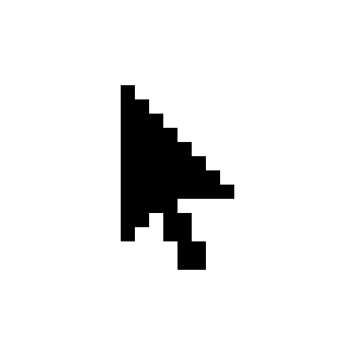
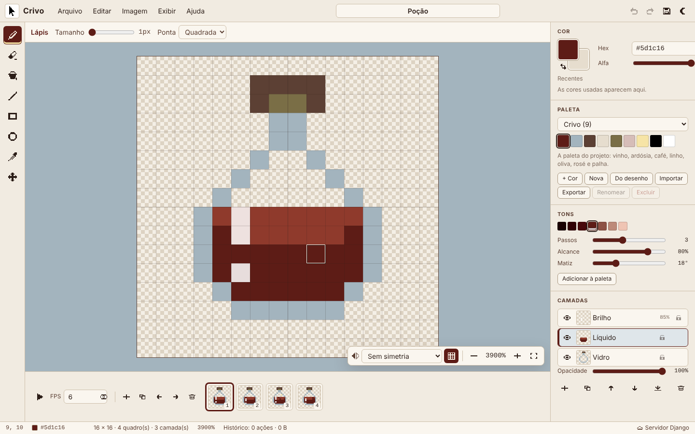
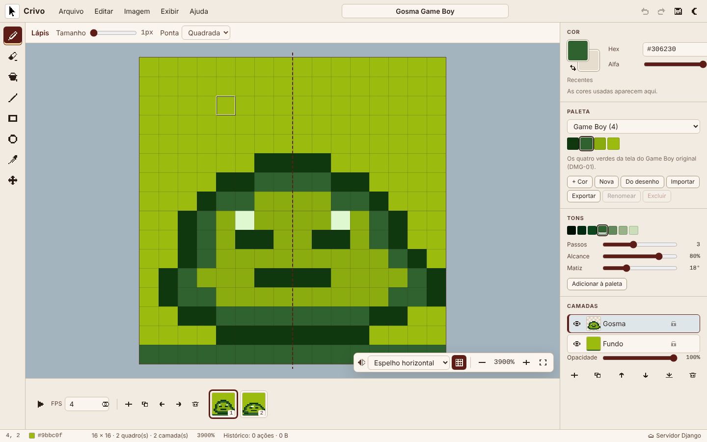
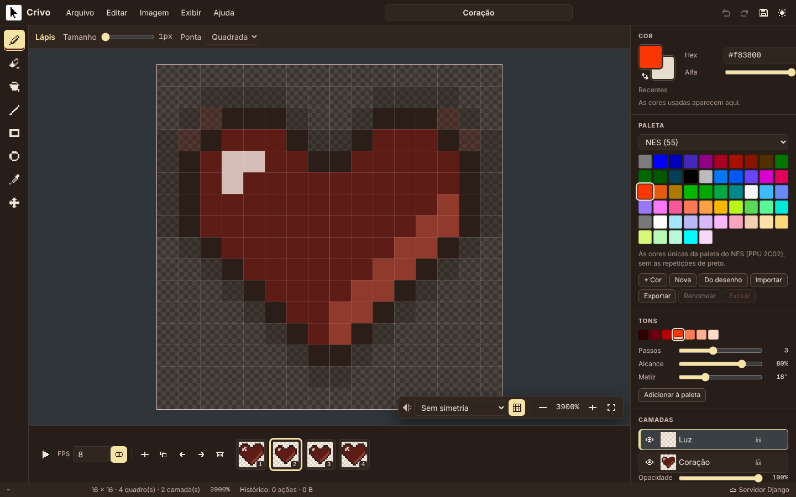
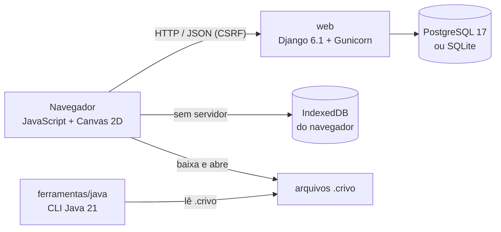
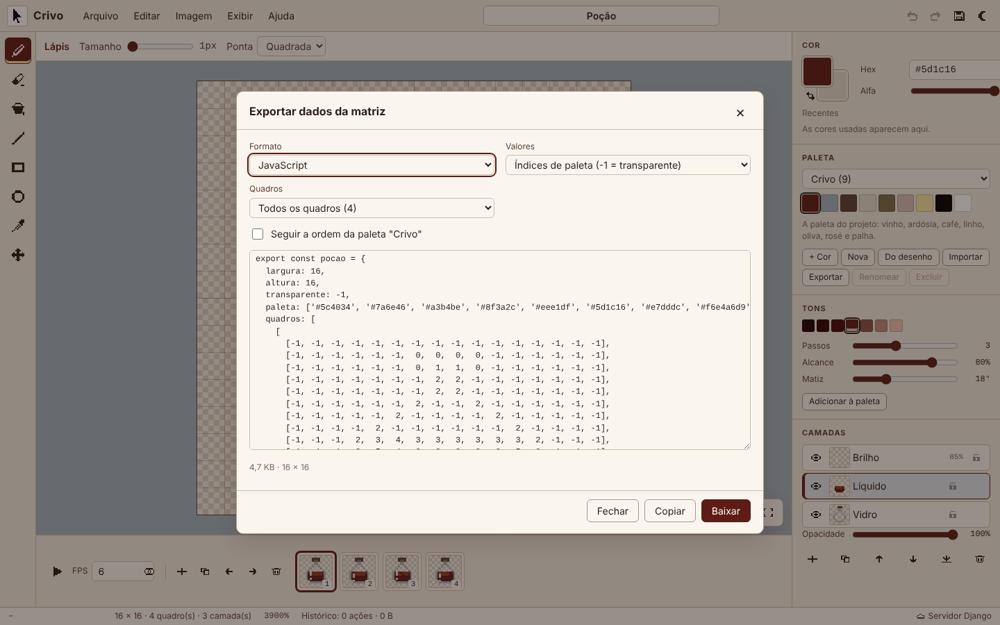
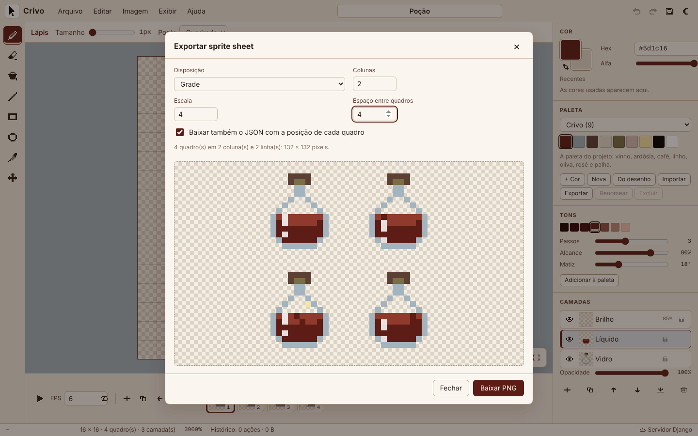
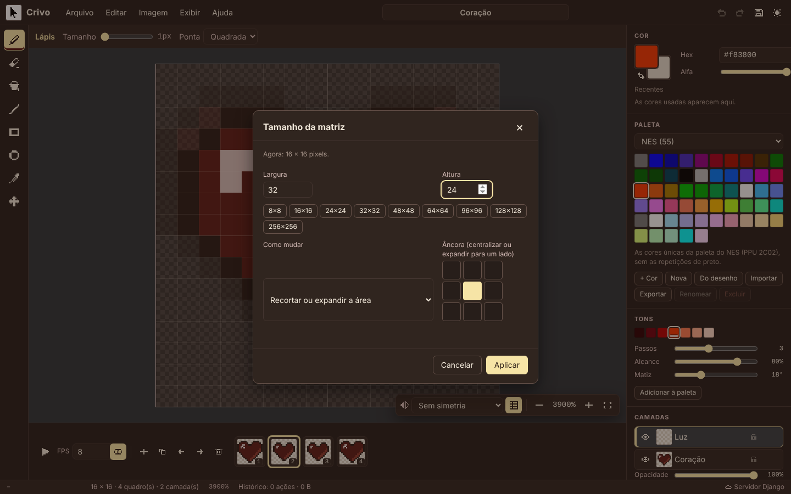
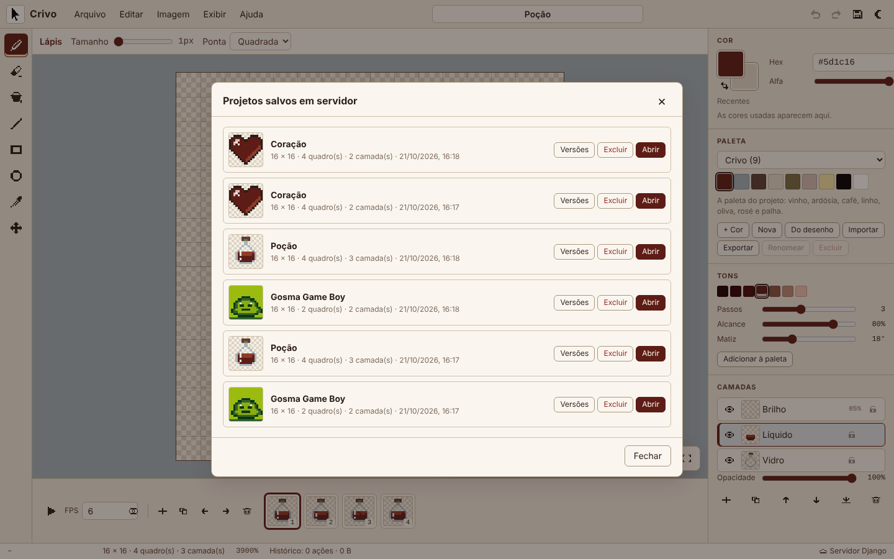

<p align="center">
  
</p>

<h1 align="center">Crivo<br><sub><sup><sup><sub>Copyright (©) 2026 Erik Pimenta</sub></sup></sup></sub></h1>

<p align="center">
  Editor de pixel art que roda no navegador e trata a imagem como ela é: uma matriz de pixels RGBA. Desenhe com lápis, balde, linhas e formas, organize em camadas, anime quadro a quadro e exporte PNG, sprite sheets ou a própria matriz em JSON, CSV, JavaScript, Python, C e Java para usar direto no seu jogo.<br>
  Pronto para usar, estudar ou adaptar.
</p>

<p align="center">
  JavaScript (módulos ES, Canvas 2D) · HTML5 · CSS3 · Python 3.13 · Django 6.1 · PostgreSQL 17 · Java 21 · Docker Compose · Node Test Runner
</p>

---

> **Manual completo:** [`Manual-Crivo.pdf`](Manual-Crivo.pdf) explica a instalação, cada ferramenta, camadas, animação, paletas, exportação, a matemática por trás dos algoritmos, a API, a ferramenta em Java, a configuração e a solução de problemas, passo a passo (cópia em [`docs/`](docs/Manual-Crivo.pdf)).

> **Banco de dados:** [`Banco-de-Dados-Crivo.pdf`](Banco-de-Dados-Crivo.pdf) traz o diagrama de relacionamentos, todas as tabelas com campos, tipos, chaves e restrições, o formato binário das células, o controle de versões, consultas prontas e como preparar o PostgreSQL.

<p align="center">
  
</p>

## O que o Crivo faz

- **Ferramentas de desenho:** lápis com pincel quadrado ou redondo de 1 a 16 px, borracha (transparente ou com a cor secundária), balde de tinta com 4 ou 8 vizinhos, tolerância e modo global, linha, retângulo e elipse (vazados ou preenchidos, com Shift para 45°, quadrado e círculo perfeitos) e conta-gotas.
- **Matriz de verdade:** cada camada é um `Uint32Array` com os canais RGBA de cada pixel. A tela é composta direto num `ImageData` e ampliada sem suavização, então o que você vê é exatamente o que será exportado.
- **Camadas e animação:** camadas com visibilidade, opacidade, bloqueio, duplicação e mescla; quadros com duplicação, reordenação, FPS, papel cebola e reprodução.
- **Histórico ilimitado sem estourar a memória:** cada traço guarda só os pixels que mudaram; mudanças grandes viram RLE da célula inteira; ações estruturais guardam instantâneos comprimidos. A barra de status mostra quanto o histórico ocupa.
- **Visualização:** zoom no ponto do cursor (100% a 12800%), arrastar com espaço ou botão do meio, ajustar à tela, grade com linhas mais fortes a cada 8 pixels e simetria horizontal, vertical ou nos dois eixos.
- **Tamanho da matriz:** de 1×1 a 1024×1024, com âncora de nove posições para centralizar ou expandir para um lado, ou escalando o desenho por vizinho mais próximo. Também gira 90° e espelha camadas.
- **Paletas:** Crivo, Game Boy, NES, Pico-8, CGA, CGA modo 4, Commodore 64 e 1 bit já incluídas. Crie, renomeie, importe (`.hex`, `.gpl`, `.json`, `.txt` do Paint.NET) e exporte as suas, ou gere uma paleta a partir das cores do desenho.
- **Gerador de tons:** a partir da cor escolhida, cria rampas de sombra e luz no espaço de cor OKLCH, com o desvio de matiz típico da pixel art (sombras puxam para o azul, luzes para o amarelo).
- **Importação e exportação:** PNG e JPEG em tamanho real ou ampliados por vizinho mais próximo; sprite sheet horizontal, vertical ou em grade, com JSON das posições; dados da matriz em JSON, CSV, JavaScript, Python, C e Java; importação de imagens com detecção automática do tamanho do pixel e fatiamento de sprite sheets.
- **Salva onde você estiver:** com o servidor Django, projetos e paletas vão para o banco de dados, com histórico de versões. Sem servidor, tudo fica no navegador (IndexedDB). Um rascunho automático recupera o trabalho se a aba fechar.

<p align="center">
  
  
</p>

## Arquitetura



| Parte | Linguagem | Responsabilidade |
|---|---|---|
| `editor/static/editor/js/nucleo` | JavaScript | Núcleo sem DOM: cores e OKLCH, geometria (Bresenham, elipse, pincel, simetria), flood fill, RLE, documento, histórico, formato `.crivo`, exportação e paletas |
| `editor/static/editor/js/ui` | JavaScript | Visor em canvas, ferramentas, painéis, diálogos, armazenamento e atalhos |
| `editor/` | Python (Django) | API REST, validação, versões dos projetos, paletas, exportação pelo servidor |
| `ferramentas/java` | Java 21 | Linha de comando: informações, paleta, PNG, sprite sheet e matriz em Java a partir de um `.crivo` |
| `postgres` | — | Fonte da verdade quando há servidor: projetos, camadas, quadros, células, versões e paletas |

### Como a matriz é guardada

Cada pixel é um inteiro de 32 bits com os bytes `R, G, B, A` na ordem da memória, o mesmo layout do `ImageData`. Uma célula (quadro × camada) é codificada em RLE: para cada sequência de pixels iguais, o tamanho da sequência em varint (7 bits por byte) seguido dos 4 bytes da cor. Um sprite 32×32 com fundo transparente costuma caber em poucas dezenas de bytes. O mesmo formato é lido pelo JavaScript, pelo Python e pelo Java.

### Como o histórico funciona

| Ação | O que fica guardado |
|---|---|
| Traço pequeno (lápis, linha, forma) | Índices alterados + cor antes + cor depois (12 bytes por pixel) |
| Mudança grande (balde numa área enorme) | RLE da célula antes e depois |
| Estrutura (camadas, quadros, tamanho, giro) | Instantâneo do documento inteiro em RLE |

Desfazer e refazer aplicam o lado "antes" ou "depois" da entrada. Uma nova ação apaga o futuro, como em qualquer editor.

<p align="center">
  
  
</p>

## Como rodar

### Com Docker (editor + API + PostgreSQL)

Você só precisa do **Docker** com Docker Compose.

**Windows:** dê dois cliques em `iniciar.cmd`.

**Linux ou macOS:**

```bash
./iniciar.sh
```

Na primeira vez o script cria o arquivo `.env` com uma senha aleatória para o banco e uma chave secreta aleatória, sobe o PostgreSQL e a aplicação e abre **http://localhost:8080**.

| Endereço | O que é |
|---|---|
| http://localhost:8080 | Editor |
| http://localhost:8080/api/v1 | Lista das rotas da API |
| http://localhost:8080/api/v1/saude | Saúde do banco |

### Sem Docker (Python)

```bash
python -m venv .venv
. .venv/bin/activate              # no Windows: .venv\Scripts\activate
pip install -r requirements.txt
python manage.py migrate
python manage.py runserver        # http://localhost:8000
```

Sem configurar nada, o Django usa um arquivo SQLite (`crivo.sqlite3`). Para usar PostgreSQL, defina `CRIVO_DB_ENGINE=postgresql` e as variáveis `CRIVO_DB_*`.

### Só o editor (Node.js)

```bash
npm run servir                    # http://localhost:5173
```

Nesse modo não há API: projetos e paletas ficam no IndexedDB do navegador. Qualquer servidor de arquivos estáticos apontado para `editor/static/editor/` também funciona.

## Usando a API

```bash
# listar projetos
curl http://localhost:8080/api/v1/projetos

# criar um projeto a partir de um arquivo .crivo (com CRIVO_API_TOKEN definido no .env)
curl -H "Authorization: Bearer $TOKEN" -H "Content-Type: application/json" \
     -d "{\"dados\": $(cat exemplos/pocao.crivo)}" http://localhost:8080/api/v1/projetos

# baixar a matriz do quadro 1 como módulo Python, pronta para o seu jogo
curl -o pocao.py "http://localhost:8080/api/v1/projetos/<id>/exportar?formato=py&quadro=1&baixar=1"
```

| Rota | O que faz |
|---|---|
| `GET /api/v1/projetos` | Lista os projetos (`q` filtra pelo nome) |
| `POST /api/v1/projetos` | Cria um projeto (`dados` no formato `.crivo`, `miniatura` PNG opcional) |
| `GET/PUT/DELETE /api/v1/projetos/{id}` | Abre, salva (com `revisao` para detectar conflitos) e exclui |
| `GET /api/v1/projetos/{id}/miniatura` | Miniatura PNG |
| `GET /api/v1/projetos/{id}/exportar` | Matriz em `json`, `csv`, `js` ou `py`, por `indices` ou `hex`, de um quadro ou de todos |
| `GET /api/v1/projetos/{id}/revisoes` | Versões anteriores guardadas a cada salvamento |
| `POST /api/v1/projetos/{id}/revisoes/{n}/restaurar` | Volta para uma versão |
| `GET/POST /api/v1/paletas` | Lista as paletas (predefinidas e suas) e cria uma nova |
| `GET/PUT/DELETE /api/v1/paletas/{id}` | Abre, altera e exclui uma paleta sua |

Pedidos que alteram dados exigem o cookie CSRF do Django (o editor cuida disso) ou o cabeçalho `Authorization: Bearer <CRIVO_API_TOKEN>`.

## Ferramenta em Java

A pasta [`ferramentas/java`](ferramentas/java) traz uma linha de comando sem dependências externas, só com o JDK 21:

```bash
cd ferramentas/java
./crivo.sh info ../../exemplos/pocao.crivo
./crivo.sh paleta ../../exemplos/coracao.crivo
./crivo.sh png ../../exemplos/pocao.crivo pocao.png --escala 8 --quadro 2
./crivo.sh folha ../../exemplos/coracao.crivo coracao.png --disposicao grade --colunas 2 --espaco 2
./crivo.sh matriz ../../exemplos/gosma-game-boy.crivo --classe Gosma > Gosma.java
./testar.sh
```

No Windows, use `crivo.cmd` no lugar de `./crivo.sh`. A primeira execução compila as classes em `ferramentas/java/out`.

## Formato `.crivo`

É um JSON legível, salvo por **Arquivo → Baixar arquivo .crivo** e aberto por **Arquivo → Abrir arquivo .crivo**:

```json
{
  "formato": "crivo",
  "versao": 1,
  "nome": "Poção",
  "largura": 16,
  "altura": 16,
  "fps": 6,
  "paleta": ["#5d1c16", "#a3b4be"],
  "camadas": [{ "id": "c1", "nome": "Vidro", "visivel": true, "opacidade": 100, "bloqueada": false }],
  "quadros": [{ "id": "q1", "duracao": null }],
  "celulas": [{ "quadro": "q1", "camada": "c1", "rle": "<RLE em base64>" }]
}
```

A pasta [`exemplos/`](exemplos) tem três projetos para abrir e estudar: uma poção com o líquido animado, um coração batendo e uma gosma na paleta do Game Boy.

## Configuração

As principais variáveis do `.env` (a lista completa está no manual):

| Variável | Padrão | O que faz |
|---|---|---|
| `CRIVO_PORT` | `8080` | Porta no navegador |
| `CRIVO_SECRET_KEY` | — | Chave do Django. Gerada pelos scripts; nunca publique a sua |
| `CRIVO_ALLOWED_HOSTS` | `localhost,127.0.0.1` | Endereços pelos quais o Crivo é acessado |
| `CRIVO_HTTPS` / `CRIVO_CSRF_TRUSTED_ORIGINS` | `false` / vazio | Use atrás de um proxy com HTTPS |
| `CRIVO_API_TOKEN` | vazio | Token para scripts alterarem dados pela API sem o cookie CSRF |
| `CRIVO_MAX_REVISOES` | `20` | Quantas versões anteriores de cada projeto ficam guardadas |
| `CRIVO_DB_NAME` / `CRIVO_DB_USER` / `CRIVO_DB_PASSWORD` | `crivo` / `crivo` / — | PostgreSQL |
| `CRIVO_WORKERS` | `2` | Processos do Gunicorn |

<p align="center">
  
  
</p>

## Personalizando o Crivo

O projeto foi organizado para ser fácil de adaptar:

| Quero... | Onde mexer |
|---|---|
| Incluir uma paleta fixa | `PALETAS_PREDEFINIDAS` em `editor/static/editor/js/nucleo/paletas.js` (e em `editor/paletas.py`, para a API) |
| Criar uma ferramenta | Lista `FERRAMENTAS` e métodos `baixar`/`moverPonteiro`/`soltar` em `editor/static/editor/js/ui/ferramentas.js` |
| Novo formato de exportação | `gerarDados` em `editor/static/editor/js/nucleo/exportar.js` |
| Trocar cores e tema | Variáveis no início de `editor/static/editor/css/crivo.css` |
| Novo ícone | Desenhe o bitmap em `BITMAPS` (`editor/static/editor/js/ui/icones.js`), um `#` por pixel |
| Atalhos de teclado | Função `atalhos` em `editor/static/editor/js/main.js` |

## Desenvolvimento e testes

```bash
npm test                              # 22 testes do núcleo em JavaScript (Node 20+)
python manage.py test editor          # 11 testes da API Django
bash ferramentas/java/testar.sh       # 10 testes da ferramenta em Java
```

O GitHub Actions roda os três conjuntos (a API contra um PostgreSQL de verdade), gera os PNGs dos exemplos com a ferramenta em Java e constrói a imagem Docker a cada push.

### Estrutura

```text
editor/                     aplicação Django (modelos, API, validação, exportação, versões)
  static/editor/            o editor: index.html, css/, img/ e js/
    js/nucleo/              núcleo em JavaScript, sem DOM, testado no Node
    js/ui/                  interface: visor, ferramentas, painéis, diálogos, armazenamento
  migrations/               esquema do banco e paletas predefinidas
  tests/                    testes da API
crivo/                      configurações do projeto Django
ferramentas/java/           linha de comando em Java 21
tests/js/                   testes do núcleo em JavaScript
exemplos/                   projetos .crivo de exemplo
scripts/                    servidor estático em Node e criação do .env no Windows
docs/                       manuais em PDF e imagens do README
.github/workflows/          CI
```

### Componentes de terceiros

O Crivo depende de componentes com licenças próprias, que continuam valendo para cada um deles:

| Componente | Uso no projeto | Licença |
|---|---|---|
| [Django](https://www.djangoproject.com/) | Back-end e API | BSD-3-Clause |
| [WhiteNoise](https://whitenoise.readthedocs.io/) | Entrega dos arquivos estáticos | MIT |
| [Gunicorn](https://gunicorn.org/) | Servidor de aplicação | MIT |
| [psycopg](https://www.psycopg.org/) | Driver do PostgreSQL | LGPL-3.0 |

O editor não usa bibliotecas externas: os ícones são desenhados em pixel art no próprio código e a interface usa as fontes do sistema. PostgreSQL roda como serviço externo via Docker e não é redistribuído neste repositório; ele segue a licença da sua própria imagem.

As paletas Game Boy, NES, Pico-8, CGA e Commodore 64 reproduzem as cores dos respectivos sistemas apenas como referência. Os nomes pertencem aos seus donos.

## Licença

Copyright (©) 2026 Erik Pimenta

Este projeto é distribuído sob a licença [MIT](LICENSE). Você pode usar, copiar, modificar e redistribuir o código, inclusive para fins comerciais, desde que mantenha o aviso de copyright e o texto da licença.
