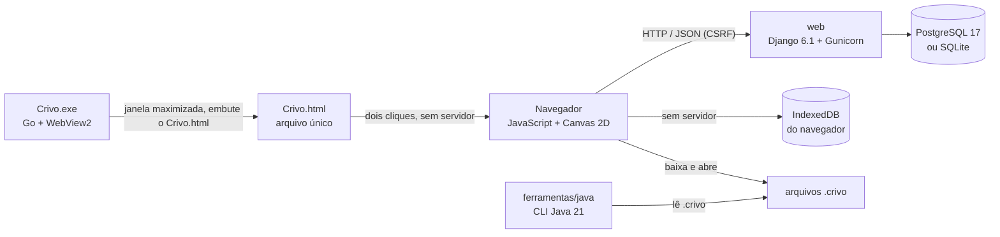

<p align="center">
  
</p>

<h1 align="center">Crivo<br><sub><sup><sup><sub>Copyright (©) 2026 Erik Pimenta</sub></sup></sup></sub></h1>

<p align="center">
  Editor de pixel art que roda no navegador e trata a imagem como ela é: uma matriz de pixels RGBA. Desenhe com lápis, balde, linhas, formas, pontilhado e degradês, selecione, copie e mova pixels, organize em camadas, anime quadro a quadro e exporte PNG, GIF animado, sprite sheets ou a própria matriz em JSON, CSV, JavaScript, Python, C e Java para usar direto no seu jogo.<br>
  Roda de três maneiras: app desktop para Windows (<code>Crivo.exe</code>, em janela maximizada), servidor local com backend ou arquivo único no navegador (<code>Crivo.html</code>).<br>
  Pronto para usar, estudar ou adaptar.
</p>

<p align="center">
  JavaScript (módulos ES, Canvas 2D) · HTML5 · CSS3 · Python 3.13 · Django 6.1 · PostgreSQL 17 · Java 21 · Go 1.24 + WebView2 (app desktop) · Docker Compose · Node Test Runner · Playwright · Ruff · Bandit
</p>

---

> **Manual completo:** [`Manual-Crivo.pdf`](Manual-Crivo.pdf) explica as três maneiras de rodar (app desktop, servidor local e arquivo único), cada uma das 13 ferramentas, seleção, camadas, animação, paletas, exportação, a matemática por trás dos algoritmos (Bresenham, flood fill, OKLCH, pontilhado de Bayer, LZW do GIF, RLE), a API, a ferramenta em Java, a configuração, a segurança, os testes e a solução de problemas, passo a passo (cópia em [`docs/`](docs/Manual-Crivo.pdf)).

> **Banco de dados:** [`Banco-de-Dados-Crivo.pdf`](Banco-de-Dados-Crivo.pdf) traz o diagrama de relacionamentos, todas as tabelas com campos, tipos, chaves e restrições, o formato binário das células, o controle de versões, consultas prontas, como preparar o PostgreSQL e as regras de integridade e segurança dos dados.

<p align="center">
  
</p>

## O que o Crivo faz

- **Ferramentas de desenho:** lápis com pincel quadrado ou redondo de 1 a 32 px e modo **pixel perfect** (tira os cantos em L dos traços), borracha (transparente ou com a cor secundária), balde de tinta com 4 ou 8 vizinhos, tolerância e modo global, linha, retângulo e elipse (vazados ou preenchidos, com Shift para 45°, quadrado e círculo perfeitos) e conta-gotas.
- **Pontilhado e degradê:** pincel de pontilhado com o padrão de Bayer 4×4 em sete densidades (de 12,5% a 87,5%) e **degradê pontilhado** linear ou radial entre a cor primária e a secundária, com matriz de Bayer 2×2, 4×4 ou 8×8. O padrão é fixo na matriz, então traços vizinhos se encaixam sem emendas.
- **Clarear e escurecer:** um pincel que sobe ou desce cada pixel um degrau na rampa da paleta (ordenada por luminosidade OKLab) ou soma/subtrai luz no OKLCH mantendo matiz e croma. Botão esquerdo clareia, direito escurece.
- **Seleção e área de transferência:** seleção retangular (S) que limita todas as ferramentas de pintura, **mover pixels** (V) com o mouse ou as setas, copiar, recortar, colar, apagar, selecionar tudo e desmarcar. A colagem flutua sobre o fundo: dá para arrastá-la, levar até fora da borda e trazer de volta sem furar nem perder pixels.
- **Comandos de imagem:** recortar para a seleção, aparar bordas transparentes, adicionar contorno (4 ou 8 vizinhos), converter para a paleta atual (cor mais próxima no OKLab), substituir uma cor por outra em todos os quadros, espelhar só a seleção, inverter cores, tons de cinza e deslocar meia matriz para pintar emendas de tiles.
- **Matriz de verdade:** cada camada é um `Uint32Array` com os canais RGBA de cada pixel. A tela é composta direto num `ImageData` e ampliada sem suavização, então o que você vê é exatamente o que será exportado.
- **Camadas e animação:** camadas com visibilidade, opacidade, bloqueio, duplicação e mescla; quadros com duplicação, reordenação, FPS, papel cebola e reprodução.
- **Histórico ilimitado sem estourar a memória:** cada traço guarda só os pixels que mudaram; mudanças grandes viram RLE da célula inteira; ações estruturais guardam instantâneos comprimidos. A barra de status mostra quanto o histórico ocupa.
- **Visualização:** zoom no ponto do cursor (100% a 12800%), arrastar com espaço ou botão do meio, ajustar à tela, grade com linha forte a cada 4, 8, 16 ou 32 pixels, **modo ladrilho** (repete o desenho 3×3 para conferir texturas) e simetria horizontal, vertical ou nos dois eixos.
- **Tamanho da matriz:** de 1×1 a 1024×1024, com âncora de nove posições para centralizar ou expandir para um lado, ou escalando o desenho por vizinho mais próximo. Também gira 90° e espelha camadas.
- **Paletas:** Crivo, Game Boy, NES, Pico-8, CGA, CGA modo 4, Commodore 64 e 1 bit já incluídas. Crie, renomeie, importe (`.hex`, `.gpl`, `.json`, `.txt` do Paint.NET) e exporte as suas, ou gere uma paleta a partir das cores do desenho.
- **Gerador de tons:** a partir da cor escolhida, cria rampas de sombra e luz no espaço de cor OKLCH, com o desvio de matiz típico da pixel art (sombras puxam para o azul, luzes para o amarelo).
- **Importação e exportação:** PNG e JPEG em tamanho real ou ampliados por vizinho mais próximo; **GIF animado** com transparência e a duração de cada quadro (codificador LZW próprio, sem bibliotecas); sprite sheet horizontal, vertical ou em grade, com JSON das posições; dados da matriz em JSON, CSV, JavaScript, Python, C e Java; importação de imagens com detecção automática do tamanho do pixel e fatiamento de sprite sheets.
- **Salva onde você estiver:** no app desktop, projetos e paletas ficam neste computador; com o servidor Django, vão para o banco de dados, com histórico de versões; no [`Crivo.html`](Crivo.html), ficam no navegador (IndexedDB). Um rascunho automático recupera o trabalho se a janela fechar.
- **Seguro por padrão:** Content-Security-Policy restrita, CSRF, token de API comparado em tempo constante, limite de escritas por IP, validação de tudo que chega à API e recusa de iniciar em produção com chave secreta fraca. Detalhes em [Qualidade e segurança](#qualidade-e-segurança).

<p align="center">
  
  
</p>

<p align="center">
  
  
</p>

## Arquitetura



| Parte | Linguagem | Responsabilidade |
|---|---|---|
| `editor/static/editor/js/nucleo` | JavaScript | Núcleo sem DOM: cores e OKLCH, geometria (Bresenham, elipse, pincel, simetria, pixel perfect), flood fill, pontilhado de Bayer e degradês, seleção e regiões, filtros (contorno, paleta, inverter, cinza, clarear/escurecer), codificador GIF com LZW, RLE, documento, histórico, formato `.crivo`, exportação e paletas |
| `editor/static/editor/js/ui` | JavaScript | Visor em canvas, ferramentas, painéis, diálogos, armazenamento e atalhos |
| `Crivo.exe` e `desktop/` | Go | App desktop para Windows, gerado por `scripts/gerar-desktop.js`: janela própria com o WebView2, maximizada (F11 alterna a tela cheia), com o `Crivo.html` embutido e atalho no menu Iniciar |
| `Crivo.html` | HTML + JavaScript | O editor inteiro num arquivo só, gerado por `scripts/gerar-portatil.js`: abre direto do disco, sem servidor nem backend |
| `editor/` | Python (Django) | API REST, validação, versões dos projetos, paletas, exportação pelo servidor (dados e PNG), cabeçalhos de segurança e limite de escritas |
| `ferramentas/java` | Java 21 | Linha de comando: informações, paleta, PNG, sprite sheet e matriz em Java a partir de um `.crivo` |
| `postgres` | — | Fonte da verdade quando há servidor: projetos, camadas, quadros, células, versões e paletas |

### Como a matriz é guardada

Cada pixel é um inteiro de 32 bits com os bytes `R, G, B, A` na ordem da memória, o mesmo layout do `ImageData`. Uma célula (quadro × camada) é codificada em RLE: para cada sequência de pixels iguais, o tamanho da sequência em varint (7 bits por byte) seguido dos 4 bytes da cor. Um sprite 32×32 com fundo transparente costuma caber em poucas dezenas de bytes. O mesmo formato é lido pelo JavaScript, pelo Python e pelo Java.

### Como o histórico funciona

| Ação | O que fica guardado |
|---|---|
| Traço pequeno (lápis, linha, forma, pontilhado, mover pixels, colar, filtros) | Índices alterados + cor antes + cor depois (12 bytes por pixel) |
| Mudança grande (balde ou degradê numa área enorme) | RLE da célula antes e depois |
| Estrutura (camadas, quadros, tamanho, giro, recortar, aparar) | Instantâneo do documento inteiro em RLE |

Desfazer e refazer aplicam o lado "antes" ou "depois" da entrada. Uma nova ação apaga o futuro, como em qualquer editor.

<p align="center">
  
  
</p>

<p align="center">
  
  
</p>

## Como rodar

O Crivo sobe de **três maneiras**. O editor é o mesmo nas três; o que muda é o que precisa estar instalado e onde os projetos ficam guardados. Os arquivos `.crivo` abrem em todas, então dá para levar um desenho de uma para outra.

| Maneira | Como subir | Precisa de | Onde ficam os projetos |
|---|---|---|---|
| **1. App desktop** (`Crivo.exe`) | Dois cliques no `Crivo.exe` (ou pesquise **Crivo** no menu Iniciar depois da primeira vez); abre **maximizado** | Windows 10 ou 11 (64 bits); nada para instalar | Neste computador, em `%LOCALAPPDATA%\Crivo` |
| **2. Servidor local e backend** (Django + banco) | `iniciar.cmd`, `./iniciar.sh` ou `python manage.py runserver` | Docker Desktop, ou Python 3.12+ | No banco de dados (PostgreSQL ou SQLite), com histórico de versões e API |
| **3. Arquivo único** (`Crivo.html`) | Dois cliques no `Crivo.html`; abre no navegador | Um navegador atual; nada para instalar | No navegador em que foi aberto (IndexedDB) |

Para só desenhar no Windows, o app desktop é o caminho mais direto. Para usar a API, o histórico de versões ou guardar os projetos num banco, suba o servidor. Para abrir em qualquer sistema sem instalar nada, use o `Crivo.html`.

### 1. App desktop (Crivo.exe)

Baixe o [`Crivo.exe`](Crivo.exe) e dê dois cliques. O Crivo abre **maximizado** (janela cheia, com a barra de título e a barra de tarefas à vista), numa janela própria, sem servidor, sem backend e sem navegador. Não há instalador: o arquivo pode ficar em qualquer pasta.

- **F11** leva à tela cheia (sem barra de título nem barra de tarefas) e volta para a janela maximizada; **Alt+F4** (ou **Arquivo → Sair do Crivo**) fecha o app, gravando o rascunho antes.
- Na primeira vez que abre, o Crivo cria um atalho no **menu Iniciar** (só para o seu usuário, sem pedir administrador). Depois disso, basta pesquisar **Crivo** no Windows. Se você apagar o atalho, ele não volta, a não ser que o `Crivo.exe` seja aberto de outra pasta.
- Projetos, paletas e o rascunho ficam em `%LOCALAPPDATA%\Crivo` e continuam lá na próxima vez, mesmo trocando o `.exe` por uma versão nova. A barra de status mostra **Desktop (este computador)**.
- Na primeira vez, o Windows pode mostrar **O Windows protegeu o computador**, porque o executável não tem assinatura digital paga: clique em **Mais informações → Executar assim mesmo**. O app não pede permissão de administrador.
- Usa o Microsoft Edge WebView2, que já vem no Windows 10 e 11. Se faltar, o Crivo avisa e oferece abrir a página de download da Microsoft.
- Por dentro, é um programa pequeno em Go ([`desktop/`](desktop/), cerca de 3 MB) com o `Crivo.html` embutido: o editor, os testes e a segurança são os mesmos do arquivo único.

Para gerar o `Crivo.exe` a partir do código (precisa do Node.js 20 e do Go; a versão exata fica em `desktop/go.mod`):

```bash
npm run desktop                   # atualiza o Crivo.html e gera o Crivo.exe na raiz
npm run desktop -- --verificar    # confere se o Crivo.exe do repositório corresponde ao código
```

O build é reproduzível: o mesmo código gera sempre o mesmo `Crivo.exe`, byte a byte, de qualquer sistema. O ícone é o logo do projeto ([`docs/images/logo.svg`](docs/images/logo.svg)), desenhado com pixels inteiros em cada tamanho do Windows, e as propriedades do arquivo trazem a versão e o copyright.

### 2. Servidor local e backend (editor + API + banco de dados)

#### Com Docker

Você só precisa do **Docker** com Docker Compose.

**Windows:** dê dois cliques em `iniciar.cmd`.

**Linux ou macOS:**

```bash
./iniciar.sh
```

Na primeira vez o script cria o arquivo `.env` com uma senha aleatória para o banco e uma chave secreta aleatória, sobe o PostgreSQL e a aplicação e abre **http://localhost:8080**.

| Endereço | O que é |
|---|---|
| http://localhost:8080 | Editor |
| http://localhost:8080/api/v1 | Lista das rotas da API |
| http://localhost:8080/api/v1/saude | Saúde do banco |

#### Sem Docker (Python)

```bash
python -m venv .venv
. .venv/bin/activate              # no Windows: .venv\Scripts\activate
pip install -r requirements.txt
python manage.py migrate
python manage.py runserver        # http://localhost:8000
```

Sem configurar nada, o Django usa um arquivo SQLite (`crivo.sqlite3`). Para usar PostgreSQL, defina `CRIVO_DB_ENGINE=postgresql` e as variáveis `CRIVO_DB_*`.

#### Só o editor, num servidor de arquivos (Node.js)

```bash
npm run servir                    # http://localhost:5173
```

Nesse modo não há API: projetos e paletas ficam no IndexedDB do navegador. Qualquer servidor de arquivos estáticos apontado para `editor/static/editor/` também funciona.

### 3. Arquivo único (Crivo.html)

Baixe o [`Crivo.html`](Crivo.html) e dê dois cliques. O editor abre no navegador direto da pasta, sem servidor local, sem backend e sem internet, com todas as ferramentas, camadas, animação e exportações.

Os projetos e as paletas ficam guardados no navegador em que o arquivo foi aberto. Para guardar uma cópia ou levar um desenho para outro computador, use **Arquivo → Baixar arquivo .crivo** e, depois, **Arquivo → Abrir arquivo .crivo…**.

O `Crivo.html` existe porque os navegadores não carregam módulos JavaScript de páginas abertas direto do disco: ele junta os módulos do editor num script só, embute o CSS e o ícone e traz a própria Content-Security-Policy. Depois de mudar o editor, rode `npm run portatil` (o `npm run desktop` também faz isso).

## Usando a API

```bash
# listar projetos
curl http://localhost:8080/api/v1/projetos

# criar um projeto a partir de um arquivo .crivo (com CRIVO_API_TOKEN definido no .env)
curl -H "Authorization: Bearer $TOKEN" -H "Content-Type: application/json" \
     -d "{\"dados\": $(cat exemplos/pocao.crivo)}" http://localhost:8080/api/v1/projetos

# baixar a matriz do quadro 1 como módulo Python, pronta para o seu jogo
curl -o pocao.py "http://localhost:8080/api/v1/projetos/<id>/exportar?formato=py&quadro=1&baixar=1"

# ou como cabeçalho C e classe Java
curl -o pocao.h "http://localhost:8080/api/v1/projetos/<id>/exportar?formato=c&baixar=1"
curl -o Pocao.java "http://localhost:8080/api/v1/projetos/<id>/exportar?formato=java&modo=hex&baixar=1"

# PNG do quadro 2 ampliado 8 vezes, gerado no servidor
curl -o pocao.png "http://localhost:8080/api/v1/projetos/<id>/png?quadro=2&escala=8"
```

| Rota | O que faz |
|---|---|
| `GET /api/v1/projetos` | Lista os projetos (`q` filtra pelo nome) |
| `POST /api/v1/projetos` | Cria um projeto (`dados` no formato `.crivo`, `miniatura` PNG opcional) |
| `GET/PUT/DELETE /api/v1/projetos/{id}` | Abre, salva (com `revisao` para detectar conflitos) e exclui |
| `GET /api/v1/projetos/{id}/miniatura` | Miniatura PNG |
| `GET /api/v1/projetos/{id}/exportar` | Matriz em `json`, `csv`, `js`, `py`, `c` ou `java`, por `indices` ou `hex`, de um quadro ou de todos |
| `GET /api/v1/projetos/{id}/png` | PNG de um quadro composto (`quadro`, `escala` de 1 a 32, até 2048 px de lado), gerado em Python puro |
| `GET /api/v1/projetos/{id}/revisoes` | Versões anteriores guardadas a cada salvamento |
| `POST /api/v1/projetos/{id}/revisoes/{n}/restaurar` | Volta para uma versão |
| `GET/POST /api/v1/paletas` | Lista as paletas (predefinidas e suas) e cria uma nova |
| `GET/PUT/DELETE /api/v1/paletas/{id}` | Abre, altera e exclui uma paleta sua |

Pedidos que alteram dados exigem o cookie CSRF do Django (o editor cuida disso) ou o cabeçalho `Authorization: Bearer <CRIVO_API_TOKEN>`. Acima de `CRIVO_LIMITE_ESCRITAS` alterações por minuto vindas do mesmo IP, a API responde **429** com `Retry-After`; JSON inválido responde **422** e corpo acima do limite, **413**.

## Ferramenta em Java

A pasta [`ferramentas/java`](ferramentas/java) traz uma linha de comando sem dependências externas, só com o JDK 21:

```bash
cd ferramentas/java
./crivo.sh info ../../exemplos/pocao.crivo
./crivo.sh paleta ../../exemplos/coracao.crivo
./crivo.sh png ../../exemplos/pocao.crivo pocao.png --escala 8 --quadro 2
./crivo.sh folha ../../exemplos/coracao.crivo coracao.png --disposicao grade --colunas 2 --espaco 2
./crivo.sh matriz ../../exemplos/gosma-game-boy.crivo --classe Gosma > Gosma.java
./testar.sh
```

No Windows, use `crivo.cmd` no lugar de `./crivo.sh`. A primeira execução compila as classes em `ferramentas/java/out`.

Sprites grandes (mais de 4096 valores) saem numa classe compacta: a matriz vai em texto e é lida quando a classe carrega, porque um literal desse tamanho passaria do limite de 64 KB por método do Java. Quem usa a classe continua acessando `PALETA` e `QUADROS` do mesmo jeito. O editor e a API geram o mesmo formato.

## Formato `.crivo`

É um JSON legível, salvo por **Arquivo → Baixar arquivo .crivo** e aberto por **Arquivo → Abrir arquivo .crivo**:

```json
{
  "formato": "crivo",
  "versao": 1,
  "nome": "Poção",
  "largura": 16,
  "altura": 16,
  "fps": 6,
  "paleta": ["#5d1c16", "#a3b4be"],
  "camadas": [{ "id": "c1", "nome": "Vidro", "visivel": true, "opacidade": 100, "bloqueada": false }],
  "quadros": [{ "id": "q1", "duracao": null }],
  "celulas": [{ "quadro": "q1", "camada": "c1", "rle": "<RLE em base64>" }]
}
```

A pasta [`exemplos/`](exemplos) tem três projetos para abrir e estudar: uma poção com o líquido animado, um coração batendo e uma gosma na paleta do Game Boy.

## Configuração

As principais variáveis do `.env` (a lista completa está no manual):

| Variável | Padrão | O que faz |
|---|---|---|
| `CRIVO_PORT` | `8080` | Porta no navegador |
| `CRIVO_SECRET_KEY` | — | Chave do Django. Gerada pelos scripts; nunca publique a sua |
| `CRIVO_ALLOWED_HOSTS` | `localhost,127.0.0.1` | Endereços pelos quais o Crivo é acessado |
| `CRIVO_HTTPS` / `CRIVO_CSRF_TRUSTED_ORIGINS` | `false` / vazio | Use atrás de um proxy com HTTPS |
| `CRIVO_API_TOKEN` | vazio | Token para scripts alterarem dados pela API sem o cookie CSRF |
| `CRIVO_MAX_REVISOES` | `20` | Quantas versões anteriores de cada projeto ficam guardadas |
| `CRIVO_LIMITE_ESCRITAS` | `120` | Alterações por minuto aceitas de cada IP na API, contadas em cada processo do Gunicorn (`0` desliga) |
| `CRIVO_PROXY_CONFIAVEL` | `false` | Atrás de um proxy confiável, usa o último endereço de `X-Forwarded-For` como IP do cliente |
| `CRIVO_HSTS_SEGUNDOS` | `31536000` | Duração do HSTS quando `CRIVO_HTTPS=true` |
| `CRIVO_DB_NAME` / `CRIVO_DB_USER` / `CRIVO_DB_PASSWORD` | `crivo` / `crivo` / — | PostgreSQL |
| `CRIVO_WORKERS` | `2` | Processos do Gunicorn |

<p align="center">
  
  
</p>

## Personalizando o Crivo

O projeto foi organizado para ser fácil de adaptar:

| Quero... | Onde mexer |
|---|---|
| Incluir uma paleta fixa | `PALETAS_PREDEFINIDAS` em `editor/static/editor/js/nucleo/paletas.js` (e em `editor/paletas.py`, para a API) |
| Criar uma ferramenta | Lista `FERRAMENTAS` e métodos `baixar`/`moverPonteiro`/`soltar` em `editor/static/editor/js/ui/ferramentas.js` |
| Novo filtro ou comando de imagem | Função pura em `editor/static/editor/js/nucleo/filtros.js` (devolve pares `[índice, cor]`) e uma entrada em `COMANDOS`/`MENUS` em `main.js` |
| Outro padrão de pontilhado | `BAYER` e `limiarBayer` em `editor/static/editor/js/nucleo/pontilhado.js` |
| Novo formato de exportação | `gerarDados` em `editor/static/editor/js/nucleo/exportar.js` |
| Trocar cores e tema | Variáveis no início de `editor/static/editor/css/crivo.css` |
| Novo ícone | Desenhe o bitmap em `BITMAPS` (`editor/static/editor/js/ui/icones.js`), um `#` por pixel |
| Atalhos de teclado | Função `atalhos` em `editor/static/editor/js/main.js` |

## Desenvolvimento e testes

```bash
npm test                                   # 40 testes do núcleo em JavaScript (Node 20+)
python manage.py test editor               # 39 testes da API Django (11 de funcionamento + 28 de segurança e rotas novas)
bash ferramentas/java/testar.sh            # 11 testes da ferramenta em Java
python -m unittest discover -s tests/e2e   # 21 testes ponta a ponta no Chromium (Playwright): 10 com o Django e 11 no Crivo.html
npm run portatil                           # gera o Crivo.html de novo a partir do código do editor
npm run desktop                            # gera o Crivo.exe (precisa do Go); -- --verificar só confere
ruff check .                               # estilo, bugs prováveis e regras de segurança no Python
bandit -q -r editor crivo -x editor/tests  # análise de segurança do Python
```

Para o teste ponta a ponta, instale antes `pip install playwright` e `python -m playwright install chromium`.

O `Crivo.html` é gerado a partir de `editor/static/editor/` por `scripts/gerar-portatil.js`, sem bibliotecas: os módulos viram um único script embutido, o CSS e o ícone vão junto e a página ganha uma Content-Security-Policy própria. Ele existe porque o navegador não carrega módulos JavaScript de páginas abertas direto do disco. Depois de mudar o editor, rode `npm run portatil`; o CI confere se o arquivo está em dia (`npm run portatil -- --verificar`).

O `Crivo.exe` é gerado por `scripts/gerar-desktop.js`, que copia o `Crivo.html` para `desktop/`, desenha o ícone, grava a versão nas propriedades do arquivo e compila o código Go de `desktop/` para Windows de 64 bits. O build é reproduzível, e o CI gera o `.exe` de novo e compara byte a byte com o do repositório (`npm run desktop -- --verificar`), além de rodar o `go vet`. O GitHub Actions roda tudo isso a cada push (a API contra um PostgreSQL de verdade), além de `manage.py check --deploy`, gera os PNGs dos exemplos com a ferramenta em Java e constrói a imagem Docker.

## Qualidade e segurança

Resultado da rodada de testes da versão 1.2.0: **111 testes, todos passando**, e nenhum problema apontado pelas ferramentas de análise. Na versão 1.1.0, uma revisão de código independente apontou 10 problemas (entre eles, desfazer durante um arraste embaralhava o histórico, a colagem furava o fundo ao ser movida e a classe Java de sprites médios não compilava); todos foram corrigidos e ganharam testes.

| Verificação | O que cobre | Resultado |
|---|---|---|
| Núcleo JavaScript (40) | Cores, geometria, flood fill, RLE, histórico, formato, exportação (inclusive Java compacta e C com muitas cores), pontilhado, degradês, pixel perfect, seleção, aparar, ladrilho, contorno, filtros e GIF (LZW de ida e volta) | 40 de 40 |
| API Django (39) | Ciclo de projetos e paletas, revisões, conflitos, exportação, PNG, formatos C e Java (a classe grande é compilada e executada com o JDK quando ele existe) e o conjunto de segurança abaixo | 39 de 39 |
| Ferramenta Java (11) | Leitura do `.crivo`, RLE, PNG, sprite sheet e matriz, inclusive uma classe grande compilada em memória com o compilador do JDK | 11 de 11 |
| Interface (21) | Editor aberto no Chromium de dois jeitos, contra o Django e como `Crivo.html` direto do disco, inclusive a integração com o app desktop (F11, sair e rascunho): cada ferramenta nova, seleção, colagem flutuante, gestos protegidos (Ctrl+Z no meio do arraste, setas no menu), comandos de imagem, desfazer, preferências inválidas, salvar no servidor e no navegador, baixar e reabrir o `.crivo`, baixar o PNG e o GIF, sem nenhum erro no console nem violação de CSP | 21 de 21 |
| Ruff e Bandit | Estilo, bugs prováveis e padrões inseguros no Python | 0 problemas |
| App desktop | Build reproduzível do `Crivo.exe` (gerado de novo e comparado byte a byte) e `go vet` no código Go | Idêntico; 0 problemas |
| `check --deploy` | Configuração de produção do Django | Só avisos opcionais (HSTS em subdomínios, preload e redirecionamento HTTPS, que ficam a cargo do proxy) |

Os testes de segurança (`editor/tests/test_seguranca.py`) conferem:

- **Cabeçalhos** em todas as respostas: `Content-Security-Policy` (só scripts do próprio site, sem `eval`, sem objetos, sem ser embutido em outras páginas), `X-Frame-Options: DENY`, `X-Content-Type-Options: nosniff`, `Referrer-Policy`, `Cross-Origin-Opener-Policy`, `Permissions-Policy` e `Cache-Control: no-store` nas respostas JSON; HSTS só quando há HTTPS.
- **Autenticação das escritas:** sem cookie CSRF ou token a API recusa (403); tokens errados, vazios, sem `Bearer` ou com um caractere a menos também; o token não vale fora de `/api/`.
- **Entradas maliciosas:** JSON aninhado 100 mil níveis (não derruba o servidor), corpo que não é objeto, corpo grande demais (413), miniatura falsa (SVG com script, HTML, base64 inválido, PNG acima de 512 KB), tamanhos e quantidades fora dos limites, RLE corrompido, IDs e parâmetros inválidos e métodos não permitidos.
- **Nome com HTML ou comandos:** volta como texto no JSON e vira um nome de arquivo seguro (`[A-Za-z0-9_-]`) nos downloads.
- **Limite de escritas por IP** (429 com `Retry-After`; leituras e pedidos já recusados pelo CSRF não contam; atrás de proxy confiável o IP vem do `X-Forwarded-For` sem aceitar endereços forjados pelo cliente) e **chave secreta fraca**: com `CRIVO_DEBUG=false`, o servidor não inicia com a chave de exemplo ou com menos de 32 caracteres.

No editor, nenhum dado do usuário passa por `innerHTML`, preferências gravadas no navegador só são aceitas se estiverem na lista de valores válidos, e os atalhos do teclado ficam bloqueados enquanto um gesto do mouse está em andamento (só o Esc vale, para cancelar): nomes de projetos, camadas e paletas entram sempre como texto, e o servidor de arquivos em Node (`npm run servir`) envia os mesmos cabeçalhos de segurança do Django. O `Crivo.html` leva a própria Content-Security-Policy numa tag `<meta>`: só executa o script embutido nele (conferido por hash SHA-256), não carrega nada de fora e não abre nenhuma conexão de rede (`connect-src 'none'`). O app desktop carrega esse mesmo arquivo, roda sem permissão de administrador, não abre portas e desliga as ferramentas de desenvolvedor e o menu de contexto do navegador.

### Estrutura

```text
Crivo.exe                   app desktop para Windows, que abre maximizado (gerado)
Crivo.html                  o editor inteiro num arquivo só, que abre sem servidor (gerado)
desktop/                    código do app desktop em Go (janela WebView2, tela cheia, atalho no menu Iniciar, manifesto)
editor/                     aplicação Django (modelos, API, validação, exportação, versões)
  static/editor/            o editor: index.html, css/, img/ e js/
    js/nucleo/              núcleo em JavaScript, sem DOM, testado no Node
    js/ui/                  interface: visor, ferramentas, painéis, diálogos, armazenamento
  migrations/               esquema do banco e paletas predefinidas
  tests/                    testes da API e de segurança
crivo/                      configurações do projeto Django
ferramentas/java/           linha de comando em Java 21
tests/js/                   testes do núcleo em JavaScript
tests/e2e/                  teste ponta a ponta da interface (Playwright)
exemplos/                   projetos .crivo de exemplo
scripts/                    servidor estático em Node, geradores do Crivo.html e do Crivo.exe e criação do .env no Windows
docs/                       manuais em PDF e imagens do README
.github/workflows/          CI (testes, Ruff, Bandit, check --deploy, Playwright, Docker e build do Crivo.exe)
ruff.toml                   regras do Ruff
```

### Componentes de terceiros

O Crivo depende de componentes com licenças próprias, que continuam valendo para cada um deles:

| Componente | Uso no projeto | Licença |
|---|---|---|
| [Django](https://www.djangoproject.com/) | Back-end e API | BSD-3-Clause |
| [WhiteNoise](https://whitenoise.readthedocs.io/) | Entrega dos arquivos estáticos | MIT |
| [Gunicorn](https://gunicorn.org/) | Servidor de aplicação | MIT |
| [psycopg](https://www.psycopg.org/) | Driver do PostgreSQL | LGPL-3.0 |
| [Playwright](https://playwright.dev/python/) | Teste ponta a ponta (só no desenvolvimento) | Apache-2.0 |
| [Ruff](https://docs.astral.sh/ruff/) | Análise estática do Python (só no desenvolvimento) | MIT |
| [Bandit](https://bandit.readthedocs.io/) | Análise de segurança do Python (só no desenvolvimento) | Apache-2.0 |
| [go-webview2](https://github.com/jchv/go-webview2) | Janela do app desktop com o WebView2 (embutido no `Crivo.exe`) | MIT |
| [go-winloader](https://github.com/jchv/go-winloader) | Carregamento do WebView2 pelo go-webview2 (embutido no `Crivo.exe`) | ISC |
| [golang.org/x/sys](https://pkg.go.dev/golang.org/x/sys) | Chamadas ao Windows no app desktop (embutido no `Crivo.exe`) | BSD-3-Clause |
| [goversioninfo](https://github.com/josephspurrier/goversioninfo) | Ícone, versão e manifesto do `Crivo.exe` (só no build) | MIT |

O Microsoft Edge WebView2 Runtime faz parte do Windows e não é redistribuído no `Crivo.exe`. O editor não usa bibliotecas externas: os ícones são desenhados em pixel art no próprio código e a interface usa as fontes do sistema. PostgreSQL roda como serviço externo via Docker e não é redistribuído neste repositório; ele segue a licença da sua própria imagem.

As paletas Game Boy, NES, Pico-8, CGA e Commodore 64 reproduzem as cores dos respectivos sistemas apenas como referência. Os nomes pertencem aos seus donos.

## Licença

Copyright (©) 2026 Erik Pimenta

Este projeto é distribuído sob a licença [MIT](LICENSE). Você pode usar, copiar, modificar e redistribuir o código, inclusive para fins comerciais, desde que mantenha o aviso de copyright e o texto da licença.
